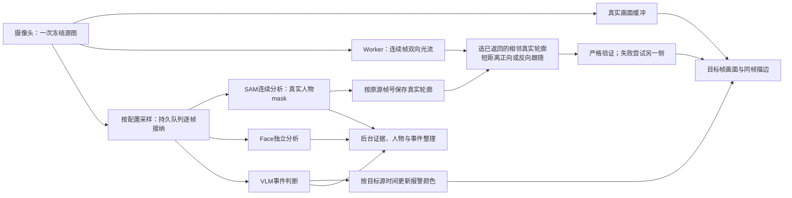

# 轮廓跟随修复记录

日期：2026-09-17。承接[首轮故障诊断](parallel-failure-diagnosis-20260917.md)。本轮按用户要求只处理轮廓跟随；吸烟提示、敏感度及事件确认规则均不调整。

## 范围与验收

保留三层关系：L1播放真实源画面并跟随描边，L2模型判断及颜色随后更新，L3记录和整理独立完成。显示至少15个不同真实源帧／秒；不以重复绘制计数，也不通过覆盖已接纳分析帧减负。运动预测只用于显示，不写回SAM、VLM、Face或归档证据。

浏览器回调到Canvas的时间不等于摄像头曝光到屏幕的延迟。连续录像的SAM轮廓只是参考结果，不能冒充人工真值。单帧源绑定、模拟调度、真人连续运动和模型联测分别验收。

## 已复现的原因

1. 原算法要求轮廓顶点附近各自有可信运动，低纹理身体边缘因此容易导致整人被拒绝；背景运动还可能污染人物跟随。
2. 摄像头缩放、视频编码及亚像素运动改变高频纹理，直接用小灰度块比较会产生错误位移或拒绝。仅在随机纹理上验证不足以覆盖真实浏览器图像链。
3. 160像素宽运动图中的远处人物只有约3–8像素宽、7–19像素高，无法满足原内部特征支持要求。独立10 FPS真人片段已排除“全部因为源帧间隔太长”的解释。
4. 每次元数据轮询都重复请求尚未播放帧的轮廓，以及逐帧重复分配画布，会额外占用显示计算预算。元数据更新又必须在播放前使早先的空结果重新计算，不能完全禁用刷新。
5. 某个人短暂匹配失败后，成功结果缓存不能把此人永久删除，也不能迫使其他人反复重算整条历史。
6. 视频延迟约1秒、SAM返回平均约3秒，而原传播上限为2秒，几乎没有抖动余量。延长传播上限必须同时验证累积形变、遮挡和离场，不能只改一个时间常量。
7. 分析采样时原来分别读取两次实时video生成显示和上传图片，存在解码画面已经前进却共用同一源帧号的风险。现改为在原生分辨率一次冻结，再分别缩放生成两份图片；分析分辨率可以高于显示图的960像素上限。模拟每次读取都推进的解码器回归已验证同源且不覆盖之前待上传的图片。这是代码风险复现，不声称已由旧日志证明它在原run发生。
8. 最终并发审查复现另一条确定性零描边路径：启动前在途的idle状态响应，晚于新会话消息返回，会调用`stopSampler`关闭新采集器；随后正常active响应只恢复running标志，不重启采集器，因而上传和描边都可能持续停止。修复必须隔离跨会话控制变化的旧响应，同时保留真正idle／ended状态停止当前会话的能力。这是实际前端函数的竞争复现，原run日志不足以确认该次是否命中。

## 传播时间预算

用上次run采集期136个成功SAM批次及其135个完成间隔，积分计算224.933秒内“至少存在一个未过期锚点”的时间比例。每批取最新源帧；其后端接纳到结果的平均年龄为2.379秒、P95为4.010秒，批次完成间隔平均1.666秒。不能只用所有SAM帧的平均延迟决定传播上限，还需覆盖两个批次之间的等待。

下表假设视频延迟1秒、每批元数据固定额外等待150毫秒；提前查询列再向前预留350毫秒计算时间。

| 传播上限 | 绘制时有未过期锚点的时间比例 | 提前查询时有未过期锚点的时间比例 | 绘制时仅因过期而无锚点的时间 |
| --- | ---: | ---: | ---: |
| 2秒 | 36.70% | 19.78% | 142.37秒 |
| 3秒 | 79.42% | 68.11% | 46.28秒 |
| 4秒 | 93.04% | 89.83% | 15.65秒 |
| 5秒 | 99.36% | 97.81% | 1.45秒 |

模型按各完成间隔积分：目标相对锚点年龄＝最新源帧的接纳到结果年龄＋150毫秒＋当前间隔已过去时间−1秒显示延迟；提前查询再加350毫秒。按此模型，绘制时达到95%／99%时间覆盖分别需要约4.237／4.880秒传播预算；若必须在提前查询时就可用，则分别需要约4.587／5.230秒。

**这是时序预算，不能作为实测轮廓覆盖率或准确率。** 日志`source_to_result`从后端SAM接纳计时，未包含摄像头采集到上传接纳的时间；这里将其代替真实源龄。计算还排除了首次启动、末批之后、实际元数据长时间中断、HTTP耗时、光流失败、历史淘汰及人物遗漏。150毫秒是固定等待假设，真实轮询等待会变化。提前查询列未计入播放前新元数据触发的刷新，因此两个比例也不是实际表现的上下界。

这是旧SAM吞吐下的诊断，最终候选没有采用5秒外推。后续真实测试改为降低SAM接纳频率，缩短结果源龄，并使用已经返回的相邻真实观察；当前候选传播上限1.5秒、历史8秒，见下文。

可重复脚本和仅含聚合结果的JSON保存在私有诊断目录：`.goodvision/diagnostics/parallel-failure-20260917/measure-contour-time-budget.py`与`contour-time-budget.json`。在仓库根目录执行`python .goodvision/diagnostics/parallel-failure-20260917/measure-contour-time-budget.py`即可重算；脚本支持`--log`、`--session`和`--output`，不会将原始日志正文、凭证或人物数据复制到结果中。

## 实现选择

自写稀疏特征／整体平移方案已经完成对照，但未通过真人完整覆盖和窄目标误匹配检查，不作为最终上线方案。其测试只能用于回归和诊断，不能因为合成运动达到20 FPS就视作可用。

当前候选改用本地OpenCV.js 4.13.0的稠密光流。官方固定版本及SHA、许可证随应用打包，不把摄像头图像发到OpenCV或CDN。Worker明确回报已启用的实现；初始化时保留源帧、锚点、绘制请求的顺序，失败会明确报告，不悄悄回退到未通过的估计器。实现依据及分发方式见[官方JS绑定](https://github.com/opencv/opencv/blob/4.13.0/platforms/js/opencv_js.config.py)和[官方加载说明](https://docs.opencv.org/4.13.0/d0/d84/tutorial_js_usage.html)。

稠密光流仍需单独处理遮挡、画框边缘和累计误差。已实测复现“反复重采样使细肢消失”和“身体整体匹配掩盖手部消失”。候选保留原始SAM mask，累积坐标映射后只在目标帧采样一次；通过局部外观及双向运动一致性检查，不能只凭整体IoU放行。

运动链按8个连续源帧分块，每接入一帧增量准备至多一次合成；后来的SAM锚点复用完整块，仅单独处理两端。源像素、运动及已接纳分析帧仍按原顺序保留。只有已经错过呈现时刻的绘制请求停止计算，并单独计数；其零耗时不能混入成功计算均值。分块中的双线性映射不满足严格结合律，测试同时检查任意锚点起点、几何误差及成片坏证据，不能声称逐像素任意坏证据绝不衰减。

局部边界退化已做有界试验：只发送原外轮廓的开放线段，不裁mask后制造闭合人体边界。但原run source94仍出现电器背景误线，6个源图像素容差下精度只有78.6%，没有通过。**`allow_partial_boundaries`默认关闭，不能作为发布修复。** 内部句柄／对外字段分离和开放段计数保留用于诊断；局部描边不算“完整描边”达标。

跨显示查询的缓存已补齐累计运动与外观证据，防止只带坐标映射、把旧的失败信息清掉。事件元数据另修复旧全量快照中未知事件复活的问题：合法SAM锚点仍可接收，但旧版本事件不能覆盖较新的快照。这只修正描边颜色的时间一致性，没有调整VLM提示、吸烟判定或事件确认门槛。

## 用真实SAM缩短传播距离

仅靠长时间光流外推不足以恢复完整边界。先在既有空闲GPU、既有`sam_live`路线测试单帧请求：原run的early/tail各7帧，14/14同源返回，平均请求0.774秒、平均源龄0.825秒；首帧1.512秒，其余请求均小于1秒。

随后将原run前30秒的90张已保留JPEG按原时间重放到候选持久队列。使用用户允许的至少1fps临时底线，比较两档采样；所有已接纳帧均完整保留并按序返回，没有用忙时覆盖减负。

| SAM采样目标 | 接纳／返回 | 采集期间成功FPS | 源到提交平均／P95 | 最大源龄 | 结束积压 |
| --- | ---: | ---: | ---: | ---: | ---: |
| 1.1fps | 33／33 | 1.078 | 0.895／1.418秒 | 1.795秒 | 0 |
| 1.5fps | 45／45 | 1.448 | 1.482／2.073秒 | 2.221秒 | 0 |

两档均0请求失败、0容量拒绝。采集中成功数分别32／43，采集时长29.698秒；末尾结果单列，不能算进采集期FPS。未被配置采样的源图分别57／45张，不是已接纳帧被丢弃。这里仅联测SAM客户端、准备、HTTP、提交和spool，不含Face、VLM、浏览器或整段原run准确率。元数据轮询还会增加可用时间。

后续候选使用约1.7秒显示缓冲与`anchor_policy:nearest_arrived`：前后真实SAM结果若都已返回，先从时间较近者传播到目标显示帧，严格验证失败才尝试另一侧。反向运动复用已经计算的双向光流，在正确的目标像素域重算置信度，不额外调用Farneback。只选择目标两侧紧邻的真实观察，同epoch且前一观察已有此人；未来才出现的人不提前画出，中间缺人观察是屏障。未来几何不提前改变人物确认或事件颜色，缺失源帧仍不能跨越。

该策略只影响显示，SAM／VLM／Face与归档仍沿真实源时间前进。`past_only`保留作对照；两档实际SAM返回时间均已回放，结果如下。私有`sam-single-report.json`、`sam-cadence-report.json`、`sam-cadence-1.5-report.json`包含逐帧结果，脚本仅使用已有GPU并关闭各自测试会话。

图中的相邻轮廓策略已用于当前本地摄像头显示修复版。显示预测没有返回到分析队列或后台证据；真实摄像头联测及远景限制见下文。

## 显示接线与诊断

- 成功几何按人物分别缓存。失败时可用留存的真实SAM源像素重新定位，不能跨缺失源帧、超龄锚点或运行代次。
- 只有新的锚点或事件版本触发播放前刷新；提前准备轮廓但不延长视频缓冲。画布尺寸未变化时复用画布。
- 补充匹配拒绝原因、重新定位帧和部分人物缺失计数。拒绝计数是尝试次数，不能当作缺失人物数；部分描边不能算完整覆盖。
- 运动图分辨率支持160–320的有界试验配置；分辨率对照未恢复远景完整覆盖，默认保留160。分析输入图片和采样率不随之变化。
- 区分摄像头回调到达速率、回调跳过的呈现帧、实际选取和显示的不同源帧，避免下一轮低于15 FPS时仍无法区分源供给不足与渲染跟不上。回调速率不是曝光速率。

## 可重复验证

使用[评测工具说明](../../tools/EVALUATE_CAMERA_CONTOURS.md)及`tools/evaluate_camera_contours.cjs`。工具冻结源码及哈希，在真实Chrome、Worker、video回调和Canvas中运行；性能测试顺序执行，避免互相争抢CPU。

私有材料保存在`.goodvision/diagnostics/parallel-failure-20260917/`，包括原run约3 FPS源JPEG、一个独立10 FPS连续多人视频片段、对应历史SAM输出、失败灰度链和叠图。浏览器评测本身不调用模型、不启动摄像头、不上传人物图片；上述SAM时间测试另用既有GPU重放已保存的源JPEG。10 FPS录像只验证连续运动质量，不能证明15 FPS摄像头显示达标。

源码服务配置明确发出20 FPS、160像素运动图、1.5秒传播、8秒历史及1.7秒显示缓冲，采用`nearest_arrived`且关闭部分边界。SAM采样目标1.1 FPS；浏览器供给Face等分析的采样率不随之压低。验收同时报告完整覆盖、缺失率和边界误差，不能只看仍画出的少数人。

Dense-4冻结候选在真实Chrome、14秒人工运动源、模拟SAM返回延迟3秒时：画面19.87 FPS，回调到Canvas延迟P95为1.029秒；新锚点首次绘制平均29.01毫秒，较Dense-3的167.71毫秒下降；同锚点后续平均10.83毫秒。稳态积压峰值7帧、结束1帧。但及时完整轮廓仅54/159（34%），99帧因运动检查拒绝、6帧未及时返回，**尚不构成轮廓跟随修复验收**。人工运动只证明调度，不代表真人质量或模型负载。

原run近景精确源对照34/34、IoU为1。Dense-3传播一秒后的完整轮廓为early 7/14、tail 4/14；剩余可见轮廓IoU约.97仍掩盖大量缺失。因此追加局部边界退化与跨调用累计证据检查，不能把更宽松阈值或开放线段算成完整轮廓恢复。图像、逐操作耗时、冻结文件及完整SHA均保存在私有诊断目录。

### Dense-7实际返回时间验收

原run近景21张源JPEG、17个SAM参考观察，结合本轮1.1 FPS测试的8个实际SAM结果及实际返回时间：仅过去锚点完成13/17，相邻已返回锚点完成15/17；排除启动时无锚点的一个观察后为15/16，进一步排除直接SAM帧后传播成功11/12。可见轮廓平均IoU为0.975。原source94误描到背景电器的问题消失，反向跟随source99到目标仅0.320秒，IoU为0.941、边界误差P95为8.07原图像素。仍有一次匹配拒绝，不能称为全程无缺失。不同模型会话的人物ID只为本次单人评测按几何对应，不代表跨会话身份关联已经验证。

同样回放1.5 FPS实际返回时间，没有未来锚点及时赶上该显示时刻，两种策略均13/17。这支持当前采用1.1 FPS低延迟档，而不是单看吞吐选择更高频率。

30秒真实Chrome Controller测试使用合成运动图像与33个实际SAM接纳／返回时间：稳态520/520帧完整描边、19.98个不同真实源帧／秒，无重复帧；回调到Canvas延迟P50为1.703秒、P95为1.730秒。过期绘制请求0，迟到Worker结果13条，未导致稳态显示缺失；稳态源帧队列峰值2、结束1。33个锚点进入延迟日程，32个实际用于绘制；90/90分析上传包被确认且结束待上传为0。每帧运动计算平均18.10毫秒，新锚点第一次呈现平均29.55毫秒，后续平均1.69毫秒。

此项仅证明真实浏览器调度与计算，不能代表真人轮廓准确率、摄像头曝光到屏幕延迟或VLM／Face同时负载。冻结主脚本SHA为`9269db86e6a41cf7d73bb4b053b95739f41a44cb807216d13d11e15af72c952d`，稠密适配器为`72745cb39507238a5fbacbac369dbc16324f9a079b0025644a877451fb372658`。

独立10 FPS多人远景仍未通过：130个人物观察中完整90个；剔除33个直接SAM观察后，传播成功57/97，成功者平均IoU约0.483，包含40个缺失为0后的全体平均为0.284。source98一名小人物的轮廓错位到背景，另有source115/118同一人物已离场却仍残留描边。运动图中的人物仅约3–8像素宽。逐像素复现证实三例都没有使用画框外复制；是小目标运动被静态背景主导，模糊后的外观检查仍放行。不能仅改画框规则，也不能靠放宽阈值恢复。

保持其余设置的240／320分辨率对照，传播成功分别44/97、36/97，包含缺失的全体IoU为0.286／0.250。source98从误画变成拒绝，没有恢复正确描边。窗口21缩至13／9及唯一一档小多项式对照也未修复该例和离场残留，均没有写入生产默认。**当前发布只交付原run近景与显示接线的已验证改善，不宣称远景多人或所有目标已达到完整跟随要求。**

## 部署边界

2026-09-17 04:30（北京时间）已仅更新harness并启用本地显示修复，包含最后发现的启动竞争补丁；摄像头未自动启动，服务保持idle。新镜像`goodvision-harness:contour-repair-20260917`，镜像摘要`e082b72f81410bd771bce44ee5ac4cda561ef53cd518e624c90205619ea3d12c`；原`goodvision-harness:latency-20260917`仍保留可回退。

镜像包括显示修复、状态轮询单在途、同步快照移出异步事件循环及已实测的SAM采样时钟修正，SAM目标1.1 FPS。启动／停止意图、会话消息与停止排空完成均更新控制版本，旧状态结果与旧请求错误不能覆盖新版本；正常轮询仍可发现既有会话或真正停止。VLM窗口源码修正未进入本次镜像，本次不更改事件判定。SAM远端控制器ID及启动时间与发布前相同，既有GPU仍ready且无活动会话，没有新建GPU。

显示候选的205项JavaScript测试及79项相关Python测试通过，相关静态检查通过。最后新增6个会话状态回归，包含它们的68项dashboard测试全部通过；内存移除隔离修复后，其中5项竞态测试准确失败，正常停止测试仍通过。镜像已在无网络临时容器验证导入和路由；部署后HTTP返回的主脚本、适配器和OpenCV文件哈希与已测版本一致，配置确认为20 FPS／1.7秒／160／nearest／1.5秒传播／部分边界关闭／SAM1.1 FPS。最终dashboard SHA为`d20734ef11049d6d0cdf8d7f599f540e65ec3b7a743165a65c456f9235dc351e`，线上已确认状态隔离代码存在；正式服务上的Chrome无摄像头冒烟检查确认页面无脚本异常、Worker报告dense ready、精确同源测试轮廓可呈现。

下一次实际run需刷新页面以载入新组件，验证真实摄像头下的轮廓覆盖、运动质量、显示FPS与所有分析分支并发负载。当前没有该次联测结论；不能将合成性能、SAM单分支重放或近景17次观察扩大成整机持续达标。日志继续区分完整／部分／无轮廓、实际源帧FPS、元数据到达、匹配拒绝和队列，不丢弃已接纳分析帧。
