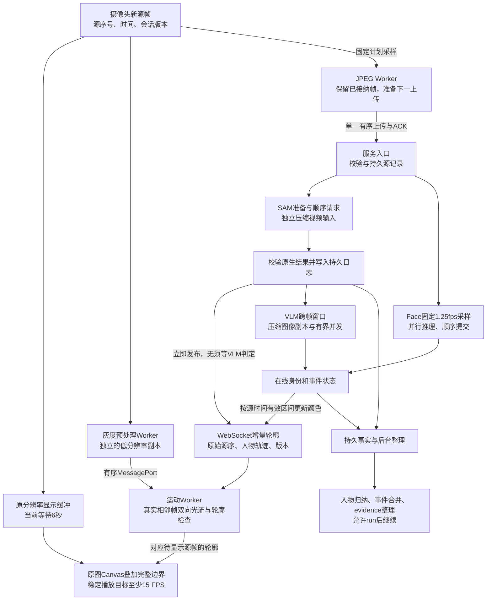

# 零描边与实时链路修复

状态：本轮已收尾并部署，按用户要求停止轮廓细节优化。先恢复大致连续的描边和流畅显示，少量缺失使用短时补帧；显示低延迟、事件判断与变色速度随后优化。复用现有GPU，以`video_samples/sample_video.mp4`经过正式浏览器页面及全部模型分支验证。最终参数完成60秒短测，不将此前其他参数的4分钟测试当成本参数的长期稳定性证明。

用户最新收束：轮廓大致跟随即可，不再继续投入细节贴合。少量缺失使用短时补帧；本轮收尾只验收有描边、原图流畅及任务不持续积压，不再扩展轮廓算法。

## 不变的约束

- L1 完整轮廓及流畅显示优先，稳定播放至少15个不同源画面/秒，不能用重复画旧帧达标。原P95两秒目标进入后续优化阶段；当前采用6秒有界缓冲联测，启动等待照实记录，不能称启动窗口也达到15 FPS。
- SAM、VLM、InsightFace 分别至少成功分析 1 FPS，后续争取 3 FPS；已接纳分析帧保持顺序和完整。
- L2 事件判断和颜色允许晚到，保留真实源时间。L3 人物、事件和 evidence 整理允许在 run 后继续。
- 不延长过期锚点。用户后续明确允许少量缺失帧做补帧、不追求完美贴合：显示可使用有界短时近似轮廓，必须与严格通过的轮廓分开计数，不改变分析证据和判断质量。吸烟误报暂不作为此次修复范围。
- 用户补充：最终显示使用原图分辨率，模型输入可独立压缩。显示缓冲不再统一缩到长边 960；SAM 尺寸/码率单独对照，压缩不能改变源序和坐标对应。

## 第一批改动

1. **轮廓独立发布、独立推送。** SAM 响应经完整校验并写入原始结果日志后，立即发布原生几何，不等待人物关联及场景提交。浏览器通过现有 WebSocket 接收增量；单一 writer 保证 ACK/控制优先，轮廓按游标补齐，HTTP 接口保留兼容。空人物锚点、run/generation/crop/epoch 屏障、事件版本必须保留。断线沿用停止所属 run 的既有语义，不虚构同 run 恢复。
2. **补齐能落盘的真实测量。** 显示窗口统计接入已配置的结构化 logger；浏览器记录捕获/拷贝/编码/绘制、回调间隔、长任务、页面可见性，以及轮廓收到与 Worker 应用的时间。显示统计也走现有 WebSocket，避免继续依赖失联的 HTTP 轮询。
3. **修正预准备重叠。** 当前 busy 时必须凑满 4 帧才准备，实测几乎仍串行。保留一个准备槽、一个 SAM 请求及 FIFO，用已完成请求的耗时进行保守临近预准备，不把每个新帧拆成小请求。相同 SAM 会话的推理仍严格有序。
4. **进一步拆开上传耗时。** 原生 SAM 计算明显短于远端读取请求体；记录发送请求头/请求体及等待响应头的边界。先区别客户端调度、共享网络负载和远端读取，不能声称增加 GPU 并发或缩小 payload 就能消除延迟。

早发布仍受当前两批待提交容量限制。若 L2 持续阻塞，需以既有持久结果日志为待消费队列并设置存储背压，不能通过无限内存队列或丢弃旧结果假装完全解耦。

## 测试与后续改动门槛

用 `tools/evaluate_camera_live.cjs` 将给定视频作为摄像头输入替身，正式页面、源上传、SAM、VLM、Face、轮廓 Worker 和记录分支实际运行；它不是物理摄像头曝光时间测试，也不是人工轮廓真值评测。报告和截图保留在私有 `.goodvision/diagnostics/contour-live-repair-20260917/`。

先同视频对照，再运行修复包。记录每个 5 秒窗口的不同源帧率、轮廓覆盖、源帧年龄、metadata 是否持续更新，以及各模型独立完成率、失败、积压和排空数。原始轮廓与显示帧必须按源序号核对，检查快速运动、远处人物及离场残影；旧远景传播质量问题不因通道修复自动视为解决。

只有实测显示主线程拷贝/编码占用明显时，才针对相应工作迁移 Worker。若上传存在资源竞争，按实测拆分上传调度，保持 L1 优先及 L2 的持续供给，避免扩大并发反而增加排队。所有发布固定镜像和源文件清单；只更新应用容器，保留当前 GPU 控制器和实例。

## 对照记录

首轮原版本真实视频约 50 秒：显示约 13.67 FPS，665 个不同源画面，完整轮廓 0；浏览器接纳 49 帧，停止时全部收到 ACK。之后分析排空约 34.5 秒。该输入含近景走动和远处人物，不能和上一轮单人摄像头 run 当成相同负载。

其中一次约 32 KB 的 SAM 请求，远端读取 4.38 秒、处理 0.529 秒；空闲通道不运行模型的固定体积探针显示约 43 KB 往返 0.48–1.93 秒，存在明显波动。仍不足以单独证明原因是带宽、SSH、共享上传或本地调度。后续实测结果在本文追加。

### 2026-09-17 后续联测（均尚未验收）

| 版本 | 主要区别 | 开始播放后的不同源帧 FPS | 完整描边帧 | SAM 请求均值 | 采集后排空 |
| --- | --- | ---: | ---: | ---: | ---: |
| baseline，约50秒 | 修改前实际镜像 | 13.67 | 0 | 多次约5–11秒 | 34.5秒 |
| candidate1，60秒 | WS增量、原生轮廓早发布、计时 | 14.56 | 0 | 3.56秒 | 17.8秒 |
| candidate2，60秒 | 灰度/编码离开主线程，原分辨率显示 | 约19 | 201 | 0.42秒 | 含原统计缺陷，不作为完成率依据 |
| candidate3，60秒 | 灰度/光流/JPEG三个Worker，JPEG与ACK重叠，上传720/q80 | 18.96 | 49/1112 | 1.67秒 | 44.6秒 |
| candidate3-low-input，60秒 | 仅SAM改384/CRF28 | 18.90 | 178 | 0.69秒 | 54.2秒 |
| candidate4，约77秒 | 小前缀JIT预准备，Face固定1.25fps采样 | 19.24 | 78 | 1.55秒 | 11.2秒 |
| candidate5，约76秒 | 6秒缓冲、Worker预热、持久日志连接复用、VLM640/q70；SAM1.1fps、512/CRF23 | 约19.7 | 1097/1379 | 0.63秒 | 4.1秒 |
| candidate5-dense-sam，75秒 | 仅SAM提高到3fps，512/CRF23 | 约19.6 | 376/约1372 | 输入超过持续处理能力 | 约30秒 |
| candidate5-dense-low，75秒 | SAM3fps、384/CRF28 | 19.51 | 1268，约93% | 1.06秒 | 12.5秒 |
| candidate6，75秒 | SAM2.5fps、384/CRF28；运动宽240，保存精确诊断 | 19.11 | 0/1345 | 2.09秒，峰值10.11秒 | 35.0秒 |
| candidate7，75秒 | 像素中心修复；SAM2fps、运动宽160，保存精确诊断 | 18.59 | 1128/1290（87.4%） | 0.50秒 | 6.3秒 |
| candidate8，75秒 | 仅运动宽改192，关闭精确诊断 | 约19.16 | 350；仍因Worker处理逾时大量缺失 | 0.66秒 | 7.2秒 |

以上不同场次有明显网络波动，不能把表中每一处速度变化都归因代码。完整描边计数仅表示通过现有传播检查，不代表人工逐帧真值验收。candidate3已保存1808×1030原分辨率带轮廓图。

已证实的边界：

- 浏览器主线程灰度读回曾平均约40ms/帧；拆成独立Worker后，显示恢复约19fps。candidate3稳态灰度排队约0.8ms、光流帧排队约4.7ms、metadata收到至应用约41ms，无持续积压。
- candidate3的61个活动期SAM锚点均有人物，但接收时源龄平均4.13秒，48个超过1.7秒播放延迟加1.5秒传播预算。浏览器时钟对账误差不超过约24ms，不能靠延长轮廓过期时间解决。
- candidate3非空请求平均远端收body约1.03秒、实际处理约0.35秒；客户端交给socket仅约6ms。链路为本地应用→Docker内SSH转发→远端SAM。证据支持上传路径成本，但尚不能指认具体VPN、WAN或代理。
- 384/CRF28把平均SAM请求从约26.7KB降至8KB。后续场次仍可能变慢，压缩不等于已保证低延迟。
- candidate3中Face双推理实例实际启用，采集约60.6秒时完成82/151帧（约1.35成功fps），后续处理余69帧约43秒。2.5fps输入超出当时完整处理能力。candidate4按用户临时每模型至少1成功fps目标，明确将Face预采样调为1.25fps；无忙时替换、无已接纳帧丢弃。是否达底线仍按成功完成数验收。
- 修正了SAM采集完成计时：过去错误包含等待Face排空时间。现在采集结束冻结分母，之后完成的帧单列；不能用修正后的数字声称计算提速。
- 新增SAM请求标记、原始结果持久化、原生几何发布分段计时。SQLite每次关闭最后一个连接会产生额外checkpoint；独立临时库对照保持连接后每次写入约从11–13ms降至5–6ms，保留FULL同步。正式链路收益待测。

candidate5已经验证连接复用、Worker预热和VLM上传副本压缩。它的SAM源龄均值0.97秒、P95约1.93秒、最大2.70秒；6秒缓冲下没有轮廓过期，但仍有约20%画面缺少至少一个人物轮廓。提高SAM密度可以减少运动传播距离，却不能超过持续处理能力：3fps/512输入出现27秒队列，3fps/384改善至约93%完整率但仍出现约5.6秒排队峰值和停止后12.5秒排空，不能作为长期稳定性通过。

当前进一步验证2.5fps/384输入，给队列留处理余量；运动计算宽度从160提高到240，原图显示仍为1808×1030。远处一个头部在160灰度图中仅约2.5×3.4像素，必须检查坐标离散化与真实灰度传播。诊断模式可保存有界逐帧灰度、输入/响应顺序及部署资产版本，普通运行关闭。新入画、远处小人物和视频循环切换的轮廓仍必须单独观察，不能用平均FPS代替跟随质量。

candidate6否决了直接提高到240的方案：该轮后段运动计算约79ms/帧，积压167帧，1018个显示查询来不及处理。同期SAM最初11–13KB请求在远端读取需要2–9秒，GPU处理仍约0.5秒，最终积压约32秒；不能把这一轮零描边归因小人物的几何检查。首个慢上传早于首个VLM请求，因此并非都由VLM抢上传造成。记录足以隔离阶段，尚不足以指认具体网络设备或SSH问题。

源码及回归确认另一项独立问题：SAM返回像素中心坐标`(x+.5)/W`，原dense模块却按`u*(W-1)`栅格化，可能偏一格。现统一输入/输出中心协议及Canvas坐标；无法表示的小组件明确报告失败，不再静默删除后称完整。27项dense和45项controller回归通过，实际覆盖改善仍单独实测。candidate7恢复160运动宽度、固定SAM2fps，保留6秒缓冲和精确诊断，继续核对最终缺失人物而不是把失败尝试数当成缺失数。

### 完整描边优先的显示调整

不能仅把后端参数从1.7改为6：旧前端硬限制最多1.8秒、60张原图，20fps下会在6秒到期前挤出所有待显示帧。修复将显式支持0–8秒缓冲，容量按目标帧率与延迟计算，原图估算内存设上限，超预算明确失败，禁止静默降低输出分辨率。6秒/20fps/1808×1030约132张、938MiB原图像素预算，不包含浏览器、WASM及光流其他内存。运动历史增至10秒，传播期限仍为1.5秒；增加的是等待结果的时间，不是允许错误轮廓长期存活。

暂不直接用最后SAM时间戳硬控播放：它不保证每个人的轮廓都有效；目前空锚点还可能来自无效几何过滤，不能等同‘确认无人’。先取得固定缓冲下真实完整覆盖及内存/帧率证据，再决定是否扩展完成水位协议。

## 当前实际数据流

显示轮廓传播仅服务L1，不反向写成VLM或Face证据。SAM同一会话请求仍严格有序；L2提交尚有两批有界容量，持续堵塞仍可能传递背压。图中的并行不能解释成任意阶段已经完全独立。

### 少量缺失帧的显示补帧

candidate7精确重放405条输入/响应完全一致；排除超时和过期后，最长连续缺失为源帧76–82（4.074–4.359秒，约0.285秒）。人物持续可见，正在快速下蹲；旧SAM锚点头顶仍被画面裁切，新显露23个像素触发局部裁切检查，尽管其余像素约97%可靠。未来锚点逆传播又因腿部局部检查失败，导致整人闪烁。这不是整人离场或场景切换。

按用户新授权，实施短时近似补帧：严格结果优先；仅局部裁切/边界失败可进入显示候选，全局外观、主体面积与运动支持等仍检查。要求前后相邻真实SAM锚点确认同一人物及epoch、源帧连续且未过期，从上次严格成功起最多0.35秒，补帧不得延长自身寿命。严格通过、使用补帧、所有已知人物均有闭合轮廓分别统计；后者才能作为新的连续显示指标。已知人物覆盖仍不同于人工标注的全场景召回率。

## 本轮最终配置与结果

最终运行容器引用镜像`sha256:c1a22432f0aac0a53e5f24123e5f4d43e888ed56a5b72fed686cbe2248caf0d0`（构建config摘要`2041ec44…`），已更新正常启动标签`goodvision-harness:sam-remote`并写入本机`.env`，不再依赖临时compose参数。仅重建应用容器，现有GPU控制器保持运行。实际部署源文件指纹保存在私有`candidate11/deployed-source-hashes.json`。

| 参数 | 最终本机值 |
| --- | --- |
| 输出画面 | 原图1808×1030；叠加轮廓 |
| 显示目标/缓冲 | 18 FPS / 6秒；启动明确等待缓冲 |
| 运动计算宽度 | 160，避免192/240下计算积压 |
| SAM、Face固定采样 | 各1.25 FPS；已接纳帧FIFO完整处理 |
| SAM输入 | 384 / CRF28 |
| VLM输入副本 | 长边640 / JPEG70 |
| 短时补帧 | 最多0.35秒，单独计数 |

除短时补帧外，已对完整严格几何做依赖缓存；仅事件变化不再重排待显示帧的几何计算，颜色在后续新帧自然更新。SAM新锚点、同源修正和epoch变化仍会刷新预取。2 FPS分析输入在较重负载下导致浏览器上传队列积压，最终按用户允许的每分支至少1成功FPS底线，固定为1.25 FPS留出余量，没有忙时替换帧。

最终60.292秒短测：

- 原图不同源播放平均17.37 FPS；缓冲完成后的完整5秒窗口最低16.00 FPS。6秒启动等待单列，不算启动阶段也满足15 FPS。
- 950个显示帧中，878帧所有SAM已知人物都有闭合轮廓（92.42%）；815帧严格通过，72帧使用过近似补帧。只有3帧完全没有轮廓，其余未全覆盖帧仍画出可用人物。补帧与部分覆盖是交叠分类，不能简单相加。
- 76个接纳分析帧全部收到ACK；停止时上传待处理0，之后约2.15秒排空。SAM活动期成功76帧（约1.26 FPS）、Face75帧（约1.24 FPS）、VLM有效观察67次（约1.11次/秒）。VLM上下文图片不重复计数。
- SAM提交至结果平均0.59秒、P95约0.89秒；这个数字不包含全部浏览器采样/上传等待，不等同摄像头到显示延迟。最终显示仍约6秒，尚未达到原两秒目标。

此结果证明本次短测恢复大致描边与流畅显示，不代表全场景识别召回率、像素完美轮廓或长期稳定性认证。按用户要求，本轮不再继续细化轮廓；后续优先观察真实使用中的任务积压与延迟。

### 视频内文字恢复（2026-09-17）

迁移浏览器原图叠加时遗漏旧服务端视频中的文字绘制。现已补回每个可见轮廓的 `ID {track_id}` 与中文事件名称（打架、吸烟、跌倒、持械、陌生人）。当前 L1 metadata 只有 SAM 原生跟踪 ID；它不是侧栏归档人物编号，也不包含姓名。文字按当前轮廓定位并限制在图像内，多轮廓组件只显示一个标签。

事件文字与颜色共用目标源帧的事件区间、epoch、track_id 和确认状态；几何缓存命中也重新计算文字，事件结束不会残留，未来事件不会提前显示。135 项相关 JavaScript 测试通过。Chrome 在 1808×1030 原图上以测试标签输入验证字体和边界，无页面错误；此次未重新运行 GPU 性能测试。显示采样、补帧及分析策略未修改。

标签修复已部署至正常启动标签 `goodvision-harness:sam-remote`，新应用镜像 `sha256:c43fa2e3cdca1fe37302c7eac7ddcd4eacf340e4a2b931421a608a2ae7340aff`；浏览器获取的脚本与本地文件完全一致（SHA256 `e85f51dda71b11a5583c4a49c1a7d8033f6f713ce0e8ee2458d66d7cb369e21a`）。现有 GPU 控制器保持运行。浏览器验证留存于私有 `labels/verification.json` 与 `labels/browser-labels.png`，图中的事件是显示测试输入，不是一次真实事件识别结果。

### 标签更新后用户实测暴露的描边连续性故障

用户 run `ead2b7ae-bd68-4833-85ac-cc9c1be74deb`（2026-09-17 13:55–13:57 UTC）在 640×480 摄像头上严重缺失描边。87.14 秒记录包含 1374 个显示帧，其中 1216 帧无轮廓（88.5%），全部是 `coverage_not_ready`；1387 个呈现请求已过期。不能以“补帧源码仍在”作为功能正常的证据。上次标签变更只验证字体与自动测试，没有完整回归实际摄像头链路，验收不足。

逐帧运动计算平均 52.0ms，而 candidate11 宽景样例约 27.5ms；呈现请求排队平均 451ms，超过旧版仅 350ms 的预取窗口。原图绘制含标签平均仅 0.339ms，且首个标签出现前运动计算已经偏慢，现有证据不支持文字绘制直接阻塞。SAM 109 帧成功、锚点持续到达；主故障在本地运动与呈现排期。固定宽度 160 使 4:3 运动工作图达到 160×120，较样例 160×91 多约 32% 像素；此差异不能单独解释全部计算耗时增长。

修复范围：运动工作图保持比例并限制面积为配置宽度平方的 9/16（默认 640×480 输入对应 138×103）；6秒缓冲下提前 1.5 秒准备轮廓，仍使用真实显示时刻的截止时间；同一源帧最多一个在途呈现请求，连续元数据更新合并到下一次刷新。原始视频尺寸、分析采样 FIFO、事件源时间边界、短时轮廓补帧及文字均保留。日志新增原始尺寸、运动尺寸、预取时间和在途查询数，方便区分计算负载与准备不足。

本轮验证须分别记录调度回归与浏览器运行结果，不把保存结果的回放当作新 GPU 识别验收。诊断期间现有 GPU 实例 51317538 被释放；未为此次修复创建新付费实例。

最终验证：141 项 JavaScript 回归与 7 项显示日志校验全部通过。真实 Chrome、原始播放器与三条 Worker 进行前后对照：4:3 测试源为 640×480，视频循环后通过 captureStream 保持摄像源时间单调；模型元数据来自保存的真实 run，按原到达时间投递、映射到最近新捕获帧。测试副本为运动计算添加相同的按像素面积计费的 CPU 工作量（160×120 时 36ms），模拟用户日志中的慢运算；生产脚本没有此注入。它验证显示调度、标签与已知人物轮廓连续性，不代表新 GPU 识别或逐像素质量验收。

| 最终对照 | 故障标签版（40.61秒） | 修复版（60.86秒） |
| --- | ---: | ---: |
| 播放帧数 / 平均 FPS | 619 / 17.88 | 984 / 17.92 |
| 缓冲结束后完整5秒窗口最低 FPS | 17.95 | 17.79 |
| 因结果未就绪缺失描边 | 605帧 | 0帧 |
| 过期呈现查询 | 732 | 0 |
| 完全无轮廓 | 606帧 | 0帧 |
| 全部已跟踪人物闭合轮廓 | 7帧 | 931帧（94.61%） |
| 标签文字绘制次数 | 20 | 4046 |

证据目录为私有 `labels-regression/final-baseline40`、`final-fixed60`。此前直接读取 video 元素的试验尾段遇到文件结束，已排除出最终验收；最终上述对照使用一致的循环摄像流管线。两轮均无浏览器错误。修复版停止时运动待处理2帧，分析上传待处理0。

正常启动标签已更新至 `goodvision-harness:sam-remote`，镜像 `sha256:3aaff2c84d4ba6db2aa7e72a797e3aa343825c2dac54f9aad6752476f4c2ab8c`，现有应用容器已重建但保持未启动，GPU 控制器保持退出。容器安装目录的 JS 与测试源一致，SHA256 `834fd013a82e2c14e06c6d675766c032d5c3b4aecd651f261460a81097656ab1`。下一次正常启动使用此版；本轮没有重新进行在线 GPU 与真实摄像头联合测试。
