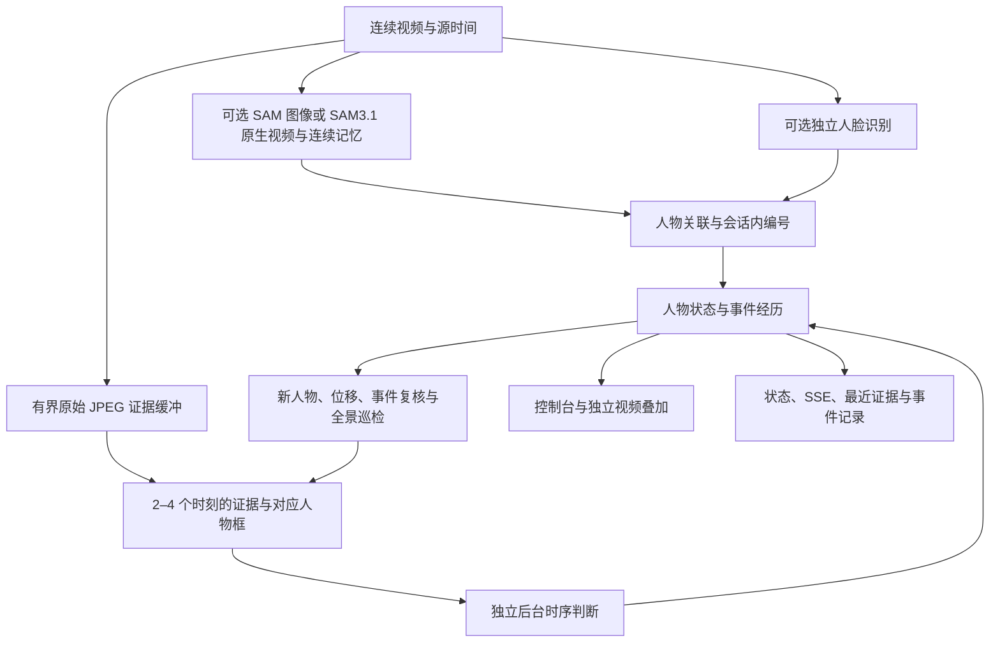

# 持续人物与时序事件引擎

日期：2026-09-12。分支：`codex/entity-event-engine`。

本轮软件回归与真实时序请求结果见 [验证记录](entity-event-validation-20260912.md)；
原生 SAM 3.1 的部署与真实录像结果见 [GPU 验证](sam31-gpu-validation-20260912.md)，
连续模式配置见 [SAM3.1 实现说明](sam31-implementation-20260912.md)。

本版本提供完整的可选运行链路：先发现人物，维护会话内人物状态，再用多个时刻的原始画面
检查事件，把开始、持续、结束和修订交给同一个事件引擎。`active` 模式已经接入后台时序模型、
独立视频叠加、控制台状态、SSE 和事件元数据归档。默认仍为 `disabled`，保留原有运行方式。

感知层现在提供三条可选路径：`sam` 使用官方 SAM 3 图像关键帧检测及本项目的保守运动跟踪；
`sam31` 在每个片段内使用原生视频记忆；`sam31_stream` 在一个有界会话内持续追加已经收到
的帧，保持原生人物编号并回收历史。SAM 3.1 权重已经获批，严格加载、真实 CUDA 推理与
连续追加等价验证已经完成。代码、接口成功和等价结果仍不能证明检测准确率或生产告警效果。

## 模式与数据流

| 模式 | 行为 |
| --- | --- |
| `disabled`（默认） | 原有逐帧安全识别、人脸与视频交付 |
| `active` | 四类安全事件使用持续事件链路；停止旧逐帧安全请求，选择陌生人能力时保留独立人脸识别 |

使用 `SCENE_ENGINE_MODE=disabled/active`，或 YAML 的 `runtime.scene_mode`。
`shadow` 旁路模式已移除。旧的 `SCENE_ENGINE_ENABLED=true` /
`runtime.scene_enabled: true` 会报错，需迁移到显式 `active` 模式；旧开关为 `false` 时不影响模式。



正式 `active` 会话要求已准备好的跟踪输入，拒绝把旧 VLM 的人物框作为跟踪后备来源。
感知 worker 无法通过 GPU readiness 时，启动会给出错误。启动后的失败、断流或人物缺失
会进入等待／不确定状态，不会生成阴性或绿色“全部安全”。`active` 不支持旧单事件诊断模式；
多事件与人脸模式仍可使用，干运行不会启动自动时序 VLM，不能用于准确率验收。

## SAM 感知的实际实现

三条路径固定官方 `facebookresearch/sam3` 源码
`660a5e9e1b8b4c02c0ad97229b88a09a6e4ff5b7`，使用本地获批权重，不在启动时下载。
所有生产 readiness 都要求真实 CUDA 预热；测试替身不能报告 GPU 已就绪。

| 后端 | 权重与接口 | 记忆边界 |
| --- | --- | --- |
| `sam` | `facebook/sam3/sam3.pt`；`/v1/tracks` | SAM 图像关键帧，中间用显式 predicted 运动框；有歧义时换号 |
| `sam31` | `facebook/sam3.1/sam3.1_multiplex.pt`；`/v1/video/batches` | 每个已收到片段使用原生视频记忆，随后释放并换 epoch |
| `sam31_stream` | 同一 SAM3.1 权重；`/v1/video/sessions` | 会话内真实追加、稳定原生 ID、有界历史清理；EOF 发完待发源帧 |

图像路径调用 `build_sam3_image_model` 和 `Sam3Processor`，默认每 0.4 源秒或五次请求重新
检测 `person`。中间预测保留原始最后观察时间，不能作为新证据；多人歧义、相撞或长间断会
停止旧编号。该路径没有外观 ReID、姿态、光流或跨镜头身份。

连续路径通过固定官方 `Sam3MultiplexTrackingProd` 接入。公开 wrapper 没有摄像头 append
方法，本项目适配下层状态和源索引，没有靠重叠离线片段伪装连续记忆。48 帧真追加以及
128／256 帧历史回收、空 EOF 的真实 GPU 对照已经逐帧核对 ID 与 mask hash 全等。
这证明当前适配的执行一致性，不等于遮挡或身份准确率验收。

连续 worker 固定 16 个图像槽，默认保留最近 32 帧历史及所需 conditioning 锚点；
SAM 留出 14 帧确认缓冲，因此接收、处理、已输出进度分别记录。主程序只接收严格源帧前缀，
空人物帧也必须返回快照。每个会话最多 65,536 帧和 2,048 个累计原生 ID，空闲 120 秒清理；
上限、分辨率改变、失败和取消会明确结束旧 epoch。

图像 worker 的默认八个会话、64 条轨迹、15 秒截止仍适用于 `sam` 对照路径；
原生会话同时只允许一个活动源，默认单请求 60 秒截止，共享 GPU 槽一直保留到真实清理完成。
挂起的 CUDA 调用不能由 HTTP 安全中断，需重启。完整协议、权重校验、请求资源上限及容器
说明见 [SAM worker 文档](../../workers/sam_scene/README.md)。

## 人物、事件与修订语义

人物用 canonical `subject_id` 表示，SAM 的 `track_id`、人物实体编号和真实姓名分别维护。
框由当时源帧的真实观察决定；迟到身份可以补充保留的历史帧，不回退人物位置。
删除登记身份会清除保留身份并阻止迟到结果重新写入，直到明确重新登记。

事件按类型与规范化人物组维护。例如两人的打架是一条共同事件。默认首次阳性为 `suspected`，
两次不同源帧的阳性确认；同一实体／人物组的同一事件需要连续 2 个不同源帧的有效 clear
判定才结束。新的阳性重置 clear 计数；多个事件分别计数。时序请求只在参与者实际被观察到的
最后一个源帧上计一次判断，不把输入的 2–4 张图片虚增为多次 clear。
同源帧重复消息不会重复积累证据。参与者必须在判断对应源帧有真实人物观察；预测框、保持框、
遮挡、能力缺失、模型错误与 `detected=null` 都不是阴性。全景阴性也只影响当时真实可见的参与者。
陌生人事件由人脸通道决定，清除要求真实观察到已确认熟人身份。

### 警报门槛（2026-09-18）

证据计数与警报门槛分别处理：未达到既有 N 帧确认门槛的事件只标黄；达到门槛后才标红。
陌生人还必须完成身份合并复核，具有至少两个不同源帧的可用人脸样本，且没有身份冲突、
合并歧义或被拒绝的合并，复核结果仍为未知人员，才允许标红。复核完成不替代 N 帧事件确认。
当前流式会话的身份合并在停止检测后的后台收尾阶段执行，因此在线复核前的陌生人保持黄色。

启用陌生人识别时，尚未取得可用人脸、背影、模糊或身份复核未完成的人物均显示黄色身份提示；
这些提示不生成事件阳性或阴性。历史沿用、未实际观察和不可用人脸不能增加陌生人确认次数。
已确认熟人身份会撤回该人物的陌生人警报；同人物已确认的其他安全事件仍优先显示红色。

公开 scene 快照、浏览器原图轮廓及服务端视频共用警报门槛。陌生人的内部时序计数保留，
公开 `phase` 在身份未确认时保持 `suspected`，`alert=false`，原时序阶段记为 `evidence_phase`；
确认时间不会早于身份复核完成的源时间。人物的 `identity_pending` 表示黄色身份提示。
原始逐帧检测结果属于候选证据，持续事件的警报以 scene 的 `phase` / `alert` 为准。
2026-09-19 起，active 模式同时向既有 `/v1/results/...` JSON/SSE/Webhook 发布
AnalysisResult v2 兼容消息（`analysis_kind="scene_state"`）：公开 phase 为 confirmed
时对应 `detected=true`，疑似、结束、撤回为 false。同类多人物事件按仍确认的事件
汇总，不把未返回的能力伪造为阴性。即时人脸原始结果继续走 `/v1/faces/fast`。
兼容输出只做下游转换，不回写时序证据、人物关联或视频归档；详细字段语义见
[接口说明](../../API_DELIVERY.md#持续事件模式的兼容输出2026-09-19)。

结束规则：连续有效 clear 达到 2 帧，或适用的安全事件满足连续 10 个成功 SAM 源帧的全体参与者消失门槛，
才结束事件；两种计数独立。重复源帧不重复计数，模糊、遮挡和未知结果不冒充 clear。
黄色身份提示没有事件结束计数；身份确认后移除该提示。

`phase`（`suspected/confirmed/ended/retracted`）与 `observation_state` 分开维护。
已经确认的事件在人物遮挡时保留历史结论，同时显示 `uncertain`，不会靠时间到期自动宣称结束。
已结束后新的源帧再次出现阳性会形成新 episode。迟到判断按原始源帧顺序纳入证据；
已被后续连续 2 个 clear 结束的事件，不会被较早的阳性重新激活。

视频使用真实同源 SAM mask 的外轮廓描边；没有有效同源 mask（如 Hybrid 的轻量检测帧）
时使用 bbox。首次阳性将对应实体标黄，事件确认后描边及事件文字变红；同一人物存在多个
事件时，已确认的红色优先于疑似的黄色，所有活动事件结束后恢复正常颜色。左上角显示事件状态。
描边位置严格对应显示源帧，而颜色和事件文字使用最新接受的事件状态；即使判断晚到或该画面
已显示，也会刷新。
显示快照单独标记 `event_state_timestamp_seconds`，不改变证据快照的原始源时间。
显示线程保留当前显示的一张原始 JPEG 和对应几何；即使证据缓存已淘汰，晚到事件仍能重绘。
人物合并后沿用当前实体编号，位置仍来自显示源帧。

同一证据消息可提交更高 `revision`，在固定源帧上修正判断或人物归属；显式撤回可取消原观察。
引擎重放受影响人物组的保留证据，必要时输出 `retract` 并修正 episode。相同或较低版本被忽略，
已超出有界历史的旧修订不会恢复被淘汰状态。无可用判断的 `null` 与显式修订撤回是不同操作。
转换记录包括开始、更新、结束和撤回，不把淘汰当成真实结束证据。

## 自动时序判断与资源预算

`active` 的 `SceneInspectionWorker` 在视频回调和现场状态锁之外执行模型请求，同一时刻最多
一个请求在途。使用当前配置的模型、供应商和密钥；不自动切换模型路线。默认网络总超时
15 秒、无 API 自动重试。调度失败会退避，下一次检查重新使用可用证据。

每次检查包含 2–4 张按源时间排序的全景图，最长边默认 720，附每张图当时人物框和编号。
指定人物的任务要求目标在各证据帧有真实位置。不会把当前框复制到过去，也尚未实现高分辨率
人物／烟具裁剪。新人物、位移变化、疑似事件及持续事件可触发复核；独立全景巡检避免只依赖
已知动作线索。默认 active 全景间隔五秒、事件刷新三秒，实际频率还受证据、队列及模型耗时限制。

四类安全事件为 `smoking/fight/fall/weapon`，陌生人身份不发给此接口。响应要求严格 JSON 字段、
类型、唯一键、合法人物引用、有限置信度及有据可查的源帧；允许仅覆盖整条消息的完整 JSON
代码围栏。空结果不等于所有阴性。请求成功、证据被接受和事件确认分别计数。

主要配置为 `SCENE_TIMEOUT_SECONDS`（默认 15，最大 20）、`SCENE_MAX_IMAGE_SIDE`
（默认 720，最大 2048）和 `SCENE_MAX_TOKENS`（默认 1600，最大 16384）。
运行服务持续产生模型请求，没有整场固定次数上限；用离线工具的 `--max-requests` 做有预算的对照。

| 资源 | 默认上限／行为 |
| --- | --- |
| 人物 | 128 人；图像路径每人 64 条位置，原生视频路径最多 512 条并受证据保留时间限制；未获新观察时按源进度显示不确定 |
| 轮廓历史 | 全局最多 131072 个点；超限移除最旧轮廓，保留人物框和事件证据 |
| 事件 | 640 个事件键，每键 64 条证据；转换和去重缓存有界 |
| 源 JPEG 缓冲 | 图像路径 48 张、16 MiB、八秒；原生视频路径 512 张、64 MiB，batch 12 秒，连续模式默认 4 FPS 时 32 秒 |
| 待检查任务 | 四个，保留图像合计 16 MiB；按源时间 20 秒过期 |
| 等待关联结果 | 128 条、90 秒 |
| 最近成功时序证据 | 最多四张原始 JPEG，另有 16 MiB 上限，新成功结果覆盖旧集合 |
| 现场发布与视频显示 | 状态历史最多 32 条；原生显示最多 512 条待显示时间记录，另保留当前显示原图（最多 16 MiB）及其几何 |

图像路径源缓冲与待检查图像预算合计 32 MiB，另加最近成功证据最多 16 MiB；
原生视频证据路径相应合计最多 96 MiB，另加当前显示原图最多 16 MiB。
连续模式按采样率保留 `max(32, 32 / max_fps + 24)` 秒，
采样率最低 0.5 FPS，时间上限 88 秒，帧数与字节上限始终生效。连续模式只把协调器接纳的
采样原图放入这个源证据缓冲；高帧率预览不会提前挤掉待返回人物结果的源帧，完整视频与人脸
归档仍按原有链路保留画面。人物位置历史使用同一时间预算。这些预算不包含 Python
对象、模型解码、现有人脸／视频缓存或 GPU 内存。停止和新源会话会清理 JPEG 与待处理请求；
迟到旧会话结果不能污染新状态。自然 EOF 或无错误断流先收尾原生待发结果和最后的时序任务，
合计最多 180 秒，再关闭场景；失败或超时会记录结果并使旧回调失效。

## 展示、接口与归档

控制台从 `/v1/ui/info.scene_engine` 读取模式，用不堆积的串行请求更新 `/v1/scene`。
active 安全卡片由持续事件驱动，人脸结果单独显示。
人物遮挡、源停止、数据停滞、识别不可用与等待证据分别显示，空事件列表不显示“全部安全”。
人物姓名等外部文本只按文本渲染。

原有 `/v1/video/annotated/latest.jpg` 和 `/v1/video/annotated/stream.mjpeg` 在 active 接入独立
现场显示线程。显示帧使用对应源时间的已有框，最多保持一秒，较旧框用虚线；未来或过旧的框
不会被画到当前画面。人物未获新观察时事件标记待核实。图像编码不阻塞视频输入或后台模型。
不会为了兼容旧安全结果而伪造逐帧 `AnalysisResult`；原有人脸结果协议保留。

| 接口 | 内容 |
| --- | --- |
| `GET /v1/scene` | 模式、状态、人物、事件、有界转换、检查任务及 worker 统计；不带完整位置历史 |
| `GET /v1/experimental/scene` | `/v1/scene` 的兼容别名 |
| `GET /v1/scene/events` | 每约 0.5 秒推送 `event: scene` 状态；重连读取当前状态，不提供持久游标重放 |
| `GET /v1/scene/history?limit=100` | 持久事件元数据，最大 1000 条；不包含视频或人脸向量 |
| `GET /v1/scene/evidence` | 最近成功检查的请求标识、原始帧序号／时间及逐帧 JPEG 地址 |
| `GET /v1/scene/evidence/{request_id}/{frame_sequence}.jpg` | 对应检查的原始证据 JPEG，非叠加后的显示图 |

状态和证据接口只读，禁止缓存。最近证据是有界的内存集合，新成功检查覆盖旧集合，停止清空；
旧会话或旧请求的图像返回 404。这些 JPEG 是 VLM 缩放前保留的对应源画面，输入模型时仍遵守
720 最长边限制。active 控制台的“连续观察证据”入口指向这个集合；旧 latest evidence 地址
在混合人脸模式仍可能提供人脸单帧，不能视为时序安全事件的完整证据。

`SceneArchive` 在配置的事件目录下写入 `scene/scene-events.sqlite3`，只记录事件类型、
人物编号、源时间、状态及有效证据计数等元数据，不存姓名、JPEG、脸部向量或任意属性。
默认数据库预算 64 MiB、队列 32、读取缓存 1000 条，保留天数沿用事件配置。
记录更新为每个事件的最新状态，不是永久保存每次修订的审计日志。原有人脸事件归档继续工作；
**当前没有独立的持续场景事件录制片段**，不可把 metadata journal 或最近四张图称为完整 scene clip。

## 本地与容器运行

需要对应路径的获批本地权重、可用 NVIDIA CUDA GPU，以及已配置的事件模型接口。
SAM 3.1 的 Vast 实例已完成部署与真实运行；其它机器仍需独立验证。推理不需要 Hugging Face
token，权重只读挂载。连续 `sam31_stream` 的启动示例、环境与实测链接见
[SAM3.1 实现说明](sam31-implementation-20260912.md)。

下面保留 `sam` 图像路径的对照运行方法：

先按 [worker 文档](../../workers/sam_scene/README.md) 启动端口 8092 的 worker 并确认
`/health/tracking` 的 `ready` 与 `gpu_ready` 都为 `true`。本地 Harness 示例：

```powershell
$env:SCENE_ENGINE_MODE = 'active'
$env:SCENE_TIMEOUT_SECONDS = '15'
$env:SCENE_MAX_IMAGE_SIDE = '720'
$env:SCENE_MAX_TOKENS = '1600'
$env:PERSON_TRACKING_ENABLED = 'true'
$env:RICH_LABEL_ENABLED = 'true'
$env:RICH_LABEL_BACKEND = 'sam'
$env:RICH_LABEL_ENDPOINT = 'http://127.0.0.1:8092/v1/tracks'
$env:RICH_LABEL_TIMEOUT_SECONDS = '20'
$env:RICH_LABEL_MAX_FPS = '4'
$env:HARNESS_AUTOSTART = 'false'
$env:HARNESS_HOST = '127.0.0.1'
python -m goodvision_harness.service
```

使用原有 `config.yaml`／`.env` 配置视频、人脸和模型接口，必要时用 `HARNESS_CONFIG` 指定
配置路径。打开本地 8080 端口的控制台选择能力并开始会话。不要把真实密钥写进实验报告或提交。

Linux GPU 容器用专门 overlay，默认权重位置为仓库 `.models/sam3/sam3.pt`：

```powershell
$env:SAM_SCENE_CHECKPOINT_FILE = 'D:/models/sam3/sam3.pt'
docker compose -f compose.yaml -f compose.scene.yaml build
docker compose -f compose.yaml -f compose.scene.yaml up -d
```

在 Linux shell 中将变量改为 `export SAM_SCENE_CHECKPOINT_FILE=/path/to/sam3.pt`。
文件必须真实存在，overlay 不会创建一个同名空目录。Harness 等待 worker 健康后启动，
overlay 已配置 active、跟踪、内部地址和 GPU；不要同时叠加旧 Paddle rich worker 作为同一感知源。
容器构建需要公开代码／依赖下载，运行设置 `HF_HUB_OFFLINE=1`。
构建通过只验证安装准备，真实 CUDA readiness 和录制测试仍必须在目标机器进行。

## 录制视频的有预算验证

在已安装项目与视频依赖的环境中运行：

```powershell
python tools/scene_video_run.py path/to/recording.mp4 --sam-endpoint http://127.0.0.1:8092/v1/tracks --output tmp/scene-real-run --fps 4 --max-seconds 60 --max-requests 12
```

无 SAM 权重时，可以明确使用预录制的 `RichLabelSnapshot` JSONL：

```powershell
python tools/scene_video_run.py path/to/recording.mp4 --recorded-tracks path/to/tracks.jsonl --output tmp/scene-recorded-run --fps 4 --max-seconds 60 --max-requests 12
```

`--sam-endpoint` 和 `--recorded-tracks` 必须二选一。后者只验证给定轨迹之上的引擎与真实 VLM
连接，绝不验证 SAM。轨迹按原始 `frame_sequence` 定位，时间必须与视频帧序号／帧率一致；
不存在的轨迹不会自动补人物。读取以恒定源帧率计算时间，可变帧率录像应先规范化再作精确对照。

其他参数：`--config` 默认 `config.yaml`；`--events` 默认四类安全事件；`--fps` 默认四、
最大 15 且不超过源帧率；`--max-seconds` 默认 60、最大 600；`--max-requests` 默认 12、
范围 1–100，包含失败调用。达到请求预算后继续输出视频，但停止新 VLM 请求。
`--no-inference` 关闭 VLM，搭配 SAM 地址时仍会调用真实 SAM，不能把它当作全部推理关闭。

输出目录必须尚不存在。输出包括：

- `tracks.jsonl`：本次源帧的跟踪输入；
- `scene.jsonl`：采样时刻的现场状态；
- `annotated.mp4`：用于查看人物和事件状态的叠加视频；
- `report.json`：输入类型、请求／失败次数、预算、统计与最终状态。

报告明确标记 `perception_source=sam_gpu` 或 `recorded_tracks`，`accuracy_measured=false`。
`sam_validated` 只表示使用了已通过 GPU readiness 的 worker 链路，不表示测过准确率。
模型请求发生失败时工具返回非零退出码。源视频、轨迹和模型判断是否正确，需要独立标注验证。

纯软件生命周期示例仍可运行：

```powershell
python tools/scene_replay.py tests/fixtures/scene_smoking.jsonl --output tmp/scene-replay.jsonl
```

其中人物和事件是人工编排的观察，展示疑似、确认、遮挡、有效清除、重复／迟到处理，
没有视频识别或网络请求。输入每行最多 1 MiB，输出同样不覆盖旧文件。

## 验证范围与仍需配合的工作

单元、协议、服务与控制台测试覆盖源帧关联、时间顺序、资源边界、超时取消、歧义轨迹、
修订撤回、模式接管及页面清理；SAM API 测试使用替身。真实 VLM 连接测试只能证明所配置
路线可完成时序请求，不能证明录像事件判断正确。完整回归应隔离部署 `.env`：

```powershell
$env:PYTHON_DOTENV_DISABLED = '1'
python -m pytest tests
```

已完成的权重加载、CUDA 视频／连续会话预热、真实 HTTP 接入和有界回收等价试验见
[GPU 验证记录](sam31-gpu-validation-20260912.md)。仍需用固定、有人工标注的录像检查
新人物发现、多人交叉、遮挡重现、身份串线及源重连；比较逐帧与时序方案的事件召回、
误报、人物归属、确认／结束延迟、请求量、显存和连续运行稳定性。抽烟的小目标可见性需特别验证，
当前全景缩放不足以保证烟具辨认。人物高分辨率裁剪、通用物体关系图、动作／姿态模型、跨镜头
身份与独立 scene 事件录像均未实现。完成这些实测前，不将此分支宣称为生产验收版本。

## 官方研究来源

- [Meta：Segment Anything Model 3](https://ai.meta.com/blog/segment-anything-model-3/)
- [固定版本官方 README 与安装条件](https://github.com/facebookresearch/sam3/blob/660a5e9e1b8b4c02c0ad97229b88a09a6e4ff5b7/README.md)
- [图像模型构造及权重加载](https://github.com/facebookresearch/sam3/blob/660a5e9e1b8b4c02c0ad97229b88a09a6e4ff5b7/sam3/model_builder.py)
- [图像提示 API 与输出坐标](https://github.com/facebookresearch/sam3/blob/660a5e9e1b8b4c02c0ad97229b88a09a6e4ff5b7/sam3/model/sam3_image_processor.py)
- [视频会话分派接口](https://github.com/facebookresearch/sam3/blob/660a5e9e1b8b4c02c0ad97229b88a09a6e4ff5b7/sam3/model/sam3_base_predictor.py)
- [模型权限申请](https://huggingface.co/facebook/sam3)
- [SAM3.1 官方 release](https://github.com/facebookresearch/sam3/blob/660a5e9e1b8b4c02c0ad97229b88a09a6e4ff5b7/RELEASE_SAM3p1.md)
- [SAM3.1 Prod 持续状态与后处理](https://github.com/facebookresearch/sam3/blob/660a5e9e1b8b4c02c0ad97229b88a09a6e4ff5b7/sam3/model/sam3_multiplex_tracking.py)
