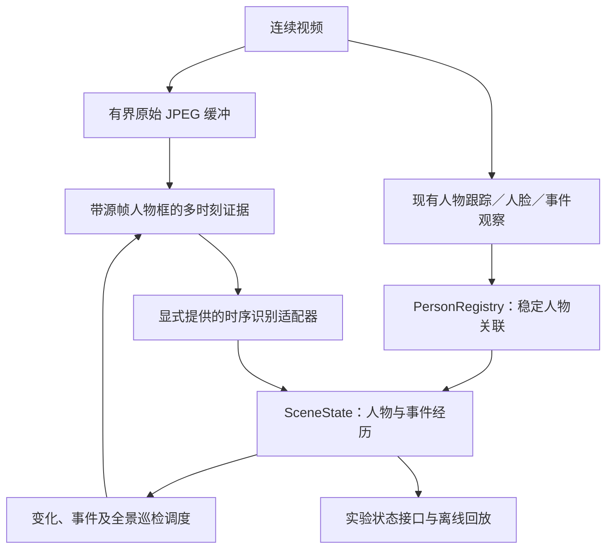

# 持续人物与时序事件引擎 · 首个可运行版本

日期：2026-09-12。分支：`codex/entity-event-engine`。

本版本把人物、源帧观察、事件经历和待检查的时间片段变成独立组件，
用于验证从逐帧判断迁移到持续现场状态的架构。当前接入方式是 **shadow（旁路观察）**：
人物和事件观察来自现有跟踪、人脸及事件模型，新增引擎维护自己的状态。
实验接口不会替换现有告警、客户 JSON 或视频显示，也不会自动增加付费模型请求。

SAM 3.1 权重、实时视频适配和真实时序 VLM 调用尚未接入。本版本验证软件机制，
不代表 SAM 效果、抽烟召回率、生产告警规则或客户 5090 性能已经验收。

## 数据流



`SAM → PersonRegistry` 是下一步替换感知输入的位置。SAM 原始 track ID 与人物实体 ID
不等同，真实身份也不等同于跟踪编号。现阶段复用已有 registry 的保守关联；
其三秒间隔限制、跨越遮挡后的重关联能力仍然限制人物连续性。

## 已实现

| 组件 | 职责 |
| --- | --- |
| `scene_state.py` | 会话内人物实体、历史位置、身份，按人物组维护事件经历 |
| `scene_evidence.py` | 源时间证据缓冲、新人物／位移／事件刷新／全景巡检调度 |
| `scene_runtime.py` | 现有观察到新状态的桥接、待检查片段、显式认领与结果回填 |
| `scene_inspection.py` | 多图时序提示构建、识别器协议、在实时锁外执行显式请求 |
| `tools/scene_replay.py` | 无模型、无网络的 JSONL 观察回放 |

### 人物与事件语义

- 人物由 canonical `subject_id` 定位，不根据事件物体框自行猜测人物归属。
- 当前人物位置、源帧历史位置和身份分别维护。已保留的历史源帧可以补充迟到身份，
  不回退人物位置。删除登记身份会清理保留值，并阻止迟到结果重新写入，直到明确重新登记。
- 事件以类型和规范化人物组作为键。例如两个人的打架是一个共同事件，
  不会自动拆成两个独立的单人事件。
- 默认两次不同源帧的阳性进入 confirmed；两次阴性进入 ended。首次阳性为 suspected。
  这是可配置的原型默认规则，不是实际安防告警标准。
- 同一个源帧不因多个模型、重复消息或重试而累计多次证据。
- 每次正负判断均要求参与者在对应源帧有真实位置观察。预测框、保持框、遮挡、
  缺失能力、接口失败都不是阴性，也不能结束事件。
- 全景阴性只作用于相同源帧实际观察到的已有事件参与者；带明确对象引用的阴性
  只作用于指定人物。陌生人事件需要真实观察到已确认的熟人身份才允许清除。
- 事件结束后再次出现阳性会产生新 episode ID。迟到的旧源帧不能重启已结束事件。
- 新会话有新的状态和检查请求标识；停止时释放 JPEG 和待处理请求，保留最后状态用于检查。

事件的 `phase` 与 `observation_state` 分开：例如已确认抽烟的人暂时被遮挡，
仍保留 confirmed，同时标记 uncertain。长时间没有证据的记录会按保留期限淘汰，
淘汰不产生“事件已结束”的观察。

### 时序检查

待检查任务包含 2–4 张按源时间排列的图像，附每张图当时实际观察到的人物框。
面向指定人物的任务只使用所有目标人物有对应源帧位置的画面；不把当前人物位置
复制到过去的图像。提示保留全景和多人关系，要求证据不足时返回 `detected=null`。

新人物、位移变化和疑似事件可以触发检查；持续事件降低重复检查频率。
全景巡检保留独立调度机会，以避免所有事件都依赖单一前置动作线索。
陌生人身份判断走人脸通道，不发送到此四类安全事件时序接口。

实时服务只准备这些任务。开发者可显式调用
`run_pending_inspections(scene_runtime, inspector)`，提供实现
`TemporalInspector.inspect(job)` 的模型适配器。它必须自行设置网络超时；
执行器每轮最多处理四个任务，不承担中断挂起模型调用的职责。
`build_temporal_messages(job)` 提供可用于多模态聊天接口的输入。

没有接入自动执行线程、供应商客户端或实际模型响应解析器。空回复表示没有可用判断，
不等于所有事件阴性。请求执行成功、状态接受证据和事件确认分别统计，不能互相替代。

### 资源边界

- 默认最多 128 个人物，每人最多 64 条位置观察；超过 3 秒未观察标记遮挡，
  超过 90 秒淘汰。
- 事件键最多 640 个，每个最多 64 条证据；转换历史和去重缓存同样有上限。
- 图像缓冲最多 48 张、16 MiB、8 秒；通常按最高 4 FPS 收集，另保留可用的分析源 JPEG。
- 最多 4 个待处理检查，所保留图像合计最多 16 MiB；因此两类编码图像引用预算合计最多
  32 MiB，不包含模型图像解码、Python 对象、现有视频缓存和 GPU 内存。
- 源结果等待关联的队列最多 128 条、90 秒。内部调度使用不含完整历史的轻量快照。
- 检查任务按源时间 20 秒过期；传输失败由调度器退避重试，且不会产生阴性证据。

## 运行离线示例

在已安装项目开发依赖的 Python 环境中，从仓库根目录运行：

```powershell
python tools/scene_replay.py tests/fixtures/scene_smoking.jsonl --output tmp/scene-replay.jsonl
```

输出路径必须尚不存在，防止覆盖旧实验。省略 `--output` 可以直接查看输出。

样例按顺序展示：Alice 出现 → 疑似抽烟 → 确认 → 遮挡 → 拒绝预测框和无可见证据的清除
→ 重新可见 → 两次真实阴性结束事件 → 拒绝迟到阳性与重复证据。Bob 的状态独立。
输入的事件判断是人工编排的测试观察，并非视频识别实测。

JSONL 第一行为 `session`，随后为 `person`、`event` 或 `tick`。
`person.bbox` 使用 `[x1,y1,x2,y2]`、0–1 源图坐标；所有时间均为同一视频源时间。
工具逐行处理，每行最多 1 MiB；错误指出行号，退出码非零，不回显整条输入。

## 在视频服务中旁路观察

启动服务前设置：

```powershell
$env:SCENE_ENGINE_ENABLED = 'true'
```

然后按原有方式启动此分支的服务和视频会话。也可在 YAML 的 `runtime` 中设置
`scene_enabled: true`；环境变量优先。Docker 部署须显式把此变量传入容器，
仅在宿主机设置变量不代表容器自动收到。

读取 `GET /v1/experimental/scene`，可获得：

- `enabled`、`mode=shadow`、运行状态、观察器错误数；
- `scene.entities`、`scene.events`、有界的 `scene.transitions`；
- `inspections` 中的 prepared／claimed 任务及源帧引用；
- 请求准备、完成、失败、接受和拒绝证据的计数。

接口是只读的，带 `Cache-Control: no-store`，不包含 JPEG、模型密钥或人脸向量，
也不加入既有客户 OpenAPI 合约。观察器异常只影响实验状态，原有视频和结果继续交付。

## 当前限制与后续制造顺序

1. **感知输入**：接入独立 SAM 3.1 worker，验证持续帧输入、窗口／内存回收、
   新目标发现和会话重置，并与已有检测跟踪输入比较。
2. **事件归属修订**：尚不支持撤销已接受证据并重新分配人物。
   未归属结果可以等待同消息修订；已接受的人物组发生变化会拒绝转移并计数。
   这是旁路阶段的明确限制，正式接管告警前需支持带修订号的归属与源时间重放。
3. **真实时序判断**：接入显式模型适配器、响应校验和独立有界执行线程，
   使用固定录制视频比较逐帧与时序策略的事件召回、误报、结束延迟、归属准确度和请求量。
   当前的源帧抽样及完整上下文规则不足以证明小烟具可识别，需单独验证裁剪策略。
4. **完整现场关系**：扩展物体实体、持有／接触等关系以及多人交互。
   当前支持多人事件参与者组，尚未维护通用物体与关系图，也未接入姿态／动作模型。
5. **生产接管**：通过录像与目标设备并发性能验收后，再让新事件生命周期驱动告警、
   显示和证据归档，逐步退役重复的逐帧调度与展示状态。

本次实现的单元及服务测试验证时间、归属、资源边界和接口行为。它们不提供真实检测准确率。

## 验证环境

2026-09-12 验证结果：新增 135 项测试通过；完整回归 **2158 passed，4 skipped**。
改动相关 Python 文件的 Ruff 检查及 `git diff --check` 通过。
17 步离线示例执行完毕，抽烟事件最终为 ended，第二人的状态保持独立。

回归测试应隔离部署用 `.env`，避免实际供应商设置覆盖测试默认值。
使用项目的 `dev` 与 `vlm` 依赖（后者包含 HTTP/2 支持）后运行：

```powershell
$env:PYTHON_DOTENV_DISABLED = '1'
python -m pytest tests
```

此设置只用于测试进程，不应当作为生产服务的默认环境变量。
