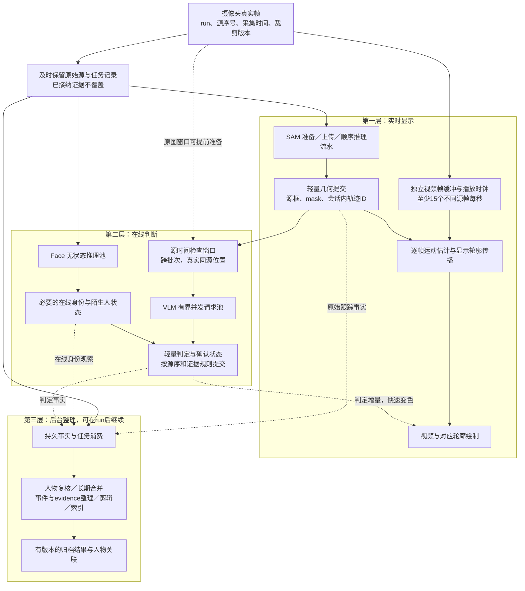

# 三层架构与并行优化执行计划

版本：v9，2026-09-18。本文件维护当前架构、约束与执行顺序；每次实验和部署证据保留在对应记录，不再用互相覆盖的历史“当前状态”指导新修改。用户优先级：完整大致描边与流畅原图显示，保留短时补帧；显示和事件延迟随后优化。当前显示目标18 FPS、缓冲6秒，尚未达到两秒。历史在线短测三个分析分支各超过1成功FPS；本轮离线回归不能代替新的在线容量验收。

## 当前状态与修改约束

连续SAM、浏览器原图播放、短时补帧、视频内事件文字、Face顺序身份提交及run后整理均已接入。描边连续性修复和原配置见[实时链路记录](contour-live-repair-20260917.md)，最新SAM断流与姓名问题见[9月18日修复记录](vlm-identity-repair-20260918.md)。旧的实验关闭、失败和未部署描述只作历史证据，见[首版实施记录](parallel-latency-implementation-20260917.md)。

修改先定位到一层的明确职责，并检查它对另外两层的输入、排队和失败传播。新增状态、缓存、重试或线程必须说明现有责任方为何不能完成；优先删除重复工作，不能靠增加例外分支解决同一职责。一次变更只选择一个明确结构边界，保留可对照的输入、配置和部署版本。

| 责任 | 唯一事实来源或责任方 | 约束 |
| --- | --- | --- |
| 源帧及身份 | 采集时的run、源序号、源时间；接纳后的持久记录 | 分支保留自己的完成进度，不另造时钟或忙时替换帧 |
| SAM状态推进与传输重放 | 同会话单路客户端；服务端相同请求响应缓存 | 有界重试只放在知道幂等契约的这一层；UI、队列和控制器不叠加同请求重试 |
| 显示几何 | SAM真实锚点＋浏览器运动Worker | Worker只负责几何及现有源时事件投影；显示补帧不得成为分析证据 |
| 姓名显示 | 已确认身份事实→主线程按目标源时绘制 | 姓名未到时显示ID，不能等待最终归档或让姓名更新重算几何；删除人物即时撤销 |
| 在线判定 | VLM窗口与Face事实的顺序提交 | 与原源帧和SAM人物关联；缺失或失败不能当阴性 |
| 历史整理 | 每run后台任务 | 事实可靠接纳后才能放行，重计算与最终归并不能阻塞画面 |

暂不增加新模型路线、新上传协议、自动重启会话或通用恢复框架。现有一次同请求重放只覆盖有限传输中断，不能冒充跨进程自动恢复。

保留的边界：VLM按有界全局FIFO提交；停止后先排空SAM／VLM／Face在线任务再开放下一run，只有L3整理可跨run；整套在线状态和人物整理在进程重启后自动续跑尚未贯通。L2容量阻塞仍可沿提交队列反压SAM；“首批轮廓早发布”不等于L1/L2持续完全独立。

### 整体审查后的整理顺序

1. 本轮先做姓名职责减法：删除Worker中最终又被主线程覆盖的姓名处理，身份事实无变化时不推进姓名版本。保留现有元数据传输协议，不另建姓名服务或队列。
2. 下一次修改显示调度时，先把同一源帧分散的`overlays/requested/pendingPresent/requestedRevision`归为一份查询任务生命周期，统一成功、失败、更新、播放和停止时的清理；不要再添一张平行状态表。几何内部`propagated/geometryCache/strictSuccesses`可随后按每源每人物结果归并。原图缓冲和灰度运动历史职责不同，不能粗暴合并。
3. 下一轮生命周期整理先处理终止失败的等待依赖，再做吞吐优化：当前停止时先等SAM提交，之后才检查VLM worker失败；若L2已终止且其满队列不再释放容量，SAM提交可能一直等。应由同一个收尾协调点识别依赖分支失败、保留已接纳工作并明确结束失败，不能各处再叠独立超时或清队列装作完成。这是源码审查发现的条件性风险，不是本次断流首因的证据。
4. 再测L2拥塞是否持续阻塞SAM提交，以及L3持久接纳与整理是否仍占用在线锁；依据数据划清事实接纳和消费者进度，不能先调大队列掩盖积压。后台归档目前存在持有全局身份控制锁等待磁盘接纳/完成的区域，会拖住登记或删除；整理时把等待移出短临界区并校验版本，避免删除后旧身份复活。SAM真框是当前VLM协议的必要输入，不为追求表面并行临时绕过人物关联。

上述结构整理不与本轮故障修复混成一次全面重写。每次验收须同时查看原图不同源FPS、完整轮廓连续性、姓名/事件源时正确性、已接纳分析帧完整性和分支故障，而非只验证新标签是否出现。

## 决策与目标

架构按三层职责组织，视频、SAM、VLM 和 Face 是这些层内的并行执行单元。**先把后台整理移出实时依赖，再对剩下的实时工作做流水与并发。** 不让显示、识别和归档共同等待一套完整人物／事件状态提交。

| 层 | 职责 | 时间目标 | 不等待什么 |
| --- | --- | --- | --- |
| L1 实时显示 | 连续真实视频、人物轮廓、已有判定的颜色 | 当前先完整描边、稳定≥15个不同源帧／秒；允许增加播放缓冲，随后争取曝光到显示P95≤2秒 | VLM 新判定、最终身份、历史人物合并、证据片段和归档完成 |
| L2 在线判断 | VLM 事件判断、必要的在线人脸／陌生人判断、轻量告警状态 | 在L1完整跟随之后优化；长期希望约2秒内识别，分别验收首次有效判定和确认延迟 | 人物最终归纳、事件历史重整、证据编码和最终数据库投影 |
| L3 后台整理 | 人物长期归纳、身份复核与合并、事件整理、evidence 整合、片段编码、索引与归档 | 允许延后，run 结束后继续；优先保证完整、可恢复和不拖慢前两层 | 不作为 L1/L2 完成的前置条件 |

SAM、VLM、InsightFace 各实际成功完成至少 1 FPS 的阶段底线继续保留，三个分支均继续向各 3 FPS 优化。L1 颜色实时指**有效判断产生后快速、准确地作用到对应人物**，不是提前猜测事件；目标是下一可呈现帧更新，单列判断到颜色显示的延迟。无新判定时保持有效状态，视频继续流畅播放。

L2 的两秒是新增的独立优化目标，不能只从 API 发起时计时，也不能用“疑似”替代原规则要求的“确认”。运行中必须保留原始证据与轻量事实记录，只有整理、合并、编码等重工作可以推后。

### 安全事件结束规则（2026-09-18更新）

用户最终确认：同一事件连续收到10个不同源的VLM clear，**或全部关联人物连续在10个成功SAM源帧中消失**，满足任一条件即结束当前事件持续。任一关联人物重新出现就重置整组的消失计数；无关人物出现不重置。两个计数独立，不能把5次clear和5帧消失相加。陌生人原有Face判断流程保持原规则。

消失计数基于完成校验、成功提交的实际SAM源帧，包含有效空人物结果，不按源序号差、请求批数、屏幕刷新或经过秒数计数。预测/补帧不是在场证据；失败、未完成、重复、旧run或被拒绝的请求也不能增加消失计数。以当前约1.25分析FPS计，10帧约对应8秒观察过程，无需为无人画面额外调用VLM。

归属保持在现有三层边界内：Runtime提交真实存在事实，SceneState将存在事实与VLM判断按同一源序重放并产生一次结束状态，现有metadata和归档消费该状态。结束时刻取第10个消失源帧，保留最后阳性与历史证据，不伪造VLM阴性；迟到的旧阳性不能复活已结束事件，再出现后的新阳性须建立新事件并重新确认。存在历史沿用现有人物历史保留目标和已接纳检查的source pins，裁剪前折入现有事件ledger的seed，避免新增第二套事件生命周期或恢复队列。

本轮只修改`scene_state.py`与`scene_runtime.py`，最终隔离部署包278项回归通过，包含空SAM结果不发VLM仍可结束、多人交替出现、晚到首个阳性、历史裁剪与已接纳检查、人物归并、颜色区间和真实归档状态。静态检查通过。正常启动镜像已更新为`sha256:a9c9d6ad35829f73a1c2f40a75e838f1a131b70b05c05265e102ef067b621282`；显示JS、dense运动模块、原图、采样及补帧配置未变。未启动GPU，本次是规则与集成回归，不是新增在线识别实测。

不覆盖待分析帧、不在忙时偷偷降采样、不将上下文图片张数或同帧重画算成完成率。长期仍以各分支3 FPS设计容量。当前按用户允许的临时至少1成功FPS目标，Face固定1.25 FPS，SAM按每次实测预先指定采样频率并记录，寻找足够密集锚点与持续处理容量的平衡；Face原2.5 FPS输入实测持续积压。每个已接纳帧继续完整处理，采样率不是完成率，最终门槛不因此放宽。



图中 L2 仍保留当前协议要求的真实源框依赖，但不再等待 L3 的最终身份。完全并行的“原图直接给 VLM，再与 SAM 关联”需要新协议和质量验证，见第3节，不能把虚线的原图预准备误当成已经解除 grounding 约束。

### 实时身份与后台人物整理的边界

L1/L2 保留最小的会话内轨迹标识，例如 `(run_id, predictor_epoch, native_track_id)` 及必要的显示标签、源框、跟踪确认状态。不能因为还没确定一个人最终归并到哪个人物档案，就阻塞轮廓或事件判断。这个临时但稳定的轨迹标识不是对最终身份的断言。

陌生人告警需要的检测、熟人库匹配和必要的短期身份状态仍属于 L2，保留版本与置信约束；长时间跨度的同人归并、重关联历史事件、人物档案归纳移到 L3。VLM 的非身份事件不等待人脸分支完成。

L3 后续产生有版本的关联／纠正记录，保留旧轨迹来源和证据，不直接拿全局锁重写实时历史。若需要反馈当前 run，L1/L2 在短提交点校验 run、版本和有效源时间后应用轻量增量；旧 run 的整理结果不能改变新 run 的人物颜色。更正可以更新归档和 UI，但不能改变“首次识别用了多久”的原始计时。

并行主要提高持续处理能力，降低排队；**不会把同一帧必须依次经过的阶段从“相加”变成“取最大值”**。本设计的吞吐预测与单帧延迟预算分开验收。

## 1. 显示独立运行，取消每批只换一张图

9月16日基线中145个SAM完成源帧只换来47个显示画面，另有113次旧图重画。显示速率约0.55 FPS；完整JPEG合成中位103毫秒，高于15 FPS的每帧66.7毫秒预算。主机源输入也只有约9 FPS。首版已新增本地浏览器独立显示实验，但尚无改动后的真实测量。

### 推荐实现

- **先做好本地摄像头路线。** 浏览器保留真实视频帧，建立独立播放时钟和短帧缓冲；分析样本按明确计划发送，不再为了显示将全部帧上传、描边编码后再回传。抽样以新解码／采集帧为依据，不能把重复读取同一视频帧伪装成新源帧。
- SAM 返回的内容是带源序号的真实轮廓锚点、人物映射及版本；事件状态单独更新。浏览器在视频层之上绘制轮廓，不再为颜色变化重编码整张 JPEG。
- 每个帧和结果携带 `stream_session_id/generation/source_sequence/capture_timestamp/crop_version`。源序号在采集时赋予，重连或裁剪变化开启新代；不靠响应到达顺序、机器时钟巧合或“最新一张”对齐。
- 远程流使用同一显示模型：主机一次解码，画面传输和分析分别消费；先验证原始画面＋轮廓 metadata 是否足够，必要时采用连续编码视频传输。原 `/annotated/latest.jpg` 可保留为兼容导出，不能拿它的轮询次数验收主显示帧率。

### 轮廓补帧必须是真实帧之间的运动传播

可以借用 `DelayedOverlayComposer` 的源序播放、时钟和会话隔离。旧 bbox 插值会移除 `mask_contours`，部分旧人脸路径会切回分析帧，这些不能直接沿用。

建议新增只属于显示层的轮廓状态：由 SAM 原始 mask 出发，根据相邻真实帧的图像运动逐帧传播到目标源帧；结果晚到时，从其历史源帧沿缓存运动场追到要显示的位置。后续真实 SAM 锚点校正漂移。若有前后两个真实锚点，可检查传播一致性；不能对顶点数不同的两条轮廓直接逐点插值。

同时检查遮挡、出入画、人物对应、画面切换和轮廓置信度。会话内轨迹ID由轻量几何提交提供，不等待最终人物档案；显示估计不能写回SceneState、Face证据或VLM输入。颜色增量校验对应源时间和人物，不能给缓冲中尚未发生事件的画面提前变色。用户后续明确允许少数缺失帧灵活补帧、不追求完美贴合，因此在前后真实锚点仍确认同一人物、源链连续时，可使用有界的短时近似轮廓（当前验证上限0.35秒），并单列补帧与严格轮廓计数。补帧不能续期自身、跨越离场/切换或锚点过期；裸视频和重复旧画面不算达标。

初始0.5–1.5秒短播放等待已不足以覆盖实测返回时间。按最新优先级，当前先验证6秒有界原图缓冲；启动等待、稳定播放延迟和不同源帧率分别计量，不能称已达到两秒。已有前后真实锚点时使用与源帧对应的运动传播，完整性通过后再逐步缩短缓冲。

**边界：**若只在 1 FPS 取真实分割，新人物可能等待近一秒才被采样，再加 SAM 返回时间，无法天然保证“第一可见帧准确描边且小于两秒”。所以 SAM 仍优先争取 3 FPS，并单独测首次锚点和新入画尾延迟；运动传播不能发现从未被分割的人物。完整描边的质量验收是这条路线的必要条件。

## 2. SAM 做跨批流水并行，同一会话不乱序推理

### 第一步：保持远端协议，准备／请求／提交三段重叠

```text
同时进行：
  准备批次 n+1：原图校验、解码缩放、编码、不可变请求体
  处理批次 n  ：当前单 append 请求及远端 SAM
  轻量提交批次 n-1：源验证、会话内轨迹、发布真实锚点
  后台独立运行：人物复核、历史重关联、事件证据整理
```

实现一个提前准备通道、一个顺序请求通道、一个轻量顺序提交通道。编码完成后得到不可变 `PreparedBatch`，携带代次、批次序号、源清单、编码参数及 payload hash；准备线程不修改 SAM accepted/emitted 水位。收到并验证的结果先保留，再发布会话内轨迹与真实锚点，并写入 L3 可消费的跟踪事实，使下一请求不必等待完整场景整理。

轻量几何提交失败时保留原结果，阻止后续几何状态越过它并支持恢复；不能绕过源序／轨迹隔离检查。但 L3 人物合并或证据编码失败不能阻塞已正确提交的几何。重置、停止和 EOF 按层分别确认水位，不能把后台全部整理完成设成实时资源释放的条件。

保持首帧即发，只合并已到达的积压，最多四帧；**不要为了并行吞吐等满四帧**。在 1 FPS 下等满四帧会额外等待近三秒，在 3 FPS 下也会让最老帧等近一秒。提前准备优先复用每帧的解码／缩放，批次形成策略需另测，避免提前冻结小批次后放大请求开销。

### 第二步：远端接收和 SAM 执行解耦

现有客户端会话锁、单连接、coordinator 串行流程，以及 worker 在接收 body 前取得模型 admission，都会限制重叠。直接把 append 并发调大可能得到 429 或客户端冲突。

增加独立的上传接纳协议：

1. 接收／验证批次 n+1，与执行批次 n、回传批次 n-1 同时进行。上传具有独立的批数、字节和像素限额；等待处理的原始样本主要留在主机，远端只保留短的可执行前缀。
2. 每个会话只有一个 SAM runner，按批次序号执行。分析源序号可以因计划采样有间隔，不能要求源序号连续加一。
3. 分开记录上传接收、SAM 接纳、输出、主机提交四个进度。上传 ACK 不代表分析成功。
4. 请求 ID＋payload hash 支持断线重试和冲突检测。现有只缓存最后一次响应的重放机制要升级为有界结果记录；主机提交确认后才能释放对应结果和源证据。
5. 结果流可以逐帧发布，但仅对已经稳定且完成源对齐的输出生效。不能把生成器 `yield` 误当作客户端已经收到；流式返回需定义失败、部分成功和恢复协议。

### 能得到多少收益

下面使用本次 47 个数据请求的累计量与均值，145 帧、平均每批 3.085 帧，不相加不同指标的中位数。

| 方案 | 容量估计 | 解释 |
| --- | ---: | --- |
| 当前运行 | **1.70 FPS 实测** | 采集期完成率；串行活跃段约 1.74 |
| 准备、提交与当前请求重叠 | **约 2.44 FPS** | 理想隐藏准备 15.796 秒及提交 8.256 秒；值得先做，但不足以承诺 3 FPS |
| 接收／处理／提交完整流水 | **约 3.73 FPS 的敏感性估计** | 假设各段成本不变且充分重叠，未分解外围开销归入一个阶段；需协议改造后实测 |

第一步按 `145 / (83.4868 − 15.7959 − 8.2558)` 估算。第二步按平均准备 0.3361 秒、worker 处理 0.4370 秒、提交 0.1757 秒、其余路径 0.8276 秒构造独立阶段，理想周期由最慢的 0.8276 秒决定。HTTP 外围尚未分清，不能把这个敏感性模型写成性能承诺。

加速后批次大小、CPU 竞争和传输行为都可能改变。这些预测说明并行方向有价值，不证明画面延迟已经小于两秒。即使只把 native 19.583 秒完全消掉，原串行流程也仅约 2.27 FPS，因此当前更应优先减少串行等待。

三层拆分还会减少旧提交阶段里的历史整理成本，但当前 8.256 秒提交计时没有拆出其中可延后的比例，不能把它全部算作新增可节省时间，也不能与上表已经隐藏的提交时间重复计算收益。

## 3. VLM 受控并发，同时改变观察窗口的供给方式

### 两秒识别改变了这层的验收与关键路径

旧方案允许事件明显晚于画面。新要求是事件识别也尽量在两秒内，因此需要同时降低单次调用和请求之前的等待。实测 API 耗时均值 **2.011 秒**、中位 **1.947 秒**、P95 **3.065 秒**，单次服务全程均值 **2.353 秒**；仅增加并发不能把这些时长压到两秒以内。

固定记录以下时点，保留源事件起点，不能等准备完才开始计时：

- `event_onset`：验证视频标注的事件可见起点；有歧义时记录标注规则。
- `evidence_ready`：首次具备该事件规则所需的真实时序证据。
- `first_valid_verdict`：首次有效模型判断完成。
- `confirmed_alarm`：满足现有独立证据／置信条件的告警确认。
- `color_presented`：浏览器实际呈现对应颜色的时刻。

分别报告起点→首次判断、起点→确认、证据就绪→判断、判断→变色。两秒目标优先看源头→有效识别／告警，另外解释因规则本身需要观察的时间；不能只报模型 API 时间。当前默认需要两次观察确认，不能为达标改成一次，也不能让重叠的同一份证据重复投票。

第一步去掉人为屏障：原图编码／窗口准备提前进行，同一源帧的真实 observed 框可用后尽快触发检查，不等最终人物归并、完整快照或归档。当前整批响应协议仍限制单帧结果何时可用；逐帧稳定输出需要与 SAM 结果协议改造配套，不能仅靠主机线程实现。

若单次 API 和这条源证据路径缩短后仍不够，再验证 **SAM 与 VLM 对同一批原始真帧同时推理**：VLM 输出带源序号与参与者区域的候选，再与同帧 SAM 观察关联，使候选与几何等待从串行相加变为 `max(SAM, VLM) + 关联`。准确关联前不得猜测人物或给错误轮廓变色。

这不是现有接口的直接用法：当前 `TemporalVerdict` 只允许给定 SAM subject ID，提示词禁止生成新框。必须定义新候选结构、同源空间关联和歧义处理，并用短事件、多人交叠、新入画验证准确性；通过后才替代实时依赖。即使并行成功，当前 API P95>3秒仍需单次请求提速，不能承诺自然达到两秒。

API 优化按相同视频对照请求准备、上传、供应端排队／推理和响应，探索保持识别质量的提示／输出冗余减少及请求实现优化；任何上下文、分辨率或模型变化都需独立质量验收，不借此丢关键证据。

### 不能只加线程

基线版本的批次入口一批SAM最多形成一次VLM检查，还要求至少两个真实观察源与足够时间跨度。47批／85.1秒，理论上也只供给约0.55次／秒，当次实际形成33个请求。因此必须把“检查窗口”与“网络append批次”分开；首版已按下述源时间窗口实现，效果待实测。

采用按源时间选择不同检查终点的调度器，跨 SAM 批次组装保留的 2–4 张真实时序图；第一阶段以约 **1.2–1.25 个不同终点／秒**作为容量验证档。保持时序跨度和关键事件覆盖，不为了增加请求数把上下文缩成无效窗口。上下文可以重叠，但重复图片不能被当成额外独立证据；一次窗口仍只算一个成功观察，事件确认规则需按新增源证据去重。

这要求真实 SAM 源观察供给足够。若 SAM 真降到恰好 1 FPS，又有请求失败，不能无条件保证 VLM 每秒产生一次新的成功观察。没有足够真实源时应记录窗口未准备好，不能复制端点补数量。

### 四并发作为候选，先做 2／3／4 对照

实测 33 次 VLM 平均服务时间 2.353 秒，31 次成功，成功率约 93.94%。在供给充分、并发不让单请求变慢、失败率保持不变的假设下：

| 并发数 | 理想成功处理能力 | 对阶段目标的意义 |
| ---: | ---: | --- |
| 2 | 0.80 次／秒 | 不足以支撑 1 次成功／秒 |
| 3 | 1.20 次／秒 | 理论可行；在 1.25 请求／秒供给下利用率约 98%，几乎没有波动余量 |
| 4 | 1.60 次／秒 | 推荐验证档；1.25 请求／秒时利用率约 74% |

1.25 次请求／秒乘本次成功率，约为 1.17 次成功／秒。这也是估计，不是逐秒保证；失败要按原端点重试并去重，不能以重试次数增加 FPS。未来目标 3 次成功／秒按同样假设需要至少八个并发槽的数学容量，不能未经验证直接配置八并发；届时需要一起评估 API 延迟、限流与窗口供给。

### 并行请求，有序应用

**首版状态：**以下描述目标机制。已实现不可变job、跨批源窗口、独立客户端池及有界全局FIFO；尚未按相关人物拆排序队列，也没有失败端点自动重试或迟到证据纠正。当前生产接线默认4在途、最多8个待处理inspection、16 MiB图片预算；容量不足保留源和批次背压，不能覆盖未处理任务。

- 在调度时冻结原图、人物位置、事件标准版本和请求序号；网络执行器只读取这些不可变数据，独立调用模型。
- 模型结果允许乱序返回，先进入按检查序号排列的结果缓冲，由 L2 唯一轻量提交器更新在线事件。人物最终归并留给 L3；本次请求使用被冻结的会话轨迹引用，不能半途改变输入。缓冲等待计入两秒，不能为了全局完全排序把无关人物的事件长期挡在慢请求后；按同一事件／相关人物维护必要的因果顺序。
- 所有已接纳任务都保留成功／失败／超时终态。失败不是阴性证据；超时不能无限阻塞后续提交，先记不确定缺口并保留重试任务。迟到成功走受约束的证据补充／纠正流程，不能把新状态回滚到旧结果。
- 原 runtime 有四个job及16 MiB图片上限等约束；首版已配套源pin、待处理预算与生命周期。后续增加请求池仍须一起核对按字节计算的预算和源保留，不能只增加`max_in_flight`。
- L2 只发布带版本的在线判定增量及必要证据引用，L1 立即消费，L3 异步整理。完整场景快照、历史重关联和归档不能在 API 回调持全局锁执行。

## 4. Face 并行的是无状态推理，身份处理保持顺序

基线存在“实际已经是stranger-only，却保留六个通用请求槽”的路由。不能只把六改成一后继续忙时丢弃：当次实际提交＋丢弃共164个窗口，供给约1.93次／秒，完成能力约1.31次／秒，排队仍会增长。首版已接入持久有序Face池，下面的容量与质量验证仍待完成。

推荐拆为：

```text
有序样本记录 → 解码／准备 → 独立模型实例 A、B → L2 最小在线身份／陌生人状态
                                                    └→ L3 长期身份复核、人物合并与历史重关联
```

FaceRecognitionSession 的锁覆盖身份 tracker 和 registry 更新，不能直接删除。抽离检测、对齐、embedding 计算等只读推理；每个执行单元持有独立模型实例，避免假设同一个实例的内部状态可以安全并发。熟人库读取绑定版本；结果按源时间进入轻量在线身份提交器，只更新当前判断所需状态，其余事实送 L3。库更新、清空和会话切换必须定义版本边界。

先对照 **1／2 个实例 × 受限模型线程数**，记录纯推理、锁等待、身份提交及显示延迟。16 个可见 CPU 不意味着可以开 16 个模型；给采集、编码和轮廓传播保留资源，避免多个模型各自占满 CPU。只有双实例测不够时，才比较增加实例或更合适的推理设备，不能先假设线性加速。

双实例理想能力约 2.62 次／秒，可覆盖本次受限入口的 1.93 次／秒。但入口恢复后，当前计划是 **2.5 次／秒**，此时利用率约 95%，缺少余量。若按利用率不超过 80%设计，应实测净能力至少 **3.125 次／秒**。因此双实例是实验起点，不是最终达标承诺；提高吞吐前不靠覆盖关键帧隐藏差额。

## 5. L3 后台整理：持久任务、独立 run、允许晚完成

### 真正移出实时路径的工作

将全场身份复核、跨轨迹人物归并、历史身份重关联、完整场景历史构造、事件合并、evidence合并／剪辑／转码和数据库投影放入独立后台任务。基线的IdentityReviewWorker虽有线程，调用仍可能持`_state_lock`并进入registry／scene的全量合并；仅增加线程不等于完成分层。首版已把全量身份复核延到run后独立池、在线改用compact事实，仍需以L3积压故障试验检查剩余共享锁和存储成本。

运行中 L3 低优先级消费事实，L1/L2 忙时减少或暂停重计算；run 结束后继续整理。L3 的队列、模型／编码工作单元和磁盘吞吐设独立预算，不能占满实时 CPU、共享模型 admission 或日志写入器。即使 L3 堆积、编码失败或数据库重建缓慢，L1 的帧流和 L2 的新判断仍应继续，后台状态单独显示。

### 证据先留住，整理可以晚做

“第三层慢慢弄”不等于run结束后才收集材料。原EventArchive仅有默认90秒／64 MiB内存源缓存和内存接纳队列，只有已写staging manifest的片段任务具备后续恢复基础。首版已补Archive持久FIFO／源JPEG和SAM、Face私有记录，避免将后台整理直接建立在短显示缓存上；但Face在采集队列接纳后、进入私有库前仍有内存边界，整套run自动恢复尚未贯通。具体配额、失败状态和恢复范围见实施记录。

共享采集基础应使用独立的顺序记录与源存储，最低保留：

`run_id、源序号／采集时间、原始帧或片段引用及hash、SAM原生轨迹与几何、Face观察及必要私有样本引用、VLM请求和结果事实、事件增量、各层接纳／完成水位`

原始事实不可变，待决任务和事件引用的源数据不能因显示缓冲过期而删除。根据分析水位和事件前后片段范围固定保留引用，后台完成后才按保留策略释放。未压缩的大量帧复制、逐帧大事务及片段转码不放在实时线程；顺序持久写入可以独立异步执行并小批量确认，可靠接纳只在相应记录确实保留后成立。这个必要的写入通道独立于 L3 重整理队列，不被旧 run 的慢任务堵住。

L3 基于这些事实构建可重做的整理结果，使用 `run_id + job_id + 输入版本` 去重、记录重试与提交确认。复核样本放在原有私有数据路径，不写入公开性能日志。后台故障不能冒充整理完成，也不能使源证据提前失去引用。

### run 结束与后台结束是两件事

为每次 run 建立独立的上下文，持有源记录、实时轨迹状态、在线事件状态、待完成请求和后台任务引用。L3 不能依赖会被下次启动替换的 `self._session`、`self._scene` 或全局 pending 字段。

目标生命周期分开记录；首版差异见下：

1. **采集结束**：停止新帧接纳，保存结束边界与所有已接纳任务；停止摄像头不等于分析结果全部完成。
2. **实时资源交接**：SAM按序处理已接纳尾帧并释放当前原生会话；必要进度可靠保存。完整目标允许旧VLM／Face尾请求持自身run上下文继续完成。**首版先排空SAM、VLM、Face在线任务再交接，旧VLM与新run尚不重叠。**
3. **后台整理中**：人物归纳、证据编码与合并、最终投影继续执行；下一 run 不等待这些工作。
4. **整理完成／待恢复**：所有所需结果及任务提交确认后才能标为 finalized；失败时保留来源、进度和可重试状态。

界面分别显示“采集已结束”“分析收尾中”“后台整理中／完成”，不要把仍在整理表示成还在采集。服务重启后按run恢复待处理任务是完整目标，目前Archive事实恢复与进程内run隔离已具备基础，整个L3人物整理和在线模型状态自动续跑仍待完成。新run不得被旧run的别名、告警或最后一帧覆盖。

当前 SAM 同时只拥有一个原生会话，切换仍须完成必要的短交接；不能为了立即开新 run reset 并丢掉旧已接纳帧。分层消除的是等待人物归纳、MP4和归档的长屏障，不是绕过原生会话安全边界。

## 6. 共享资源与可靠接纳

### 减少复制和大锁内工作

主机接纳同一 JPEG 后，尽量复用只读解码帧及明确规格的派生图像。先验证颜色通道、裁剪、方向和像素一致性；保存的原始证据不被传输压缩副本替换。H.264、Face 和显示分别消费只读数据，不能并发修改同一图像缓冲。

`_state_lock` 只做代次检查、取得不可变引用、更新小量状态和发布指针；图片编码、模型调用、完整历史复制和大范围整理移出锁。改成短锁也必须保留 reset 与发布的原子性：提交前再次校验代次，不能让旧会话画面重新出现。

CPU 工作先限制执行单元数量，再测是否增加。网络等待适合请求并发；受状态依赖约束的 SAM runner 不通过同会话多模型来提速；Face、轮廓传播和编码需按实际 CPU/GPU 预算隔离。资源优先级为 L1＞L2＞L3，源材料可靠接纳使用单独的小型保障通道；优先级必须落实到队列和锁边界，不能只给线程换个名字。

### 不丢帧的队列不是无限缓冲

分析任务使用小型有界 RAM 活跃队列＋有配额的本地持久记录。只有源证据和任务被可靠保存后才标记接纳；每个分支分别确认完成，相关事件还需要的原图继续保留。未完成任务不能被新任务覆盖。显示短缓冲与分析任务保留分开，不能复用显示过期策略清理分析证据。

持续输入率 λ 大于净服务率 μ 时，积压必然增长；任何有限队列都无法同时保证永不丢失、永不停止且永久低延迟。持久记录用于吸收短时波动和恢复，不用于掩盖性能不足。配额接近上限时明确报告容量不足并对源端背压；不能偷偷丢帧后仍显示“实时正常”。方案成立的前提是稳定净处理能力高于计划输入，并留出波动余量。

## L1 两秒目标怎样落到时间预算

已有人的画面可以利用历史真实锚点和运动传播继续播放；新入画的人必须等待第一次真实分割，不能靠并行线程凭空提前知道轮廓。

对新目标，至少要支付：**等待下一次 SAM 采样＋该样本到真实锚点返回＋对齐绘制**。因此建议把“样本接纳到可用锚点不超过约 1.0–1.2 秒”设为下一阶段的工程目标，并保持 SAM 争取 3 FPS：采样间隔约 0.333 秒，配合对齐绘制约 0.1 秒预算，才有机会把首次轮廓控制在约 1.4–1.6 秒这一数量级，为输入和显示前段留余量。

这些是预算，**不是新实测，也不是把各项 P95 相加得出的端到端保证**。若 SAM 只有 1 FPS，最坏采样等待接近一秒，同样预算就可能超过两秒；此时必须报告新入画的实际覆盖和延迟，不能用已有人物的平滑视频代替验收。

在旧的“等前后两次分析再插值”模式中，目标帧还需要等下一个分析锚点，1 FPS 时可能多等近一秒。推荐的逐帧因果运动传播正是为了省去这段固定的未来等待；它也带来漂移和遮挡风险，因此要与短缓冲及真实 SAM 校正共同验证。

L2 另有独立预算：事件观察／采样等待＋真实位置依赖＋请求准备与排队＋API＋在线确认与通知。应先消除 L3 和整批屏障，再测各项；若仍约两秒的 API 时长不变，就没有足够空间容纳其他必要步骤。L1 顺畅不能被当作 L2 已达两秒，L3 提前完成也不能美化前两层的时间指标。

## 实施顺序与退出条件

| 步骤 | 变更范围 | 本步验证 |
| --- | --- | --- |
| A：层边界与留证基础 | 最小在线轨迹／事件状态、原始事实与源引用持久化、每个 run 独立上下文、分层水位 | 材料不因后处理延迟丢失，下一 run 不等旧归档，跨 run 不串数据 |
| B：先移走 L3 重工作 | 全局锁外身份复核、历史快照、证据合并与编码；轻量增量通知 | L3 阻塞／故障时 L1/L2 不被共同锁住；当前提交成本重新测量 |
| C：两条实时开发线并行 | L1 视频＋轮廓层；SAM 准备／请求／轻量提交流水 | 显示不同源帧率上升，SAM 排队下降；不承诺仅此到 3 FPS |
| D：L2 吞吐与延迟 | VLM 时间窗口＋2/3/4 并发、单次 API 提速；Face 无状态实例池 | 各分支≥1 FPS，首次判断／确认分开测，保留源覆盖和原事件规则 |
| E：进一步解除依赖 | SAM 接收与顺序执行解耦；必要时验证 VLM 候选与 SAM 并行关联新协议 | 幂等无漏帧，稳定输入不积压；候选关联准确且不乱序变色 |
| F：三层整机验收 | 实时运行＋故意积压 L3＋停止／新 run／恢复 | L1≥15 FPS并争取≤2秒；L2争取源事件→识别≤2秒；L3最终完整可恢复 |

每一步先用相同录制输入、同样采样和图像质量与串行完整处理基线对照，再做实时到达回放，最后摄像头联测。数据集要包含短暂事件、新人物、遮挡和快速姿态变化；画面流畅不能替代完整轮廓与识别质量验收。

验收记录包括：L1 浏览器实际呈现的新源序号、轮廓覆盖／对齐误差、源到显示 P50/P95/峰值、最长冻结、在线判定到对应颜色出现的时间；L2 首次判断和确认的源头延迟、各分支去重成功完成率、输入覆盖、失败和重试、最老任务年龄及积压斜率；L3 事实／人物／事件／证据引用完整性、任务年龄、恢复成功与最终完成状态。使用固定滚动窗口同时报告最长无完成间隔；不能只报整场平均，停采后的补算另列。若要求任意一秒都必须有新分析结果，还需要单列这一更严格条件，不能用平均≥1 FPS替代。

两秒目标还需要留出真实锚点的采样等待和返回时间。已有人员的轮廓传播、新入画首个轮廓、冷启动分别报告，所有失败与覆盖不足都保留在验收结果中。

## 后续执行清单

以下状态只描述本计划的实施进度。完成一项须附代码变更和相应验证结果，不能因写好了设计或单元测试通过就宣称性能达标。

- [x] 保存22:30实测基线，完成逐请求和分支审计。
- [x] 固化用户认可的并行方向，更新三层职责、两种两秒目标及后台收尾边界。
- [x] A1 首版在线接口：会话内原生稳定轨迹、源／版本metadata、轻量事件颜色和后台事实边界。
- [x] A2 首版存储与生命周期：SAM／Face／Archive私有记录、逐run后台控制；在线任务排空后允许L3与下一run重叠。
- [ ] A2 完整恢复：长run留证、所有接纳边界、后台整理进程重启自动续跑与统一配额／清理验收。
- [x] B1 首版分层：全量身份复核延到run后独立池；在线compact事实，完整历史／最终归档后台处理。
- [ ] B1 验证L3积压、磁盘慢写及故障时的实时共享锁／提交成本。
- [x] C1 实验实现：本地浏览器FIFO、运动轮廓传播、源时颜色、GVC2源ACK及明确容量暂停；开关默认false。
- [x] C1 故障隔离：实测零描边后关闭本地显示实验，保留既有SAM精确源帧显示入口；不宣称该兼容入口达到15 FPS。
- [ ] C1 修复运动传播；使用真实Worker／Canvas和正式接口验证运动、新入画、遮挡与连续覆盖，不能只测静态轮廓。
- [ ] C1 真实15 FPS、轮廓正确率／新入画覆盖、曝光到显示与判断到变色延迟验收。
- [x] C2 首版SAM准备／单append／顺序提交重叠和spool；首帧即发，不覆盖已接纳样本；相关离线回归通过。
- [ ] C2 新流水真实吞吐、排队和长run容量验证。
- [x] D1 跨批源窗口、受控并发、有界FIFO提交、重叠证据去重与失败不算阴性；保留双证据确认。
- [x] C2／D1 源码修正重复采样与量化时间窗误伤；真实源时离线重放通过，未部署。
- [ ] C2／D1 修正后的完整输入容量、成功观察率与每类事件覆盖联测，不以错误过滤隐藏处理不足。
- [ ] D1 吸烟误报与长间隔阳性累计／报警延续审计，建立真实正负例对照；不将unknown当clear。
- [ ] D1 按实测评估单次API提速、FIFO尾延迟及是否需要更细因果顺序／安全重试，验收源事件到判断。
- [x] D2 首版独立实例、线程限制、持久任务及顺序身份提交；全量回归与现有模型双实例预热通过。
- [ ] D2 真实CPU竞争、识别质量、净处理容量与长run实测。
- [ ] E1 SAM 上传与执行协议流水，断线／重复请求／EOF／切换验证。
- [ ] E2 如源框依赖仍主导L2延迟，再验证VLM候选与SAM并行关联协议；保留准确性门槛。
- [ ] F1 三层同时运行实测，L3积压时保持L1/L2指标，分开报告FPS、识别延迟和覆盖率。
- [ ] F2 旧run后台整理＋新run开始＋服务重启恢复；无串run、重复事件、遗失证据和误报完成。

每轮执行记录：日期／代码版本、完成清单项、输入与参数、日志目录、L1/L2/L3各自结果、质量回归、未解决问题、下一步。先读取本文件与最近一轮记录；发现设计与实测冲突时修改计划并说明依据，保留历史基线，不用更快但不同条件的数据替换它。

## 修订记录

| 版本 | 变化 | 实施状态 |
| --- | --- | --- |
| v1 / 2026-09-16 | 基于最新日志提出独立显示、SAM流水、VLM并发和Face实例池 | 方案已讨论，无性能优化部署 |
| v2 / 2026-09-16 | 按用户三层要求：L1最高实时，L2事件尽量两秒，L3可run后整理；增加轻量在线状态、可靠留证和独立run收尾 | 本文更新完成；上述实现项均待执行 |
| v3 / 2026-09-17 | 记录首版实施、实验开关、保守在线收尾、私有存储及恢复边界；拆分代码实现与性能／质量验收清单 | 首版全量回归及本地实验部署完成；真实达标验收、E1／E2和正式交付待执行 |
| v4 / 2026-09-17 | 纳入真实失败run：零描边、重复采样、窗口量化、请求阻塞及吸烟误报；先修质量和容量再联测 | 本地显示实验已关闭；候选源码修复经离线回归但未部署，运动传播和误报仍未解决 |

## 结论

**先分层，再并行：L1消费视频、几何和颜色增量，L2快速完成事件与必要身份判断，L3依据可靠原始事实慢慢整理。** SAM顺序流水、VLM四并发候选、Face独立推理实例仍保留，但实时提交被缩小，最终人物和证据整理不再是实时屏障。新增的L2两秒目标还需要单次调用及源证据路径提速；两层实时指标和后台完整性分别验收。
