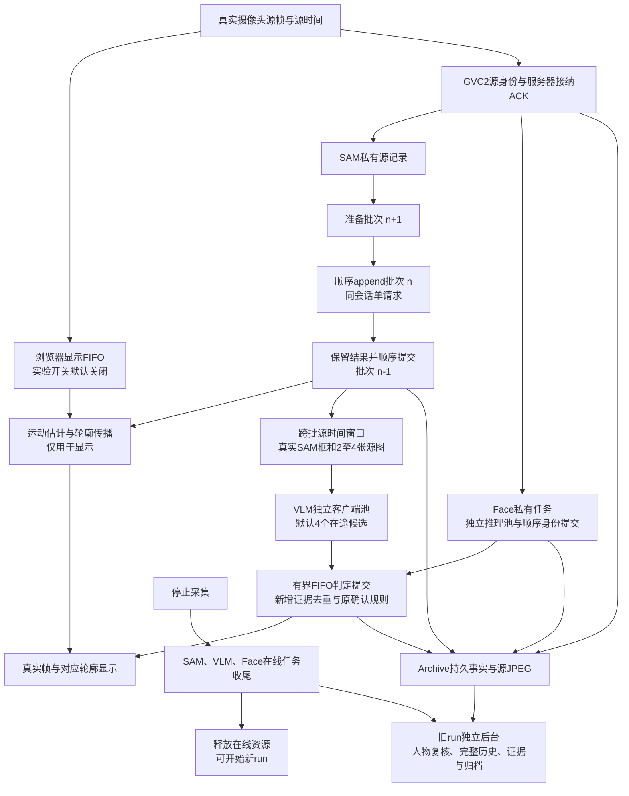

# 三层并行首版实施记录

日期：2026-09-17。对应[主设计](parallel-latency-design-20260916.md)。**后续摄像头联测已失败，本地显示实验已关闭，采样／窗口／阻塞修复仍在源码、未部署**；最新事实以[故障诊断](parallel-failure-diagnosis-20260917.md)为准。以下保留首版实施和部署历史，“已实现”指代码行为，不代表显示15 FPS、三个分析分支各1 FPS或两秒目标已验收。真实Face双实例加载及空白图预热不能作为分析吞吐成绩。

对照基线仍是[9月16日22:30实测](sam-live-instrumented-diagnosis-20260916.md)：SAM 1.70 FPS、Face 1.30 FPS、VLM 0.33次／秒、不同源描边画面0.55 FPS。旧数据不能作为本轮改动后的成绩。

## 当前实现与剩余工作

| 项目 | 首版已落地 | 未完成／待验证 |
| --- | --- | --- |
| A1 在线事实边界 | SAM会话内稳定原生轨迹引用；源序号、源时间、run／代次／裁剪版本；轻量几何与事件颜色metadata | 最终人物关联仍由后台复核；接口通过不代表多人交叠质量已通过 |
| A2 留证与run隔离 | SAM、Face、Archive私有持久记录；逐run后台控制及接纳／完成边界 | 整套后台整理在进程重启后自动续跑尚未贯通；长run、磁盘满和全链路恢复验收未完成 |
| B1 移出重整理 | 全量人物身份复核移到run后独立执行池；在线发布不带完整history的scene快照／事实，完整历史及最终归档在后台处理 | 全局锁、磁盘竞争和后台积压对实时分支的影响仍需整机计时 |
| C1 本地显示 | 浏览器真实帧FIFO、独立播放时钟、运动传播轮廓；原始SAM锚点校正；源时颜色更新；GVC2源ACK和明确容量暂停 | 实测约12.9 FPS、零描边；实验已关闭。传播可靠性、完整覆盖、新入画和连续延迟未通过；远程视频未获得相同改造 |
| C2 SAM流水 | 准备、单路顺序append、顺序轻量提交三阶段重叠；私有spool保存源、请求和结果，提交确认前不释放所需源 | 远端接收与runner协议未改；崩溃后的自动会话恢复未贯通；未做真实吞吐对照 |
| D1 VLM | 跨SAM批次源时间窗口、独立客户端受控并发、乱序完成后有界顺序提交、新证据去重、失败不当阴性 | 首版采用全局FIFO，并非按人物拆分因果队列；无自动端点重试／迟到结果纠正；单次API未提速 |
| D2 Face | 源码已接入独立模型实例、线程预算、持久有序任务与单一身份提交器；默认2实例、每实例2线程 | 统一回归与真实模型双实例预热通过；真实CPU竞争、净容量和陌生人识别质量未验收 |
| E1／E2 | 暂未实施 | 等首轮实测决定是否改SAM上传协议、或新增VLM候选与同源SAM关联协议 |
| F 整机验收／部署 | 保留原基线，补分段指标与回归用例 | 首次联测失败，显示实验已隔离；最新源码修复未部署，完整恢复与达标验收未通过 |

## 首版实际数据流



VLM仍需当前协议指定的真实SAM人物框；本轮没有启用“原图直接并行推理后再猜人物”。陌生人所需的人脸检测、图库匹配与短期身份状态仍在线运行。显示轮廓传播不生成模型证据，也不写回SAM、SceneState或Face。

### 停止与下一run

首版比完整设计保守：停止新采集后，先完成已接纳的Face任务、SAM尾批以及VLM窗口收尾，再释放在线资源。之后人物复核、证据编码与最终归档可持有旧run上下文继续运行，下一run不等待这些L3任务。

**旧run的VLM尾请求目前不能与新run在线分析重叠。** 不能把“L3可跨run”写成“停止后所有旧在线请求都可以立即让位”。在线收尾失败明确保留失败状态；后台失败不标成finalized。进程内逐run隔离与进程重启自动恢复是两项不同能力。

### 源窗口与并发的边界

VLM按源时间选择不同终点，默认目标1.25个终点／秒。窗口跨SAM批次，保留2–4张真实图及至少0.75秒跨度，运行终点收尾仍需满足有效时序条件。窗口重叠部分只提供上下文，不能让旧证据再次投票；原默认双证据确认不降低。

网络可并行，在线判定由单一提交器按检查顺序应用。最早请求尚未完成时，后续结果会等待；超时形成未知缺口并允许后续进展。超时后仍在执行的客户端继续占自己的槽，迟到结果不算新成功观察。失败、无效输出和缺失均不算clear。首版没有自动重试调度器，不能把设计中的重试／修订能力视作已交付。

生产接线最多8个待处理inspection、4个并发槽；图片预算默认16 MiB，源pin总数有界。已接纳job独立保留图片与源观察，不被新帧覆盖；容量不足在修改轨迹／场景前拒绝本次提交，SAM保留原批次并背压重试，源游标不提前越过未接纳窗口。

SAM spool提供同一批次的原JPEG／源序／源时作为短缓存过期的严格查找后备，但不会放宽所有陈旧数据检查。若长时间积压越过tracking history的源年龄边界，仍可能明确失败并保留待处理材料，尚不能宣称任意长积压都可自动回灌在线几何。

## 配置与试验方法

仅适用于包含本轮源码的开发运行。历史镜像不会因添加环境变量获得这些能力；本轮已构建并部署本地实验镜像，尚未发布新的正式交付包。

| 配置 | 当前默认／范围 | 用途 |
| --- | --- | --- |
| `LOCAL_CAMERA_DISPLAY_ENABLED` | `false`；`true`开启 | 本地摄像头显示实验，仅active持续场景且backend为`sam31_stream`时生效 |
| `SCENE_MAX_IN_FLIGHT`／`runtime.scene_max_in_flight` | 4；1–4 | 独立VLM客户端数量，建议固定输入做2／3／4对照 |
| `SCENE_OBSERVATION_FPS`／`runtime.scene_observation_fps` | 1.25；大于0且不超过3 | 不同真实终点的目标供给率，实际仍受SAM证据供给限制 |
| `SCENE_TIMEOUT_SECONDS`／`runtime.scene_timeout_seconds` | 15秒；大于0且不超过20秒 | 单次模型请求超时，不是两秒达标预算 |
| `FACE_INFERENCE_INSTANCES`／`face.inference_instances` | 2；1–4 | 独立Face模型实例；增加会占用额外内存和计算资源 |
| `FACE_INFERENCE_THREADS`／`face.inference_threads` | 2；1–16 | 每实例ONNX算子线程上限，inter-op为1；需检查实际provider支持 |
| `GOODVISION_SAM_SPOOL_DIRECTORY` | `.goodvision/sam-spool` | SAM私有任务记录目录；需要持久可写存储 |
| `events.directory`／`events.max_storage_bytes` | `.goodvision/event-evidence`／10 GiB | 归档事实、源JPEG与证据目录及预算；实际以加载配置为准 |

以下为首版开发实验参数记录。**本次失败后保持显示开关关闭，完成真实浏览器运动回放和容量验证前，不直接按此例重新开启实验。**

```powershell
$env:LOCAL_CAMERA_DISPLAY_ENABLED = 'true'
$env:SCENE_MAX_IN_FLIGHT = '4'
$env:SCENE_OBSERVATION_FPS = '1.25'
$env:FACE_INFERENCE_INSTANCES = '2'
$env:FACE_INFERENCE_THREADS = '2'
```

重启开发服务后开启新的本地摄像头run，确认页面信息中的`local_camera_display.enabled`为true。浏览器需支持`requestVideoFrameCallback`、Worker与OffscreenCanvas；不满足时仍使用兼容显示，不能把兼容路径结果记作新方案验收。显示实验当前服务参数为15 FPS目标、1秒短缓冲、6秒运动历史；它们不是已测得的最优值，也尚未成为独立配置面板选项。退出实验可将环境开关设回false并重启。

浏览器显示缓冲与分析上传队列分开：显示过期会计数；分析选中的源任务按FIFO等待匹配源ACK，不能新帧覆盖旧任务。上传容量满会明确暂停新的分析接纳并提示，已接纳任务保留；短次数重试仍失败或断线时保留未确认状态。浏览器任务尚在内存，关闭／刷新页面前未收到ACK的部分不能宣称已可靠进入服务器。停止按钮会尝试排空上传；排空失败会显示完整性未确认。

Face两个实例只是验证起点。旧单实例平均间隔对应约1.31次／秒，两实例即使理想翻倍也只有约2.62次／秒；恢复原计划2.5次／秒输入后利用率约95%。目标净能力至少约3.125次／秒才有20%容量余量，不能把低帧率基线中的1.93次／秒供给当作长期负载。暂时允许各分支1 FPS底线不等于降低已配置输入或丢已接纳任务。

VLM四并发亦只增加容量。按旧平均服务2.353秒与93.94%成功率估计，2／3／4并发理想成功能力约0.80／1.20／1.60次／秒；外部API高并发延迟和额度未验证。1.25个不同终点／秒按原成功率只有约1.17次成功／秒的平均预期，不能保证每秒必有一次成功。API本身平均约2.011秒、P95约3.065秒，本轮尚未改变。

## 私有存储与恢复边界

| 来源 | 可靠接纳与保留 | 当前恢复／容量边界 |
| --- | --- | --- |
| SAM spool | SQLite保存原JPEG、批次源清单、准备体和返回结果；结果提交ACK前保留对应源 | 默认每journal 256 MiB，预留准备／结果空间；满额明确拒绝接纳并保留已有任务。该数是代码构造参数，尚无同名环境配置。未贯通进程重启后的自动远端会话续跑 |
| Face私有记录 | 默认图库目录下`private-face/*.sqlite3`，保存源run／序号／时间、图库快照、raw embedding／质量与顺序身份提交事实；成功提交后清源图，失败任务保留源图 | 默认每store 256 MiB逻辑上限；满时`capacity_fault`停止该pipeline新接纳，不覆盖库中任务。私有数据不是公开日志或陌生人图库。已由`PushSampledSource`接纳但尚未入Face库的帧仍在旧session内存，正常drain会完成，磁盘故障／进程崩溃不能保证自动恢复；自动重放有状态身份及统一保留清理尚未实现 |
| Archive ingress | `events.directory/ingress.sqlite3`持久FIFO与原JPEG，持久事务提交后才算接纳；处理失败保留事实且不作为成功 | 逻辑内容预算为`events.max_storage_bytes`一半；配额不等于SQLite文件/WAL物理大小。相同run的失败事实阻止后续越过，其他run可继续；重启可重试已持久的待处理事实及恢复其已处理进度 |
| 归档投影／编码 | 从事实及源引用整理；运行结束、待决证据和编码引用分别保留 | 完成且明确结束的run才按保留策略清理，不清未完成引用。已有staging任务具有恢复基础，但整套人物整理与服务生命周期的自动重启续跑未完成 |

持久写入本身仍包含同步磁盘事务，不是零成本。Archive的大源查询使用独立WAL读连接，清理采用小批次；仍需实测机械盘／满盘和并行写入下对采集的影响。三个存储的额度分开计算，不能只看归档目录10 GiB便宣称整机磁盘有统一上限。保持这些目录私有，不把JPEG、embedding、图库或私有payload写入公开计时日志／交付包。

## 新增观察指标与正确读法

结构化记录沿用服务器日志。下列字段描述当前可收集数据；目标端到端指标仍有待补齐／标注的部分。

| 层／日志 | 关键字段或状态 | 能说明什么 |
| --- | --- | --- |
| 浏览器`Local camera display timing`，`POST /v1/video/display/metrics` | `distinct_presented_frames`、`window_presented_fps`、`source_to_present_p50_seconds/p95_seconds/max_seconds`、`max_present_gap_seconds`、`contour_frame_ratio`；真实／传播轮廓计数、无轮廓帧、buffer过期、分析暂停／pending | 独立播放是否稳定、轮廓是否缺失、上传是否跟得上；当前源时起点是浏览器媒体回调采集，终点为canvas绘制，**不是传感器曝光到实际屏幕发光**。有轮廓比例不代表轮廓正确率 |
| SAM `sam_pipeline_prepare`、`sam_coordinator_dispatch`、`sam_coordinator_timing` | 准备、append、`commit_queue_seconds`、`commit_seconds`、`source_to_result`、输入／输出源序、完成间隔 | 三阶段是否重叠，以及排队／HTTP／提交各占多少；结合`queue_policy=durable_ordered`、`disk_pending_frames`、`pending_commits`、`rejected_capacity`、`recovery_required`判断是否积压 |
| VLM `vlm_inspection_timing`、`vlm_late_result_timing` | 源终点及上下文序列、`prepare_seconds`、`model_seconds`、校验／完成／通知、`reorder_wait_seconds`、`completed_observations` | 区分模型慢与排序等待，按不同真实终点算成功；迟到记录成功数为0，未知执行时长用null，不能用输入图片张数或重试数抬高FPS |
| VLM runtime／worker状态 | `retained_temporal_sources`、`pending_temporal_endpoint`、`inspection_capacity_blocked`、`active_requests`、`pending_completions`、`expired_while_running` | 区分证据供给不足、容量阻塞、在途请求及等待有序提交 |
| Face `face_pipeline_timing` | `decode_seconds`、`inference_seconds`、`pool_wait_seconds`、`ordered_commit_wait_seconds`、`identity_commit_seconds`；实例数、`backlog`和失败 | 推理副本是否带来净收益，或只是增加CPU竞争／身份提交排队 |
| run后台状态 | run ID、`state`、`stage`、`error`；身份复核、evidence、finalized或failed | 区分采集结束、在线收尾、后台整理和最终完成；不把后台耗时记成仍在采集 |

必须继续分开报告采集期成功率与停采后补算。用固定滚动窗口统计不同源完成率、最长无完成间隔及最老积压年龄，不把全场平均当作逐秒保证。

L2验收仍需同一测试视频的`event_onset`、规则所需`evidence_ready`、`first_valid_verdict`、`confirmed_alarm`及`color_presented`。当前日志和源时metadata提供关联基础，尚未完成这组端到端测量。两秒应从源事件／可判断证据开始，而非API发起；首次有效判定与满足原双证据规则的确认分别统计。颜色metadata保留首次确认、最近阳性和结束源时，不能把迟到判定提前画到事件发生前的缓冲画面。

## 已有验证与下一步

最终全量Python回归：**3350 passed、10 skipped**。最后的逐run归档失败隔离改动另完成81项服务／归档复测（与全量覆盖重叠，不相加）。浏览器JavaScript回归118项通过，源协议11项通过。本轮修改的Python源文件和回归用例通过Ruff，差异空白检查通过。停止排空、启动部分失败、ACK重试、旧run后台／新run隔离、删除人物期间收尾、归档故障和小缓存完整留证已有覆盖。

额外部署验证使用原有InsightFace 1.0.1／ONNX Runtime 1.30.0，在无网络、只读模型卷上加载两个真实实例；空白图预热13.402秒，两个检测实例的实际线程数均为2。这是模型接线与依赖兼容检查，不是人脸识别准确率或实时吞吐测试。未提交新的真实摄像头片段给模型。

本地部署记录：

- 镜像：`goodvision-harness:latency-20260917`，本次manifest `sha256:f6f28b5d71c1c972151733e42b99595b65c85ce68bed8c5637b21510d5f3c3a7`，同时标记为当前Compose的`goodvision-harness:sam-remote`。
- 沿用部署前镜像依赖，仅覆盖本轮Python包和前端资产；旧镜像保存在`goodvision-harness:latency-base-20260917`。未改Face或SAM模型权重、采样输入及图像质量。
- 仅更新`harness`，SAM远端控制器ID及启动时间均保持原值，未创建新GPU实例。
- 本地`.env`启用`LOCAL_CAMERA_DISPLAY_ENABLED=true`并固定`HARNESS_AUTOSTART=false`，同时将优先级更高的持久部署设置`autostart`设为false。仓库通用默认仍为false；新容器保持待机，用户刷新后手动开始检测。更新时持久设置的自动启动覆盖了环境值，源连接失败且接收0帧；已同步修正持久设置并重启验证待机，这不是性能实测。
- 已核验前端资源200、存活接口、SAM连续路线、显示实验开关，以及Face 2实例×2线程、VLM 4并发／1.25源终点每秒配置。浏览器运行表现待下一次run验证。

首版原定下一轮顺序（已由[故障诊断中的执行顺序](parallel-failure-diagnosis-20260917.md#后续执行顺序)替代）：

1. 保留本次通过回归的镜像及配置，开始同条件性能对照；已完成的离线检查不替代真实联测。
2. 同一录制输入按真实到达速度对照：先固定采样／画质，比较SAM三段、VLM 2／3／4、Face 1／2实例。保留完整输入覆盖、错误和积压。
3. 开启本地显示实验做摄像头联测，记录15 FPS、真实曝光延迟、冷启动／新入画／遮挡／运动轮廓误差和事件源头到首次判断／确认／变色。
4. 故意制造慢API、L3积压、磁盘配额不足、停止后新run和进程重启，核对材料完整性及不能自动恢复时的明确状态。
5. 依据瓶颈决定E1／E2及单次API优化；质量、容量和恢复边界验收后再准备正式交付。

当前状态：**首次本地联测失败，显示实验已关闭；候选源码修复未部署，正式交付未通过验收**。真实显示≥15 FPS且完整描边、SAM／VLM／InsightFace各≥1成功观察／秒、L1和L2两秒目标：**整体验收未通过**。
