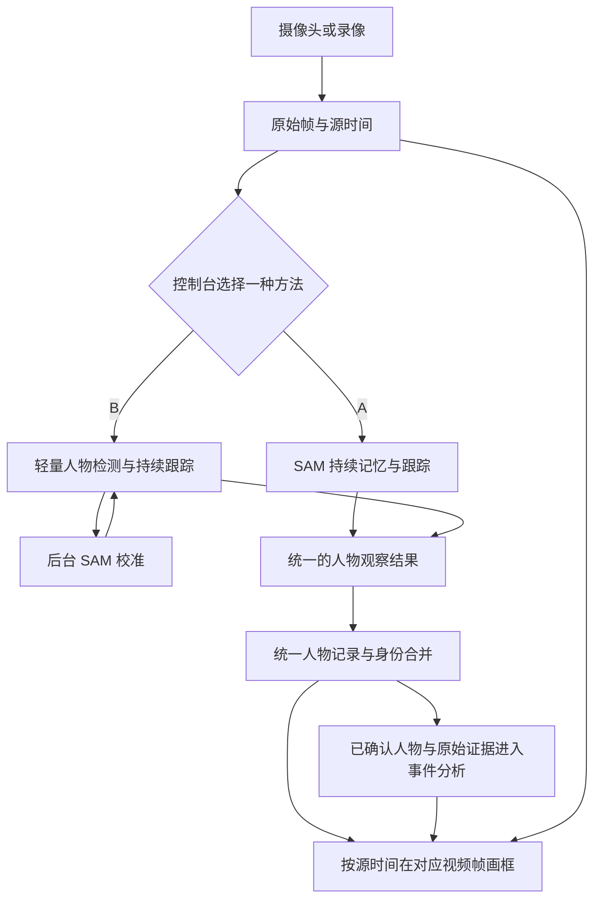

# 可切换的人物识别路线

状态：两条路线实现与本地协议测试；遵照用户要求，本轮不启动 GPU，不运行真实模型测试。因此本文没有两秒延迟达标或准确率达标的结论。

## 使用方式

Deployment console 提供两个选择：**SAM 连续分析** (`sam_live`) 和 **快速跟踪 + SAM 校准** (`hybrid`)。

停止当前会话，选择方法并保存，再启动新会话。停止后的尾部处理也必须结束才能切换。保存的选择在应用重启后保留；未保存的选择不能用于启动。服务器离线仍可保存选择，启动时必须通过所选路线的真实就绪检查。

人物结果延迟表示一帧在本地进入人物处理队列后，到其结果完成提交的实际耗时；尚无结果时为空。它与视频播放缓冲 N 秒分开显示，也不代表事件模型的完整延迟。

## 独立模块与共用边界

| 层 | 共用职责 | 各路线独立部分 |
|---|---|---|
| 控制台与服务 | 保存选择、停止/启动、就绪检查、状态与错误 | 路线描述 |
| 主机 `perception.py` | 工厂、严格协议、确认状态、队列参数 | 不导入任何 GPU 模型 |
| Worker `perception_routes.py` | 插件注册与目录 | 后端工厂和不可变会话配置 |
| Worker `continuous.py` | 生命周期、输入校验、限额、源时间、取消、释放 | 调用插件的推理和序列化方法 |
| `sam_live.py` | — | 原生 SAM 因果持续推理 |
| `hybrid.py` / `hybrid_tracker.py` | — | SSDLite、轻量跟踪、SAM 校准调度 |
| 人物、场景、事件、显示 | 统一观察格式与确认状态 | 不按 A/B 分叉 |

独立端点：`/v1/perception/{method}/sessions`。健康检查：`/health/perception/{method}`。目录：`/v1/perception/routes`。原有图片、视频批处理和连续会话端点保留原合同。一个 worker 同时只允许一个活动会话；不同路线的 token 与模型记忆不可交换。

观察仍使用源帧编号、源时间、归一化框、原生身份与 epoch。A 的实际 backend 为 `sam3.1_video`，B 为 `person_hybrid`；轻量检测结果不会冒充 SAM 掩膜。

新路线额外提供逐源帧的临时人物 ID。主机校验后统一标记 `tracking_confirmation`。临时人物可画框，但不能成为可信身份合并或人物事件证据；确认后沿用原人物记录。晚到的校准只修正与其源时间相符的跟踪证据，不能把历史框充作当前观测。

## 两条路线的具体行为

**A**：第一帧即可启动，先输出已到达帧的观察。保留原生三次检测确认策略，不通过重复首帧或伪造未来帧来确认人物。持续记忆与有界历史跨请求保留。首帧输出不等于首帧就已确认一个人。

**B**：使用 torchvision 的 SSDLite320 MobileNetV3 COCO 人物检测器。保守关联相邻观察与外观，不把预测框标成真实观察。SAM 校准队列只保留一个正在处理的源帧和一个最新待处理源帧；完成的同源校准可以确认弱轨迹或帮助找回之后真实检测到的人。

SAM 校准读取独立单帧状态的 `add_prompt` 结果。这是单帧模型支持，不等同于 A 的三次视频检测确认；不会把一个来源重复计数来制造时序证据。

两条路线均在空闲时立即发出请求，每次最多四个积累帧，本地待处理队列最多四帧。过载时丢弃最旧的待处理帧并计数，禁止延迟无限积累。HTTP 仍按请求返回结果，不是逐帧分块流。

B 的后台调度不要求每次人物请求先完成一次 SAM 校准，但同一 GPU 上已经运行的校准不可抢占。下一次检测可能等待当前校准结束；这仍是之后实测需要关注的延迟来源。

## 部署准备

在已有 SAM 3.1 worker 环境上启用 `SAM31_LIVE_ENABLED=true`、`HYBRID_ENABLED=true`，以及需要 H264 时的 `SAM31_SESSION_H264_ENABLED=true`。旧连续路线无需同时启用。

B 还需要本地官方权重 `ssdlite320_mobilenet_v3_large_coco-a79551df.pth`，通过 `HYBRID_CHECKPOINT_PATH` 指向文件。加载前限制 32 MiB、核验官方文件名对应 SHA256 前缀，并以 `weights_only=True` 严格加载；服务启动时不自动下载。两条路线共享现有 SAM 权重。

本机已准备该权重于 `.models/ssdlite320_mobilenet_v3_large_coco-a79551df.pth`，大小 14,069,355 字节，完整 SHA256 为 `a79551df90c79834bcd3bb3845ef9d966b5449a3a9b2833ae8404778ca5d65d2`。本轮仅下载和校验，未加载模型；文件不进入 Git。

Docker 使用 `compose.yaml` + `compose.sam31.yaml` + `compose.perception.yaml`。新覆盖文件挂载额外检测器权重，并配置两条路线的就绪检查。此次仅准备文件，没有启动远程实例或部署运行模型。

本地 Demo 启动默认方法为 A，控制台保存的选择优先。GPU 恢复后还需更新 worker 文件、放置检测器权重并重新启动 worker，之后再测试 A/B。

## 如何保留一种、删除另一种

先停止所有活动会话，把默认方法及保存的选择切换到保留路线。然后从 worker 的 `PLUGINS` 与主机 `METHODS` 目录移除另一项，同时调整设置允许值与控制台可选项；移除对应 worker 模块、Docker COPY 和启用配置。人物、事件、源帧与显示模块无需重写。若删除 B，也可去掉其检测器权重挂载。

## 验证范围

本地测试覆盖首帧与 EOF、原始时间对应、严格后端与确认协议、两条路线及旧接口会话互斥、队列上限、取消后的旧状态、临时人物的证据限制、保存与重启、UI 未保存/运行中/失败状态。模型测试使用明确的测试替身，不作为真实 GPU 的速度或质量证据。

最终本地全套回归：**3089 通过、4 跳过**（2026-09-15，226.09 秒），改动文件的 Ruff 检查及 Git diff 检查通过。实际 8096 控制台完成未保存禁止启动、A/B 选择、离线保存、刷新保留与恢复 A 默认值检查，期间没有摄像头或视频源会话。测试日志与 JUnit 留在本机 `tmp/perception-final-pytest.log`、`tmp/perception-final-tests.xml`。

后续真实验证应使用同一保留录像、采样率、传输与播放 N 值比较 A/B：首个框、首个已确认人物、人物结果延迟分布、积压与丢帧、人物断号/误合并、漏检和事件完整延迟。离线跑完后的零积压不能代替运行期间延迟。

已有 `tools/sam31_latency_run.py` 增加 `--processing-method sam_live` / `--processing-method hybrid`。同一录像运行两次、输出到不同目录即可比较；客户端、队列和调度均复用控制台工厂。工具按摄像头速度回放，不启用摄像头或事件模型，报告保留实际方法、后端、源时间与原始证据校验。后续可使用相同的 `--fps 3 --transport-codec h264 --transport-max-side 512 --transport-crf 23`，每段最多 60 秒。本轮只验证协议替身，不执行真实 GPU 回放。
