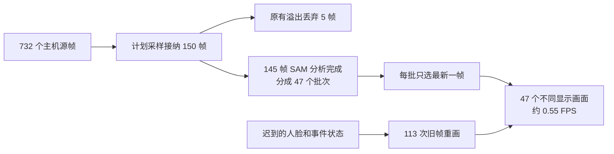

# 新计时版本实测：慢在哪里

分析时间：2026-09-16。实测会话北京时间约 **22:30:35–22:32:00**；日志来自现有 Docker 容器，没有重跑推理、修改参数或重启服务。原始快照与可复算脚本保存在 `.goodvision/diagnostics/instrumented-20260916/`。

基于这组数据的实施设计见 [并行优化方案](parallel-latency-design-20260916.md)，包含可重叠阶段、吞吐估计、有序提交、显示轮廓传播及验收条件。

## 结论

这次已经能够区分主要瓶颈。**画面卡顿最直接的原因是显示端每批 SAM 结果只选最后一张源图，47 个批次只产生 47 个新画面；VLM 则受单次调用和串行队列限制；SAM 的端到端时间主要消耗在准备、传输接收、请求外围和提交的串行链路上。** 不能将所有慢因归给 SAM 推理或 GPU。

InsightFace 还有一个确定的调度问题：SAM 场景模式把逐帧分支缩成只做人脸后，外层仍允许六个并发请求，内层却以会话锁串行处理。这增加等待，不能提高六倍吞吐。

## 本次实际产出

统一以运行状态保存的 `capture_elapsed_seconds=85.100918393` 为实时阶段分母。该计时到协调器 flush 为止，包含最后源帧到收尾调用之间约三秒；成功结果按会话和源帧／观察终点去重，停采后的 VLM 产出单列。

| 路径 | 实时阶段实际产出 | 平均完成率 | 判断 |
| --- | ---: | ---: | --- |
| SAM | 145 个分析源帧 | **1.704 FPS** | 平均超过 1；批次间仍有停顿 |
| InsightFace | 111 次成功新观察 | **1.304 FPS** | 平均超过 1；有排队及丢弃窗口 |
| VLM | 28 次成功新观察 | **0.329 次／秒** | 未达 1；上下文多图不能放大计数 |
| 服务端描边显示 | 47 个不同源帧 | **0.552 FPS** | 远低于 15；浏览器不可能补出服务端没有发布的新帧 |

SAM 总共 47 次数据 append，加一次空 EOF；全部成功，无重试、重复输出或 worker pending。VLM 总共 33 次请求、31 次成功：其中三次成功在停采后完成，另两次为 `ModelAPIError`。人脸 111 次全部成功，但 pipeline 记录 **53 个过载丢弃窗口**。

SAM 入口共 732 个源帧，其中 150 帧按计划采样被接纳，582 帧为计划采样排除；150 个已接纳样本又因原有队列溢出丢了 **5 帧**，最终得到 145 帧。五个溢出源序号是 42、97、153、241、400（harness.log:1417、1484、1579、1699、1928）。计划采样与过载丢弃必须分开，不能称为无丢帧达标。

平均值不保证每个滑动一秒窗口达标：SAM 批次完成间隔中位 **1.824 秒**，P95 **2.295 秒**，最长 **2.666 秒**。人脸最大相邻成功间隔 **1.041 秒**。

## 显示为什么像定格

日志有 160 次服务端图片发布，但仅 47 个不同源帧；其余 **113 次是事件变化触发的同帧重绘**。47 个显示源序号恰好等于 47 个 SAM 数据批次各自的最后源序号，逐一匹配，没有用 HTTP 请求次数推算 FPS。

实测代码 `SceneRuntime.tracked_display_frame()` 从跟踪历史末尾倒序选最新完成帧；`TrackedSceneDisplayWorker` 随后移除此前的源帧待显示标记。所以平均每 1.8 秒才换一张图，期间主要更新旧图上的事件状态。单纯将轮询设成 15 FPS，或让 SAM 从 1 FPS 提升到 3 FPS，都不能直接实现 15 FPS 连贯描边。

新画面从主机接纳源帧到发布的年龄中位 **2.437 秒**、P95 **3.156 秒**、最大 **3.394 秒**；这是发布时刻，尚未包含摄像头曝光／浏览器上传前段和浏览器下载绘制，也没有覆盖两次新画面之间旧图继续变老的时间。即便按这一较短边界，两秒目标仍未达到。当前保存的播放等待配置是 **0 秒**，不是先前的八秒缓存问题。

显示线程也有后续瓶颈：JPEG 渲染中位 **103 毫秒**、P95 **226 毫秒**，已超过 15 FPS 的每帧 66.7 毫秒预算。发布中位仅 0.05 毫秒，但 P95 达 **359 毫秒**。发布回调经过全局 `_state_lock`，与采集、SAM 提交和事件更新共用；因此此字段包含等待，不能解释成图片网络发送时间。精确锁等待与锁内计算尚未拆开。

主机共接纳 732 个源帧，在约 82 秒实际源时间跨度内只有约 **9 FPS**（按整个 85.1 秒阶段为 8.60 FPS）。入口也低于显示要求；当前日志未记录浏览器采集／编码／发送各段，不能判断损失首先发生在浏览器、上传还是主机接纳之前。把显示路线解耦后仍需解决此项。

## SAM 为什么仍有两三秒延迟

对 47 次数据请求按 request_id 配对客户端、coordinator 和 worker，累计协调器串行执行耗时 **83.486842 秒**。以下阶段互不重叠；排队另列，不能把它再次加入该总量。

| 串行阶段 | 累计秒 | 占比 |
| --- | ---: | ---: |
| 请求准备、压缩编码 | 15.796 | 18.92% |
| worker 接收请求体 | 17.518 | 20.98% |
| SAM native 推进 | 19.583 | 23.46% |
| HTTP 至响应头中未被 worker 总计覆盖的部分 | 16.570 | 19.85% |
| 主机提交分析结果 | 8.256 | 9.89% |
| 其余阶段与开销 | 5.764 | 6.90% |

四帧批次共 21 个，准备中位 **0.432 秒**、worker 请求体接收 **0.476 秒**、SAM native **0.534 秒**，完整客户端请求 **1.884 秒**，协调器处理整批 **2.048 秒**。这些是各自的中位数，不能相加当成某个实际请求。

等待最久样本的派发前排队中位 **1.455 秒**。全部 145 帧源到 SAM 结果中位 **2.804 秒**、P95 **3.778 秒**、最大 **4.669 秒**。单次顺序 append 使下一批在前一批准备、传输、执行、响应和提交时继续等待。

轮廓转换累计只有 **0.218 秒**，四帧批次中位约 **5.6 毫秒**；当前没有依据优先优化 mask 转轮廓。native 阶段只占上述串行耗时约四分之一，不能把整体 1.70 FPS 当成 SAM 模型自身的运算上限，也没有证据支持先换 GPU。

HTTP 外围差额包括客户端调度、序列化、转发、往返及响应头等，**不能全部叫纯网络延迟，更不能直接断定 SSH、带宽或地理距离是唯一原因**。本次已把大段耗时定位清楚，但具体链路原因还需拆分验证。

## VLM 为什么低于 1 FPS，报警为什么迟到

VLM 每个请求处理时长中位 **2.131 秒**，其中 API 调用中位 **1.947 秒**，占累计处理时间 **85.45%**。准备中位 73 毫秒、完成回调中位 205 毫秒。相邻请求之间空闲中位仅 **4.65 毫秒**，说明 worker 基本持续忙碌。

本次使用 `video-inspection-*` 的 SAM 批次检查入口，不是旧的三秒／五秒巡检路径。慢因是**单请求耗时加单在途请求形成的积压**，改旧巡检间隔不会解决这次问题。

SAM 完成到 VLM 开始等待中位 **3.146 秒**，最长 **9.564 秒**。最新证据源接纳到 VLM 完成中位 **7.125 秒**、P95 **12.948 秒**、最大 **13.737 秒**。这解释了事件报警与描边变色比几何结果更晚。两次 `ModelAPIError` 的日志仅有错误类型，无法进一步确认 HTTP 错误、解析还是超时。

## InsightFace 为什么吞吐超过 1 FPS，单次延迟却接近四秒

实测容器使用 `CPUExecutionProvider`，16 个可见逻辑 CPU。人脸结果平均约每 **0.762 秒**完成一次，但记录的 `model_seconds` 中位 **3.783 秒**，并非单次纯推理花了这么久：该字段覆盖包装器整个调用，包含会话锁前排队、解码、模型和身份处理。

原始选择是 `multi + smoking,stranger`。`service.py` 先按原始 features 判断是否启用人脸单请求模式，随后 SAM 场景路径把逐帧任务变成只有 stranger，仍留下 **6 个通用并发槽**。这条纯人脸包装路径又绕过独立分支的 single-flight 准入，最终六个调用在 `FaceRecognitionSession.classify_window()` 的同一把锁前等待。锁内还有包围 `model.get()` 的推理锁。

这足以解释调用延迟与完成间隔的差距。直接加并发不会提高这个串行模型的吞吐；简单降为一个槽并沿用忙时丢弃也不满足保留关键帧的要求。需要按实际串行能力安排有序任务，并分开测锁等待、检测／识别和身份处理，消除堆积的同时保证输入覆盖。

## 下一步优化顺序

1. **先修显示架构。** 复用高频真实视频源的连续播放，SAM 提供关键帧轮廓，帧间轮廓更新仅供显示，事件颜色异步叠加。必须验证移动、遮挡、出入画；显示估计不能写回识别证据。同时把主机入口提升并实测到至少 15 个不同源帧／秒。
2. **缩短主机串行路径。** 分开测 `_state_lock` 等待和锁内工作；将可独立完成的图片编码、准备等放到合适的有序处理阶段。保留会话隔离和按序提交，不通过覆盖待分析关键帧降延迟。JPEG 每帧耗时也必须低于显示预算。
3. **优化 SAM 准备和传输。** 以本次约 60% 的准备／请求接收／外围开销为主要对象，验证准备与发送的重叠、传输路径及请求方式，保持 SAM 会话内模型执行顺序。先做对照测量，不直接降低分辨率损害识别。
4. **分别处理 VLM 与 Face 调度。** VLM 需要降低约两秒的 API 延迟，或验证受控并行并按源序提交；Face 需消除“六槽排队一把锁”的路径。两者都应统计实际完成和丢弃覆盖，不能拿排队请求数当分析 FPS。

## 证据与边界

- 原始文件：`harness.log`、`sam-remote.log`；状态与配置：`status.json`、`info.json`、`settings.json`。
- 复算：`analyze-host.py` / `host-summary.json`、`worker-audit.py` / `worker-audit.json`、`branch-audit-summary.json`。
- 实测 `scene_delivery.py`、`scene_runtime.py`、`face_recognition.py`、`pipeline.py`、`video_tracking.py`、`video_transport.py` 的 SHA256 与工作区一致。`service.py` 有后续归档相关差异，已保存容器版本 `runtime-service.py`；本报告的调度、选帧和回调锁结论均核对实测版本，不把后续改动算成本次原因。
- 新计时来自主机墙钟，不是 CUDA kernel 时间。CPU 竞争和全局锁是需要进一步分项测量的候选；本次没有 CPU 栈采样或锁内占比，不能声称某个具体函数独占这些耗时。
- 浏览器真实绘制率和曝光到屏幕时间仍未记录。本报告使用服务端不同源帧发布率，已经足以证明当前无法达到 15 FPS，但不能代替最终端到端验收。
