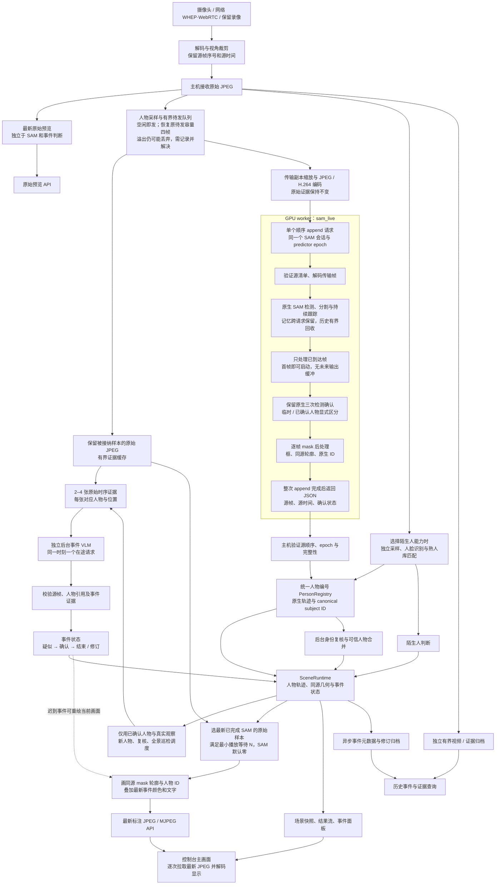

# SAM 连续分析：完整流程与两秒显示目标

日期：2026-09-16。产品入口统一使用 `sam_live`（SAM 连续分析），不再提供 Hybrid 选择。本文以现有代码为依据，分别说明已实现行为、历史测量和下一步验收目标。**当前没有 `sam_live` 在真实 GPU 上达到两秒的测量结论。**

修订：撤回本页此前提出的“忙时只保留最新待分析帧”及收紧浏览器上传准入的方案。先检查真实运行并补齐分段计时，再优化吞吐；不能以丢关键帧换延迟。按用户最新要求，阶段底线是**显示至少 15 个不同源帧／秒，SAM、VLM、InsightFace 各自实际分析至少 1 FPS**；三个分析分支均继续向各自 3 FPS 优化。允许参考已有补帧改善显示，显示层估计不得进入事件证据。22:30 新计时版本实测见 [最新诊断](sam-live-instrumented-diagnosis-20260916.md)：SAM 平均 1.70 FPS、人脸 1.30 FPS、VLM 0.33 次／秒，服务端不同源画面仅 0.55 FPS。以下保留原流程与实施计划；旧 18:56 会话的 1.08 FPS 不能代表新运行。

## 目标与完整流程

优先缩短“摄像头里的动作 → 屏幕中带完整人物描边的对应画面”。人物身份、事件判断、报警及描边变色可以稍后补充；显示不应等待这些判断。保持轮廓与实际显示画面同源，不能为了数字变小，把过去的 mask 贴到最新原图上。



图中唯一需要等待 SAM 的主显示链为：采集 → 采样 → 传输 → SAM → 同源几何提交 → 描边显示。VLM 请求、人脸识别及磁盘归档不构成模型级的显示前置条件；内存提交、快照生成及锁竞争仍需要在联测中计时。

实现入口：[`service.py`](../../src/goodvision_harness/service.py) 的 `_on_display_frame`、`_on_tracking_batch`、`_on_scene_update`；[`perception.py`](../../src/goodvision_harness/perception.py) 的客户端／调度工厂；[`scene_delivery.py`](../../src/goodvision_harness/scene_delivery.py) 的 `TrackedSceneDisplayWorker`；[`dashboard.html`](../../src/goodvision_harness/dashboard.html) 的 `pullLatestFrame`。

## 现在已经分开的职责

- **人物描边先返回。** `sam_live` 使用真实 SAM 检测与持续记忆；首帧就能开始，输出只依赖已到达帧。临时人物可以显示，不能被当作已确认人物事件证据。三次检测确认不等于必须把整张画面压后两个采样周期。
- **事件随后更新。** `SceneInspectionWorker` 独立请求 VLM，默认总超时 15 秒，不占人物推理线程。事件首次阳性为黄色，确认后红色；所有活动事件结束后恢复正常颜色。当前实现需要同一事件累计 10 个不同源观察的有效 clear 才结束，新的阳性会重置计数。
- **位置和颜色使用不同时间。** 位置取当前显示帧的 SAM 结果；颜色和事件提示取最新接受的事件状态。迟到结果可重绘已显示画面，也可跟随同一人物的后续同源轮廓，不必重放旧视频。
- **人脸与身份在旁路更新。** 只有选择陌生人能力时运行人脸分析；脸与身体通过可信来源关联及后台身份复核合并人物。它们不为普通轮廓显示增加前置等待。
- **归档异步。** 场景事件元数据通过有界队列写入 SQLite；源视频／证据走独立归档。归档失败不能解释成“没有事件”，也不应等待磁盘后才画人物。

## 必须区分的延迟数字

| 指标 | 起止点 | 能说明什么 |
| --- | --- | --- |
| 摄像头到屏幕 | 相机实际曝光／画面中的可核对时钟 → 浏览器完成绘制 | 用户关心的主指标，目标 P95 ≤ 2 秒，越低越好 |
| 人物结果耗时 | 主机接纳 SAM 采样帧 → 对应结果提交完成 | 包含本地排队、在线压缩、网络、推理和提交；不含摄像头进入主机前、浏览器绘制的时间 |
| 当前标注画面年龄 | 当前源进度／本地经过时间 → 已显示源帧 | 能发现卡住、积压和旧画面；`stream_delay_seconds` 会在没有新结果时继续增加 |
| 报警耗时 | 支持事件的真实源观察 → 事件状态接受／屏幕变色 | 另含证据积累、事件排队和 VLM，可独立放宽 |
| 首个框 / 首次人物确认 | 本次采集起点 → 首次可见轮廓 / 首个 confirmed 人物 | 必须分别统计；首帧模型输出不保证首帧检测到人 |

当前控制台人物结果数字 `source_to_result_seconds` 是最近已完成帧的值；批次含多帧时循环最终留下最后一帧。它不是 P95，不包含摄像头到主机的传输，也不能直接宣称“摄像头到屏幕两秒”。

`N` 是**最小播放等待**，不是总延迟保证。大致关系为：

```text
画面延迟 ≈ 摄像头到主机耗时
         + max(N, 入队等待 + 在线编码 + 请求往返（已含 SAM 与后处理）+ 主机提交)
         + 等待显示线程 + 最新帧请求/传输 + 浏览器解码绘制
```

这些阶段实际可能部分重叠。应使用同一源帧测量，不能把不同帧的中位数拼成达标数字。

## SAM 缓冲、批量和排队的实际边界

`sam_live` 与旧 `/v1/video/sessions` 的非因果 `sam31_stream` 使用相同视频后端名称，但不是相同输出策略：

| 行为 | 旧连续接口的历史配置 | `sam_live` 已实现 |
| --- | --- | --- |
| 启动 | 等首批 16 帧 | 1 帧即可启动 |
| 待未来确认的输出 | 默认 14 帧；已试过降低到 4 帧 | 0 帧；每次返回已接纳的全部帧 |
| 人物确认 | 原生三次检测，并可据后续帧筛掉历史输出 | 原生三次检测，当前 provisional 状态显式输出；不回写历史观察 |
| 单次追加上限 | 16 帧 | worker 协议上限 4 帧 |
| 持续记忆 | 同一会话 | 同一会话 |
| HTTP 返回 | append 全部完成后返回 | append 全部完成后返回，尚非逐帧推送 |

`sam_live.py` 构造模型仍传 `hotstart_delay=5` 以保留兼容的原生早期拒绝参数；它用 `CausalPostprocessing` 替换了未来输出缓冲。不能仅看到这个构造参数，就认为 `sam_live` 仍固定等待四帧。

已撤回本轮将 `sam_live` 主机待发容量从四帧减为一帧的修改。恢复 `batch_frames=1`、`batch_seconds=0.1`、`pending_capacity=4`：空闲可立即提交，忙时等待的帧随后合批发送，worker 协议上限仍为四帧。原有队列在溢出时仍会丢弃等待帧，恢复四帧不等于实现无损接纳。批内等待和队列覆盖率必须分别记录，不能靠缩小容量丢掉关键帧来获得较低的延迟数字。

浏览器摄像头恢复此前的 1 MB WebSocket 发送缓冲准入规则，撤回“发送缓冲必须为空”的新增限制。它不是服务端完成确认，也不证明端到端接纳完整。应提高可持续处理吞吐并记录入口、采样、拒绝、排队与完成情况；不能把丢样本作为满足分析吞吐要求的手段。

worker 当前在 `continuous.py` 的原生输出循环中逐帧调用 `native_snapshot`：mask 转 CPU、连通域筛选、外轮廓提取、归一化及 JSON 生成与后续帧推理串行衔接。因此“GPU 每帧耗时”小于“整个 HTTP 请求耗时”是正常的。日志 `native_output_seconds` 也包含这段循环，不能直接等同 CUDA kernel 时间。

## 现有测量证据及其限制

最近一次真实 `sam_live` 会话为 2026-09-16 北京时间 18:56:51–18:58:36，已从保存的原始日志重新统计：29 次 append 全部成功，113 帧／104.414 秒，约 **1.08 FPS**。28 个四帧批次的 body 接收中位数 **1.508 秒**，原生模型与输出整理中位数 **0.839 秒**，worker 总计中位数 **2.371 秒**；请求完成间隔还包含平均 **1.198 秒**未被 worker 计时覆盖的时间。这些不是摄像头到屏幕延迟。详细边界、原始行号、P95 及日志缺项见 [最近真实运行诊断](sam-live-run-diagnosis-20260916.md)。此前本页没有检查这批日志，属于遗漏。

以下是**旧连续接口**的真实 RTX 4090 记录，不是 `sam_live` 的性能。报告在本机保留，历史结论见 [2026-09-13 优化记录](sam31-optimization-20260913.md)。

| 测试 | 已观察结果 | 解释 |
| --- | --- | --- |
| H.264 512 / CRF23，3 FPS，60 秒 | 180 / 180 样本处理；0 背压丢弃；首输出 10.225 秒；实时跟踪滞后 P50 6.333 秒、P95 8.667 秒 | 首批仍等 16 帧，另有四帧未来输出缓冲和请求积压 |
| 同上，逐帧源到结果 | 采集期间完成的 162 帧 P50 6.431 秒、P95 9.079 秒；18 帧在 EOF 后完成 | 与固定时钟采样的“当前最新结果年龄”不同，两个 P95 不能混用 |
| H.264 512 / CRF23，4 FPS，48 秒 | 176 / 192 样本处理；16 帧背压丢弃；实时滞后 P95 9.750 秒 | 该配置不够稳定处理 4 FPS，EOF 追平不能掩盖运行时滞后 |
| 原生离线后处理 batch 1 / 4 | 每 16 帧三轮平均 2.2255 / 2.2293 秒；对应 ID 与 mask hash 相同 | 批量后处理未带来速度收益，不能据此优先扩大批次 |
| 显示链路 H.264 联测 | 两段测试实际显示延迟约 4.08 / 5.89 秒，N=2.5 秒 | 验证同源画面对齐和收尾，不是实时到屏延迟基准 |

本机原始报告分别位于 `tmp/sam31-opt-20260913/h264-512-hot5-3fps/report.json`、`h264-512-hot5/report.json`、`service-display-h264/report.json`。这些测试没有同时覆盖摄像头、浏览器显示、全部人物身份和事件分支。

9 月 15 日的 `sam_live` 验证是本地协议／回归和控制台操作，GPU 保持停止。不能把旧连续接口的速度平移为新路线达标，也不能把测试替身成功当作 GPU 推理质量证据。

## 同时满足延迟、分析与显示吞吐的实施顺序

1. **已去掉 SAM 的默认人为显示下限。** 原默认 N=2.5 秒使两秒目标不可能达成；新增 `display.sam_live_delay_seconds`，默认 N=0。N=0 表示结果完成后尽快显示，仍使用对应源 JPEG 与 mask。控制台已经保存的用户自定义播放等待值继续优先；开始验收前确认实际运行值为零。旧诊断路线的播放默认保持独立。
2. **已撤回丢帧优化，先留存完整时间账单。** 保持一个顺序会话和单个在途 append，恢复原四帧等待容量及浏览器准入规则，明确旧溢出丢弃仍待解决。分别记录 SAM、VLM、InsightFace 实际到达、采样、接纳、溢出、完成率及队列等待；各自阶段底线至少 1 FPS，三个分析分支均继续向各自 3 FPS 优化，不以丢关键帧换低延迟。
3. **依据最新日志定位传输与请求间隙。** 分开量化本地编码、请求 body 发送／接收、响应回传、解析、主机提交和浏览器绘制。现有 body 接收约 1.508 秒、请求间隙约 1.198 秒，尚不能分解为纯网络或某个实现阶段。先补观测，再选择传输、部署或协议改动；完整 mask 和识别质量必须保留。
4. **再考虑推理与后处理重叠。** 在真实测量确认 CPU 轮廓是瓶颈后，探索有界 CPU 后处理线程或逐帧增量返回。保留源序、取消隔离和原生 mask 生命周期，不让异步读取遇到重用的输出缓冲。当前批次响应协议需要完整返回；逐帧返回是协议改造，不能把 Python `yield` 误当成客户端已收到。
5. **解决至少 15 FPS 的实际显示架构。** 目前主显示只选 SAM 已完成的源帧，3 FPS 采样最多提供约三次／秒或更少的不同源画面；显示线程上限、轮询和同帧重绘不能满足要求。可参考已有补帧、几何插值，为高频真实源帧生成对应的显示轮廓估计，或进一步提高 SAM 实际吞吐。估计必须验证出入画、遮挡及人物编号，并与真实分析区分，不写回事件证据；当前尚未完成这项能力。

以下仅是早期**目标预算**，不是实测结果，也不是每一阶段独立 P95 相加的统计保证。最新运行远超其中的传输目标；不得据此承诺两秒可达：

| 阶段 | 预算 |
| --- | ---: |
| 摄像头曝光、编码、传输、主机解码及采样 | 0.40 秒 |
| SAM 本地排队 | 0.15 秒 |
| 在线压缩与请求／响应传输（不含模型处理） | 0.25 秒 |
| SAM 推理与 mask／轮廓后处理 | 0.65 秒 |
| 人物提交、描边 JPEG、浏览器请求及绘制 | 0.20 秒 |
| 波动余量 | 0.35 秒 |
| **合计目标** | **2.00 秒** |

预算无法满足时，先报告超时阶段和覆盖率，再依据证据改进传输或推理吞吐，保持三个分析分支各自至少 1 FPS、显示至少 15 个不同源帧／秒的阶段底线，三个分析分支均继续向各自 3 FPS 优化。缩小传输尺寸需要重新看多人交叠、远处小人和边缘人物；旧试验中 384 的遮挡定位已出现明显退化，不能为追速度直接沿用。

## 下一轮怎样证明达标

先用保留录像按实时到达速度验证 `sam_live`，沿用生产客户端和 coordinator，在线进行传输编码。示例（将地址换为已准备好的 worker，输出目录须尚不存在）：

```powershell
python tools/sam31_latency_run.py tmp/rich-benchmark/vtest.avi `
  --sam-endpoint http://127.0.0.1:8092/v1/video/sessions `
  --processing-method sam_live --fps 3 --max-seconds 60 `
  --transport-codec h264 --transport-max-side 512 --transport-crf 23 `
  --output tmp/sam-live-latency-20260916
```

该工具不启动摄像头、不调用事件 VLM，主要验证人物链。分别报告首次输出、首次已确认人物、采集期间固定时钟的画面年龄、每帧源到结果 P50/P95/峰值、背压丢弃和覆盖率；EOF 收尾单列。异常、没有输出、连续冻结都计入结果，不能只取成功帧平均值。

随后在实际控制台做摄像头到屏幕联测：画面中放可读时钟或同步计时信号，记录浏览器真正显示的同源帧，覆盖多人移动、交叠、出入画及新人物。分别开启／关闭事件和人脸分支检查资源竞争。阶段验收同时包括 SAM、VLM、InsightFace 各自实际完成至少 1 个不同源帧／秒（时序 VLM 一个成功请求只算一个观察终点）、浏览器实际显示至少 15 个不同源帧／秒，并争取带完整轮廓画面的端到端 P95 ≤ 2 秒；三个分析分支均继续向各自 3 FPS 优化。另报峰值、冻结次数、各分支接纳覆盖率、丢弃、误合并和漏检；事件首次报警和变色单列，不要求主画面等它们。显示层补帧估计不计入分析完成率。重复请求、同源帧变色重绘、采集结束后的追赶均不算实时帧率达标。

保留零默认播放等待，撤回最新单帧待发及收紧上传准入的改动。已用保存日志建立真实运行基线，本轮补充后续诊断计时，尚未产生修改后的真实 GPU 或摄像头到屏幕联测结果。三个分析分支各 1 FPS、15 FPS 显示与两秒目标仍需上述验证，不能由本地回归测试代替。
