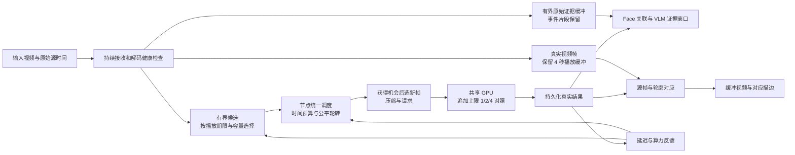

# SAM 实时提速与有界延迟方案

日期：2026-09-20。状态：方案与首版 worktree 实验；未部署、未进行新的 GPU 性能测试。

## 用户修正与实验边界

4 秒是播放视频的缓冲，SAM 在缓冲期间已经运行；它用于提高播放时轮廓就绪率，并不是推理后再等待 4 秒。保留现有 4 秒播放缓冲及轮廓对齐机制。本实验不降低播放缓冲、不改播放器、不启用原始画面替代方案。

当前 `sam_live` 可在同一 native_state 中逐帧追加；多帧请求也是逐帧推进。真实日志 394 个数据请求中有 316 个单帧请求，全部成功返回；末轮 72 个请求中有 69 个单帧请求。这支持“单帧追加可执行”，不证明批次 1 比 2/4 更快或跟踪质量等价。批次 1/2/4 均保留为对照档位；历史状态和三次真实检测确认保持原逻辑。

首版仅实现可开关的有界最新候选、未发送帧过期/替换审计、实际批次上限和结果截止时间指标。重点事件预留槽、节点统一许可、自适应采样、GPU 状态优化与输入接收修复仍是后续阶段，不能视作已交付。

依据：本次完整日志诊断、当前源码、任务“对比 SAM 3.1 调用优化”（01a0bea6-6a8c-73f2-8cf8-ca23242b3ce8），以及仓库已有压缩和 GPU 对照实验。本文的阈值是建议实验起点，不是已达到的性能或准确率承诺。

## 1. 决策与目标

采用“实时分支优先处理新帧 + 按算力分配摄像头预算 + 有期限的事件重点采样”。实时 SAM 不再补算所有过期帧。保留原始证据的职责与实时推理分开；需要完整录像时单独配置有容量限制的录像，不把 SAM 队列当录像库。

用户本次明确允许战略性丢帧，因此新增实时策略可以替代此前设计中“所有已接纳帧必须 FIFO 完成”的要求。录像批处理仍可保留有序完整处理模式。丢帧必须有记录、可统计，不能伪装成检测成功、无人或事件解除。

先解决三个不同问题：

1. **停止延迟累计**：限制等待任务的数量和年龄；忙时覆盖未派发的普通候选。
2. **恢复模型稳定吞吐**：查清双路 native 阶段从约 0.4 秒/帧变成 4–5 秒/帧的原因。
3. **保证结果赶上缓冲播放**：保留 4 秒视频缓冲，测量结果及时率和实际描边覆盖率；后台恢复另行验证。

### 日志支持的优先级

| 证据 | 设计含义 |
| --- | --- |
| 第二路最终 74.53 秒：派发前 43.33 秒、GPU 等待 17.82 秒、三帧 native 13.16 秒、其他约 0.22 秒 | 先清理待发积压、缩短 GPU 连续占用，再查 native；仅压缩上传不能解决主要部分 |
| 另一条路四帧连续处理约 18 秒 | 请求数量公平不等于等待时间公平；对照 1/2/4 帧实际请求上限 |
| 最后单路结果中位数 0.844 秒，模型末段约 0.35 秒/帧 | 低延迟存在可行基线，但尚未证明双路可长期保持 |
| 显存生命周期峰值约 99.85% 物理容量 | 优先采集逐请求显存和对象状态；目前不能认定泄漏或换页 |
| 显示正常约 4 秒；后台恢复出现约 17、31 秒 | 保留正常缓冲来等识别，后台额外落后另行修复 |
| 第一路源 PTS 相对接收时钟落后增量约 199 秒 | 输入前段列为独立故障；不能用 SAM 低延迟指标掩盖 |

### 建议验收目标

| 指标 | 起始目标与适用条件 |
| --- | --- |
| 尚未派发的实时候选 | 首版每路 1–8 个未准备候选，数量与年龄可配；按采样率和播放缓冲校准。原 1 秒/2 槽建议可能过早丢弃可用帧，未采用为性能结论 |
| SAM 接纳到结果耗时 | 在双路 native 恢复稳定、容量充足的场景，P95 ≤ 2 秒 |
| 最新有效结果年龄 | 正常模式 P95 ≤ 3 秒；动态更新，不能以“上一请求很快”代替新鲜度 |
| 缓冲播放画面 | 保留 4 秒目标；比较超出缓冲的额外落后和实际描边覆盖率，不设与 4 秒缓冲冲突的 3 秒显示目标 |
| 后台恢复 | 恢复后 1 秒内对齐最新可用画面，不补播整个隐藏期间 |
| 持续运行 | 双路 60 分钟，候选年龄和数量有界；有效处理覆盖率、最长无新结果间隔同时达标 |

不能把这些目标解释为“事件确认也在 2 秒内”。人物三次检测确认、事件多次证据和 VLM 推理有自己的时间要求。模型单帧若仍耗时 4 秒，丢帧只能防止无限排队，无法让该帧在 2 秒内完成。

## 2. 总体结构

Face、VLM 和归档继续独立运行。已有真实 SAM 结果仍可靠提交；显示不等待 VLM 整理完成。播放缓冲期间等待对应帧的识别结果，不将降低缓冲作为提速手段。暂不重新开启尚未通过验证的光流轮廓传播实验。

## 3. 候选队列与战略性丢帧

### 3.1 丢弃发生在哪里

| 状态 | 规则 |
| --- | --- |
| 尚未采样 / 尚未接纳 | 首选丢弃位置：按速率与价值选择，不为每个将被替代的帧写全量持久任务 |
| 普通候选，尚未准备 | 容量满时替换最旧候选，超过配置年龄才淘汰；按播放期限校准数量和年龄，记录源范围 |
| 重点候选，尚未派发 | 最多 1 个，2 秒期限；同一事件只保留一个最有用且仍新鲜的代表，不无限堆积 |
| 已准备但确认从未发送 | 可放弃整个准备批次，事务记录 abandoned，再以新 request_id 准备；不能改写原 hash 对应的内容 |
| 已发送 / 是否执行不确定 | 不用取消 HTTP 冒充取消 GPU。按原 request_id 查询或幂等重试；确认完成或失效后才能继续推进同一会话 |
| 已在 GPU 执行 | 允许完成；不释放执行锁、不并发推进相同状态 |
| 已返回真实结果 | 持久化并正常完成提交；过旧结果不刷新实时画面的“新结果”时间，可留作历史事实 |

后续重点候选策略尚未接入。若一个重点候选和一个普通候选都有效，**同一会话必须按源序号递增选择**。选择新帧越过旧重点帧时，旧帧变为历史证据或明确丢弃，不能随后倒序送回在线 SAM。

候选之外，每路最多一个已准备/待发送槽、一个在途请求；推荐最终把准备移动到获得节点调度机会之后，减少过早冻结旧帧。所有槽分别限图像字节数；候选数有界不等于原始视频缓冲有界。

### 3.2 重点帧如何产生

可使用已有事件状态、人物进出、身份待确认、位置显著改变作为提示；加入低成本的粗运动/场景变化信号，避免只有 SAM 检测到事件后才提升 SAM 优先级。信号只参与采样，不直接宣称事件发生。

建议策略：

- 稳定场景：以普通轮转采样。
- 刚进入的人物、正在确认的轨迹、事件从无到有：给予短时优先权，优先获得后续不同源帧。
- 持续告警：先保留首次发生、明显变化和当前状态，减少大量相似重复帧。
- 没有新证据：保持“未知/等待”，不得因丢帧累积 clear 次数。
- 恢复正常判断也需要真实新证据，不能让持续告警永久占满所有采样机会。

运动指标会受光照、摇镜影响，也会漏掉静止人物和短事件。保留周期性全画面探索采样；“没有运动”不能永久停掉人物分析。限频和丢帧必然可能降低短事件覆盖率，必须纳入质量验收。

### 3.3 持久化和证据语义

在 spool 新增显式跳过记录，至少保存 run、generation、源序号范围、源时间范围、原因、策略版本。原因区分 `superseded`、`expired`、`rate_limited`、`overload`、`input_resync`。在线接纳量必须能由完成、跳过、失败、未决数量核对。

已经被事件任务、Face 或归档引用的原图，不因 SAM 跳过而删除；采用引用计数或明确保留契约。未被引用且已终结的普通图像可释放。不要为了降低延迟取消 SQLite 的可靠提交语义。

实时丢弃的帧不默认排入同一 GPU 的后台“补算队列”，否则只是把积压换个名称。确需回放时采用独立任务、独立 predictor epoch、严格存储额度，只用实时工作之外的容量；历史结果不能回写当前人物位置。

停止实时分析时：终结未发送候选，等待已执行工作安全退出，再释放会话；保留收尾状态。录像完整分析模式仍按其合同排空。后续新 run 不复用旧 run 的源序、事件投票或轨迹 epoch。

## 4. 节点统一调度和自适应采样

### 4.1 从“FIFO 请求”改为“摄像头时间预算”

GPU 保持一个执行槽；现有 8 GB 环境下先不增加模型并发。CPU 图像准备、网络和结果整理可与 GPU 工作重叠，但均使用小容量队列。

1. **首版：实时 append 上限可选 1/2/4，先对照测试，不认定 1 最优。** 不是仅把触发目标设为 1：当前目标已是 1，积压时仍可发 4 帧，所以必须限制实际选取帧数。空闲 GPU 立即处理，不等 0.5 秒凑批。
2. 摄像头默认相等权重，按实际占用时间扣预算；同等情况下轮转。事件重点可短时提高权重，初始上限 2 倍，设 2–3 秒有效期，不能永久插队。
3. 调度时参考预测完成时间：候选年龄 + 预计 GPU 等待 + 单帧成本 + 提交成本。预计超预算先换最新候选；如果连最新帧都无法满足，进入明确的算力不足模式，继续有界的最佳努力分析，不通过永远拒绝来“达标”。
4. 任何时间预算都只能在真实帧之间执行。单帧已运行 4 秒时不能假定可以在 1 秒处抢占；因此慢帧仍可能阻塞另一条路，模型阶段必须单独修复。
5. 只有单路、无过期候选、实测确有净收益时，后续实验允许合发 2 帧。4 帧档也受候选数量和年龄限制，不允许以补旧账为由无限积压。

### 4.2 两个独立 Harness 需要 Contour 协调

不能只在两个客户端分别调低队列，然后假定实现了全局公平。最终在 Contour 节点登记每路“有候选”的轻量就绪信息，节点选定下一路后给短期发送许可；客户端此时选择最新有效源帧并发送。每路最多一个就绪项。

这是新增协议能力，需在 capabilities 中协商；旧客户端继续走旧路径，不能把新语义悄悄套在旧接口上。许可绑定 lane、session、generation 和一次性标识，过期未发送可回收；已开始执行则必须等待线程真实退出。节点重启后旧许可失效，请求重试仍沿用原幂等键。已收到完整媒体但未执行的 staging 也必须限字节数和年龄。

实施可分两步：先用每路最新候选 + 实际单帧 append 缩短 FIFO 占用；再加节点许可，把 GPU 队列从“等待的旧媒体请求”变成“等待的摄像头机会”。不要用客户端高频重试 429 实现轮转。

### 4.3 采样率由实际成本决定

令第 i 路实际 native 服务成本为 `c_i` 秒/帧、接纳速率为 `f_i` 帧/秒。初始容量规则：

`Σ(f_i × c_i) ≤ 0.70`

30% 余量用于突发、尾部波动和其他 GPU 开销；不是 GPU 利用率应低于 70% 的直接传感器阈值。成本同时观察近期均值、P90 和长尾，不能被初始化或空白预热代表。每 5 秒调节一次，并持续保留不同摄像头成本。

- 健康双路若都约 0.4 秒/帧，可先试每路 **0.75 FPS**：需求约 60% GPU 服务时间。是否足以满足业务确认速度还需验证。
- 如果仍要求双路各 1 FPS，则在同一保守预算下单帧平均成本需约 **≤ 0.35 秒**；不能把降低到 0.75 FPS 后的成功称为原 1 FPS 目标达标。
- 若两路都变成 4.4 秒/帧，70% 预算仅支持总计约 0.159 FPS，均分后每路约 12.6 秒一帧。此时必须报告容量不足，并修复模型、转移一路或升级经实测合适的资源。

快降慢升：连续两个短窗口过载或请求明显变慢，采样预算下调 20%–30%；连续约 30 秒健康，再以每路 0.05–0.1 FPS 小步回升。已有重点权重只重新分配总预算，不凭空增加总量。建议 0.5 FPS 作为试验中的业务覆盖警戒线；低于它需要明确降级，不能承诺仍可完整确认短事件。

## 5. 丢帧后的连续跟踪与事件正确性

协议现已要求源序号、源时间严格递增，没有要求数值连续，所以跳过未发送帧原则上可复用同一会话。但内部 native 索引按实际送入的帧递增，不能伪造重复帧补齐序号。

需要补齐三条规则：

1. **短间隔跳帧**：保留真实源时，维持会话；验证快运动和遮挡后的 ID 连续性。
2. **长间隔 / 输入重连 / 镜头突变**：超过经测试的跟踪可信间隔时关闭旧 epoch 并重新检测；初始可用 3 秒作为评估点，不是模型保证。明确轨迹中断，不以空间接近强行继承旧人物 ID。
3. **确认与解除**：SAM 三次真实检测确认保留。0.75 FPS 时，仅从第一次到第三次观察就约需 2.67 秒，事件启动还有采样相位和处理时间。重点调度应帮助获取后续新观察，但不能把同帧重试、复用框或空缺当成新证据。

VLM 时序窗口继续要求不同真实源帧、有效源跨度和足够图像。丢帧造成窗口不足时明确缺口，不重复旧图补成 2–4 张。丢失的时间段不算阴性；超过允许间隔时打断相应连续证据链。Face 关联仍在同源或已有严格关联契约下完成，不因“优先调度”放宽身份匹配。

## 6. 压缩方案：继承已验证部分，避免过度压缩

“对比 SAM 3.1 调用优化”确认云端和 Contour 共用核心实现：共享模型、BF16、无梯度、CPU 视频帧、16 槽输入环、32 帧历史裁剪和因果输出都已具备。本次不把这些已有能力当成新增提速成果。

| 项目 | 建议 |
| --- | --- |
| 传输编码 | 以现有 H.264 为质量基线；无 B 帧、zerolatency、请求独立解码，继续保留 |
| 图像长边 | 以 512 作为基线；本次日志已经是 384，不能说“改到 512 是进一步压缩” |
| 编码质量 | 以 CRF 23 为起点；只在带宽或编码指标证明必要时试 25/27，逐档验证人物轮廓、小人和遮挡 |
| 引擎输入上限 | Contour 明确配置 640，与云脚本对齐，防止其他客户端送入大图；对已缩到 384/512 的帧不会再次缩放，不能宣称获得倍数收益 |
| 批次策略 | 继承压缩方式；1/2/4 帧做对照，保持同一时序状态，不额外等待凑满批次 |
| 原始证据 | SAM 压缩副本与 Face/事件原图分开，保留完整视野和源映射 |

已有 9 月 13 日实验显示：H.264 512/CRF23 在特定视频上较 JPEG512/Q65 减少约 67% 媒体字节，但也存在遮挡、边缘框差异，不能称为精度不变。384 曾出现遮挡人物框严重退化，不建议进一步降至 320/256 来换取未经证实的 GPU 收益。

**单帧请求要重新比较编码成本。** 旧 H.264 优勢包含帧间压缩；每请求一帧时基本没有这项收益。以 JPEG512/Q65 与 H.264512/CRF23 做真实在线对照，比较总准备、传输、解码、native 和质量，局域网选择端到端更快的一项。当前上传本身是毫秒级，不能为了省字节等待凑批。

客户端 max_side 和引擎 `inference_max_side` 主要控制传输、解码、输出/掩码尺寸，不能直接当作神经网络内部计算尺寸。记录实际预处理 tensor shape 后才评估改动对 encoder 的影响。

**分辨率只能在受控会话边界切换。** `continuous.py` 校验会话 source_size/output_size 不变；中途由 512 切 384 会要求 reset。调度先调采样率和优先级，压缩档位在会话边界选定。切档涉及新 epoch、原图到归一化几何的映射以及身份重新关联，不能视为无损的热切换。

## 7. 模型阶段和显存专项

这是恢复双路容量的必要工作，队列优化不能替代。

### 7.1 先按请求补齐测量

在 node 单一 GPU 执行槽内，记录请求前后 allocated/reserved/free、该请求峰值、活跃轨迹数、历史状态条目、缓存特征字节、帧输入尺寸、CPU/GPU 搬运、native 和后处理耗时。初始化、普通推进、清理分开。逐请求重置峰值只在串行入口内做，防止多路统计互相覆盖。

诊断模式可用 GPU 事件或 profiler 分段确认；默认生产不额外在每个子步骤强制 synchronize，避免测量改变性能。采集 GPU 功率/频率/利用率和宿主进程显存，以区分状态增长、系统竞争、温度/功耗或平台内存压力。

### 7.2 对照矩阵

同一固定视频、相同采样时刻与原图，测单路、双路；分别测无人、单人、多人进出、持续遮挡。检查变慢是否与第二路开启、对象增长、缓存增长或显存余量下降同步。至少重复 3 次，再做 60 分钟持续运行；每次同时记录输出质量。

### 7.3 按结果实施

- 保留模型共享和现有状态裁剪；检查旧对象、frame feature、mask、CPU pinned buffer 是否在应过期时真正释放引用。
- 保留历史 32 的已审核基线。当前 adapter 明确支持 32–64，不能直接写 8/16；进一步缩短需要改状态契约和独立质量/等价性验证。
- 对明确人数很少的部署，可新建 `max_objects=8` 的实验配置，与默认 16 比较峰值和速度；不能仅截断输出数组冒充减少模型工作。人数超过上限要报告容量不足，拥挤场景保留 16。
- 以实测峰值分位数和余量控制新路接纳，起始试验保留约 1 GiB 或 15% 显存余量，结合 reserved/allocated/free 解释，不能单看 reserved 比例。容量不够则拒绝新增路、迁移或降级，不能清理其他路仍在使用的状态。
- 空闲回收机制继续使用；不在每帧做 `empty_cache()`，不以定时重启掩盖持续状态问题。必要的异常恢复在真实请求退出后进行，并显式开启新 epoch。
- 既有 encoder 编译和后处理批量 4 实验没有证明速度收益，保留关闭/批量 1，后续仅针对该 GPU 单独 A/B。
- INT8/低比特权重或状态压缩作为后续研究项，需要兼容性、显存、算子耗时、轮廓、ID 和事件召回全套验证；目前没有本仓库实测依据，不能承诺直接开启会提速。

如果单帧 native 仍明显超过预算，下一步是把一路迁到另一块 GPU/另一节点，或提供独立的轻量检测跟踪模式。轻量模式应有清晰的框/轮廓能力说明；用间歇 SAM 加轻量追踪时，推算几何不能冒充真实 SAM 观测，也不能重复充当事件证据。硬件采购和替代模型选择应在测出瓶颈后另做实测选型。

## 8. 输入接收与显示

### 8.1 输入落后的独立修复

目前 `stream_adapter.py` 使用接收时间生成下游 timestamp，而原始 PTS 只用于诊断。保留双时间轴：源 PTS/时基/连接 epoch，以及主机单调接收时间。只有获得可信时钟映射时才显示绝对源延迟，否则显示“相对落后增量”，不把接收时间标成拍摄时间。

将持续接收与昂贵的颜色转换/后续处理解耦，解码后普通输出使用最新帧槽。当前 `_put_latest` 已丢旧帧，但它发生在 `track.recv()` 和转换之后，因此仅缩小它的容量无法修复上游解码队列。

进一步测量发送端 FPS/PTS、RTP 到达、jitter/decode 队列、解码 FPS、颜色转换和事件循环停顿。若证实解码能力不足，优先协商降低源分辨率/FPS、减少无用颜色转换，再验证硬件解码是否有净收益。不要直接删除任意 H.264 P/B 包；压缩流追实时需按解码器/接收协议支持的关键帧刷新机制恢复。

初始异常触发点可设为相对落后增量超过 2 秒且持续扩大；这只触发诊断，需区分源时钟异常。确认缓冲失去实时性后，受控重同步/请求关键帧或重连，记录源 epoch 变化并限制重连频率。验收使用带可辨识源时钟的视频，避免“重写时间戳后指标归零”的假改善。

### 8.2 显示修复

- **保留 4 秒播放缓冲**。SAM 利用这段时间追上对应视频帧；同时测量超时结果比例、实际观察/传播描边覆盖率和最长无轮廓间隔。不得通过提前播放未识别帧美化延迟。
- 网络显示 FIFO 每个绘制周期选择最新到期的帧，释放更旧可展示帧；不只 shift 一帧慢慢追赶。重置必须同步清理图像/纹理和旧 Worker 回调。
- 页面恢复前台后清理过期队列，重建播放时钟，立即拉最新帧；按 generation 丢掉后台期间迟到的旧响应。
- 保留现有缓冲播放和轮廓对齐路径，比较真实观察描边、传播描边和无描边帧比例，不通过切换原始画面规避覆盖率评估。
- 事件状态更新可以重绘旧源图，但不增加 distinct_source_frames，不刷新“最新图像时间”。

### 8.3 指标改名与关联

页面同时提供：最近完成帧的处理耗时、最新有效结果的当前年龄、当前显示源帧的年龄、输入相对落后增量、最近一分钟处理覆盖率和跳过原因。结果与显示均携带同一 run/epoch/source_sequence，才可计算同帧从结果就绪到呈现的开销。

浏览器目前根据收到的一组媒体时间重建 capturedAt，未包括上游全部时间。跨主机不能直接相减 monotonic；新增时钟映射与 RTT 不确定度，或使用已知源时钟基准测试。在未完成前，不宣称页面数值代表传感器到屏幕延迟。

## 9. 实施顺序与代码落点

| 阶段 | 改动与主要落点 | 出口条件 |
| --- | --- | --- |
| P0：可观测与显示 | `scene_delivery.py`、`camera_display.js`、`dashboard.html`；同源时钟、及时率与描边率指标、保留 4 秒缓冲，后台恢复另测 | 同源关联正确；后台停留 30 秒后不补播旧帧；每项延迟含义清楚 |
| P1：阻止积压 | `sam_tracking_pipeline.py`、`sam_tracking_spool.py`、`video_tracking_session.py`；可配 1/2/4 帧上限、有界候选、过期/替换审计、幂等边界 | 人工注入慢请求时队列数量/年龄有界，恢复后处理新帧；旧结果/重试不乱序 |
| P2：统一调度与输入定位 | `workers/sam_scene/multistream.py`、`continuous.py`、Contour contracts/adapter/API；节点许可、成本预算；`stream_adapter.py`/`stream_diagnostics.py` 输入时间轴 | 双路不会重复排旧请求；公平和降级可见；PTS 落后来源定位 |
| P2 并行专项：native 稳定性 | `sam_live.py`、`streaming_state.py`、`gpu_memory.py`、`sam31.py`；逐请求内存、对象和成本关联 | 找到并修复 native 增长原因，或明确硬件/场景容量边界 |
| P3：压缩与资源配置 | `video_transport.py`、部署配置、Contour 包；512/CRF23 基线、单帧 JPEG 对照、640 上限、人数容量档位 | 只有实测更快且质量合格的配置成为默认 |
| P4：可选扩展 | 轻量实时模式、多节点/多 GPU、编译/量化实验 | 独立质量与性能验收，明确能力差异 |

首个实验版本先交付队列 P1 与结果及时率指标，播放器保持原样；模型专项和输入异常定位同时开展，不能等所有优化完成才阻止积压。最终发布需同时包含 Harness 和 Contour 的匹配版本、协议能力声明、有效配置回读及回退开关。

新策略建议命名 `realtime_latest`；旧完整处理策略保留 `durable_ordered`。切换仅在 run/session 边界。自动降级、跳过原因和覆盖率必须在状态接口出现，不能只是内部日志。

## 10. 验证、质量门槛和回退

### 必要功能测试

- 注入 0.4 → 4.4 秒处理成本变化：只保留有界候选，未发送旧任务有跳过记录；恢复后不继续补 40 秒旧帧。
- 两路成本不同、重点权重持续到来：按成本计费，另一条路仍有服务机会；报告资源不足时的最长空窗，不承诺物理不可能的硬时限。
- 请求发送后断网、超时、重复请求、停止/新 run 交错：没有重复推进、提前放锁、串会话或改写幂等内容。
- 跳帧、长间隔、分辨率变更：源映射正确；需要 reset 的场景明确新 epoch。
- 丢帧不重复确认、不当作 clear；VLM 缺帧窗口不伪造；被引用原图不会提前清理。
- 标签页隐藏 30 秒后恢复、慢 Worker 迟到、事件重绘：最新帧及时呈现，旧回调不覆盖新帧。
- 断线重连与异常 PTS：能识别 epoch，不能以改时钟掩盖输入积压。

### 实机性能与质量验收

固定同源视频，逐项改变一个因素：当前基线 → 单帧 → 新候选策略 → 节点调度 → 压缩/资源配置。必须在线计入缩放、编码、传输和解码；原片 PTS 驱动回放，不能让慢分析反向拖慢“采集时钟”。

至少覆盖单路/双路、无人/多人、近远人物、快速进入、遮挡重现、短事件和事件解除；正常/后台恢复/网络抖动；每种短场景至少 3 次，最终双路 60 分钟。

同时报告：

- 源到结果、源到呈现、当前结果年龄的 P50/P95/P99；首次结果、最长无新结果间隔。
- 每路采集期不同源成功 FPS、重点/普通覆盖率、跳过比例与原因；EOF 补算单列，不能用补算美化实时成绩。
- 请求前等待、GPU 等待、native、准备、提交、显示，各段的同源关联。
- 显存峰值和随时间曲线、对象数量、状态字节、native 时间是否出现持续增长。
- 人物召回、轮廓质量、ID 切换、事件召回/误报、首次有效判断与最终确认延迟。

质量门槛建议：关键标注事件不能新增漏检；一般人物/事件召回相对基线下降超过 1 个百分点或 ID 切换率增加超过 10% 即暂停推广并复查。门槛须结合样本量、标注和置信区间，不能用几段样片证明没有退化。过载测试允许显示“分析降级”，但不允许静默漏帧并仍报告满足原吞吐目标。

回退按功能开关执行：显示、实时候选、节点调度和压缩档分别可控。协议/状态变更在新 session 生效，原在途请求完成后再切换。回退旧 FIFO 的同时限制新接纳速率，否则会重新制造原有积压。

## 11. 依据与可复核位置

- 本次日志分析：`.goodvision/diagnostics/sam-queue-20260920/sam-latency-analysis.md`；原 ZIP、逐批关联和接口快照保留在同目录。
- 既有压缩、编译与质量实验：`docs/architecture/sam31-optimization-20260913.md`。该文中的旧 16 帧启动/旧跟踪模式不是当前 sam_live 的配置。
- 既有并行、证据和显示边界：`docs/architecture/parallel-latency-implementation-20260917.md`；不能将其中未验收的显示实验视为已经可用。
- 当前候选与准备流程：`src/goodvision_harness/sam_tracking_pipeline.py`；持久化：`sam_tracking_spool.py`。
- 当前 FIFO GPU：`workers/sam_scene/multistream.py`；源序、尺寸、执行与幂等：`continuous.py`。
- 当前因果输出与三次确认：`workers/sam_scene/sam_live.py`；已审核历史限制：`streaming_state.py`。
- 当前传输：`src/goodvision_harness/video_transport.py`、`video_tracking_session.py`；云配置：`compose.sam31-remote.yaml`、`tools/start_sam.py`。

首版 worktree 已实现 P1 子集并完成协议模拟回归与过载对照，详见 `docs/validation/sam-realtime-queue-experiment-20260920.md`。其余阶段仍是方案；模型吞吐、质量和实际描边覆盖率尚未经过这台双路 GPU 的新一轮验证。
