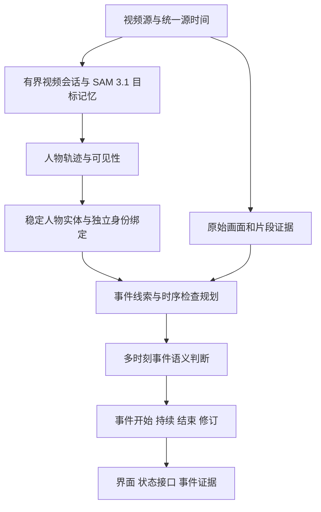

# SAM 3.1 适用性与架构改造评估

日期：2026-09-12。评估对象：`codex/entity-event-engine`。

## 决策

**SAM 3.1 适合作为本项目原生视频感知后端的候选；需要较大的感知和视频接入改造，但不需要推倒现有的人物／事件分层架构。**

适用性是根据官方代码、论文与本地实现作出的工程判断。当前未加载 3.1 权重、未进行 GPU 实测，不能将该判断当成实时性、显存或识别效果验收。

对于已有录像，公开视频接口提供了清晰的验证路径。对于持续运行的摄像头，模型的时序核心可以复用，但公开接口尚未提供完整的无限流输入与资源管理；这部分需要我们维护。

建议先验证原生视频跟踪是否确实优于当前关键帧方案，再完成有界实时适配，最后决定是否设为默认后端。本轮仅形成评估，没有修改运行逻辑、下载权重或租用服务器。

## 版本与能力边界

当前 worker 使用 `facebook/sam3` 的 `sam3.pt`，调用图像模型，关键帧之间由本项目的恒速关联器预测位置。它没有使用官方视频 tracker 的目标记忆。[当前实现](../../workers/sam_scene/README.md)

SAM 3 本身已有原生视频跟踪。对本项目而言，从图像调用转为有记忆的视频会话，是主要架构变化；SAM 3.1 的 Multiplex 则改进了多目标视频处理的效率。官方发布说明的约 7 倍加速针对 H100、128 个对象、相对 2025 年 11 月版本，部分概念分割基准也有退步，不能推导成我们的事件识别普遍更准或更快。[发布说明](https://github.com/facebookresearch/sam3/blob/660a5e9e1b8b4c02c0ad97229b88a09a6e4ff5b7/RELEASE_SAM3p1.md)

论文附录 H 对双方优化后的内部实现报告另一比较口径：单目标约有 7% 延迟开销，多个目标开始获益，128 个目标时约 5.2 倍。它与发布说明的比较基线不同，均不是本项目在 4090 上的测试结果。[论文附录 H](https://arxiv.org/html/2511.16719v2)

可期待的收益是人物轨迹、分割轮廓与多人场景处理效率；其幅度需要实测。SAM 的 object ID 仍是跟踪编号，不等于真实身份，也不保证跨摄像头或长时间离开后的身份连续。抽烟、打架、跌倒、持械的判断仍需结合上下文和时序语义模型。

本项目固定的官方源码 `660a5e9e1b8b4c02c0ad97229b88a09a6e4ff5b7` 已包含 3.1 的构建入口，因此不必为支持 3.1 而盲目更新源码；需要选择正确的构建器、权重和适配方式。

## 实时接入的实际距离

官方示例以已有 MP4 或 JPEG 目录建立会话，添加 `person` 提示，传播得到每个源帧上的对象结果。换语义提示需要重置会话。[官方示例](https://github.com/facebookresearch/sam3/blob/660a5e9e1b8b4c02c0ad97229b88a09a6e4ff5b7/examples/sam3.1_video_predictor_example.ipynb)

公开分派器没有实时帧追加操作，默认传播方向为 `both`；`handle_stream_request` 是结果流。实时验证必须只使用当时已经收到的帧，并明确限制传播方向。[会话接口](https://github.com/facebookresearch/sam3/blob/660a5e9e1b8b4c02c0ad97229b88a09a6e4ff5b7/sam3/model/sam3_base_predictor.py)

底层已有逐帧推理、动态对象管理和分批延续生成器状态的实现，说明可以继续开发实时适配；但输入初始化仍固定帧数。需要一起解决输入追加、历史状态回收、源帧编号、新人物发现、断流和超时。仅向目录追加图片或反复创建重叠片段，不等于已经实现连续模型记忆。[跟踪实现](https://github.com/facebookresearch/sam3/blob/660a5e9e1b8b4c02c0ad97229b88a09a6e4ff5b7/sam3/model/sam3_multiplex_tracking.py)

默认构建器设置 `hotstart_delay=15`、检测及后处理批次 16。按本项目当前 4 FPS 输入折算，15 帧就对应约 3.75 秒的源时间量级；这只是参数折算，未计其他等待，不能当作实测延迟。实时适配必须重新选择批次和确认策略，量化其对准确率的影响。[默认构建配置](https://github.com/facebookresearch/sam3/blob/660a5e9e1b8b4c02c0ad97229b88a09a6e4ff5b7/sam3/model_builder.py#L1094)

## 必须修改与可以保留的部分

| 部分 | 判断 | 原因与目标 |
| --- | --- | --- |
| SAM 感知 worker | 主要重做 | 从图像检测＋运动预测改为拥有模型记忆的视频会话；维持清晰的就绪、失败和资源边界 |
| 感知输入／输出协议 | 主要重做 | 接纳按序帧或有界视频批次，返回逐源帧结果；支持会话、模型重启代次、完成进度和丢帧信息 |
| 人物关联 | 必须修改 | 原生轨迹编号应稳定映射到人物实体；保留独立的人脸身份绑定 |
| 证据时间与检查规划 | 必须修改 | 分离最新采集时间与已完成跟踪的源时间，围绕图像和轨迹均齐全的区间检查 |
| 人物状态、事件生命周期 | 保留核心 | 开始、持续、结束、未知、修订与撤回不依赖 SAM 版本 |
| 时序 VLM 执行器 | 保留核心，调整调度 | 继续处理事件语义；根据新轨迹和事件证据选择检查时机 |
| 界面、状态 API、事件目录 | 保留框架 | 补充处理延迟、后端和必要的证据字段，无需重建整个产品 |

### 1. 避免覆盖原生跟踪编号

当前 `service.py` 将 worker snapshot 交给 `PersonRegistry`。`person_registry.py:239` 每次按框与速度重新关联，未优先信任已有原生 ID；其短期过期规则也会删除映射。直接把 SAM 3.1 的 object ID 放入当前响应，可能仍被上层改写。

新增原生轨迹模式，以 `(source session, predictor epoch, native object ID)` 映射到稳定的 `subject_id`。同一模型会话内保留映射；重启后不能仅凭相同整数 ID 合并人物。只有需要跨会话衔接时，才使用独立的关联证据，歧义保持未知。

### 2. 分开视频感知与单图请求

当前 `rich_labeling.py` 采用 JPEG 请求对应单张 snapshot；协调器会替换尚未处理的旧帧，并校验返回结果与请求帧相同。这不适合直接承接视频传播的多个结果。

应建立单独的视频会话协议。输入、帧序号和源时间必须有序；积压时明确降采样、报告间隔或重置，不能无限排队，也不能把任意丢帧隐瞒为连续输入。感知处理频率与 VLM 证据采样频率应分别控制。

### 3. 分开采集时间和分析进度

当前 `scene_runtime.py:405` 围绕最新采集时间前 3 秒规划检查。如果完成一个 5 秒片段后才返回轨迹，早期结果到达时可能已经被判定为遮挡，且找不到可规划的当前证据窗口。

规划应围绕已完整提交的 tracking source watermark，视频展示与数据新鲜度仍按真实采集时间判断。不能用较旧的分析进度冒充实时，也不能将旧框画到当前画面。

原始图像、轨迹历史与检查任务应按时间跨度和字节数共同保留。当前人物历史上限 64 条，若直接接入 30 FPS，只有约 2.1 秒，需避免帧率提高反而缩短有效时序证据。

### 4. 保留观测真实性与修订语义

最小版本可以将有效 mask 转为 bbox，暂时保留现有 VLM 输入。协议仍应携带源帧、原生 ID、会话代次、可见性与来源信息；将来增加有界 mask 引用，而非向所有界面响应复制完整掩码。

当前图像实际参与计算、有有效定位的模型跟踪结果，可以作为一次新的定位观测；纯运动外推、空 mask 或仅保留 ID 不能等同于当前可见。模型输出也不是人工真值。

原生视频重算历史轨迹时，需要独立的轨迹修订入口；现有 watermark 会拒绝旧几何结果。事件引擎的修订／撤回机制可以复用，但要明确连接轨迹归属更正与受影响的事件证据，且不倒退当前画面状态。

## 更充分的事件逻辑升级

以下是为了提高产品能力的后续设计，不是使用 SAM 3.1 的硬性前提：

- 用人物轨迹、姿态变化、人与物品的相对变化构建候选线索，再调用 VLM 复核；保留独立全景巡检，避免只关注已经成功跟踪的人。
- 对抽烟、小型武器等细节同时保留人物局部与全景上下文。稳定的人体框本身不能保证这些细节可见。
- 将事件判断从一个窗口的单个真假值扩展到发生区间、支持帧、参与者与修订。相互重叠的窗口按新增证据去重。
- 保存有界事件片段和证据引用。当前事件目录主要保存元数据，最新时序检查只保留一组图像，并不是完整视频证据库。

当前全景巡检间隔 5 秒、回看窗口 3 秒，人物触发主要看人体框位移。短暂动作可能落在未覆盖的时段，稳定跟踪也不会自动解决；应在对照实验中单独检查事件证据覆盖率。

建议目标数据流：

## 部署前需核验的具体事项

- 新权重为 `facebook/sam3.1` 的 `sam3.1_multiplex.pt`。需要确认此仓库的账号访问权限，不能假设 SAM 3 获批就自动覆盖 3.1。[官方权重仓库](https://huggingface.co/facebook/sam3.1)
- 当前 Python 3.12、PyTorch 2.10、CUDA 12.8 基础路线可以保留。首轮明确关闭可选 FA3 和编译优化，验证正确性后再逐项测性能；优化开关不能代替 GPU 预热与真实录像验收。
- 固定源码的会话调用存在一个静态可见的参数不匹配：基类 `start_session` 传入 `offload_state_to_cpu`，实际 multiplex 模型的 `init_state` 不接收该参数，wrapper 也没有覆盖此方法。沿该调用链会产生参数错误，需适配；本次未进行 GPU 运行确认。[调用方](https://github.com/facebookresearch/sam3/blob/660a5e9e1b8b4c02c0ad97229b88a09a6e4ff5b7/sam3/model/sam3_base_predictor.py#L112)、[模型签名](https://github.com/facebookresearch/sam3/blob/660a5e9e1b8b4c02c0ad97229b88a09a6e4ff5b7/sam3/model/sam3_multiplex_tracking.py#L2050)、[wrapper](https://github.com/facebookresearch/sam3/blob/660a5e9e1b8b4c02c0ad97229b88a09a6e4ff5b7/sam3/model/sam3_multiplex_video_predictor.py)
- 4090 24GB 可以作为少人数、有界录像验证的候选，不能承诺任意视频长度、人数与缓存策略都够用。若选择 48GB 卡，得到的是更大的显存余量，不是已经解决实时内存增长。
- 官方 builder 对部分权重加载使用 `strict=False`；部署适配应审查缺失／额外键，不能仅凭构建函数返回就报告权重完整或 GPU 就绪。

## 实机验证与迁移顺序

1. **先验证正确加载。** 固定代码与权重，检查依赖、权重键、最小会话和前向传播。先修复可独立定位的接口兼容问题。
2. **固定录像做感知对照。** 相同输入、分辨率、采样率，对比当前关键帧后端与 3.1 原生视频；条件允许时加入 SAM 3 原生视频，区分“引入视频记忆”和“Multiplex 升级”的收益。
3. **验证真实增量输入。** 只向模型提供当前已到达的帧；先做单路、少人数，再逐步增加。若先用片段方式，明确记录片段延迟和模型记忆重置，不能把它命名为已完成的无限实时会话。
4. **接入人物映射和分析进度。** 验证交叉、遮挡、离开重入、新人中途加入、断网、重启、重复和迟到结果；核对人物与事件不会错归属。
5. **固定语义模型做事件对照。** 使用同一 VLM、证据分辨率与请求预算，量化事件召回、误报、首次疑似／确认延迟及总成本。之后再单独比较新的检查规划策略。

需要同时记录：ID 切换与断轨、人物漏检、错误事件归属、处理进度与真实画面的差距（P50/P95）、峰值与持续内存、队列长度、各类事件召回／误报、VLM 图像 token 与 GPU／流量成本。

迁移门槛应根据真实样本和业务可接受延迟确定。至少要求：连续性有可重复改善、事件效果不因迁移退步、输入持续运行时队列和内存有界、当前状态如实显示处理滞后。小样本成功只支持试点，不能支持生产准确率结论。

**最终建议：推进 SAM 3.1 原生视频后端的验证和针对性改造；保留当前人物／事件骨架。全面重写整个程序没有必要，直接替换权重同样不足。**
