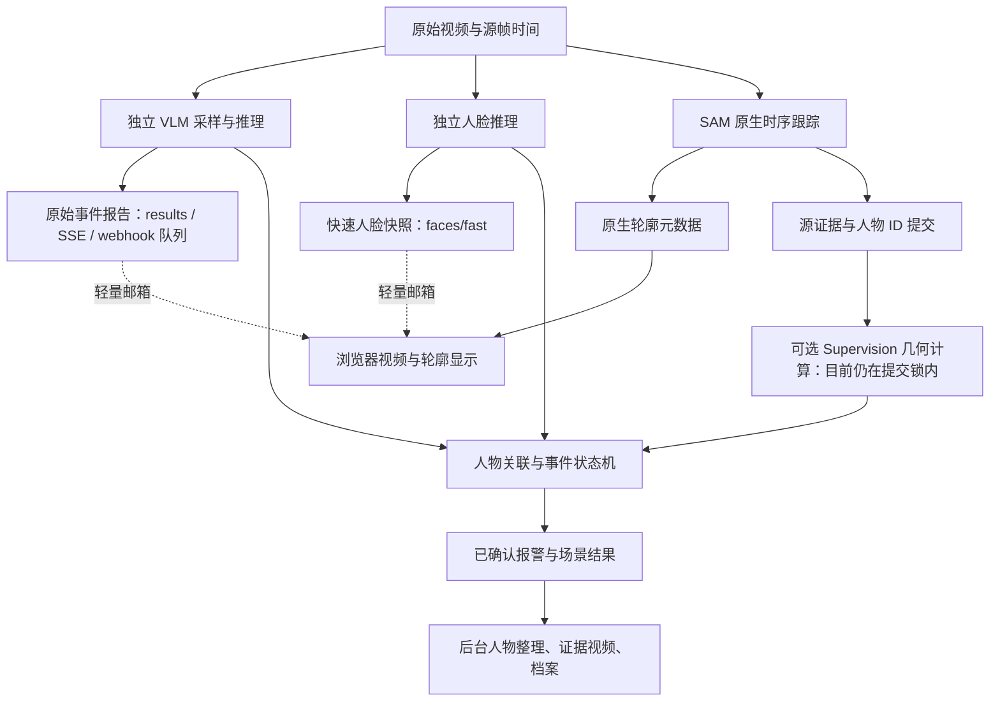

# Supervision 实验：部署时延与硬件评估

2026-09-23。审查对象为 `codex/supervision-event-runtime` 的 `630cd25`，对照基线
`24e8ca8`。[结构和配置](supervision-experiment.md)；
[本次测量原始数据](../validation/evidence/supervision-runtime-20260923.json)。

## 结论

新分层与原来的实时部署方向兼容，但当前实验不能宣称已经满足“第一时间报警、
低延迟标注”的整机目标。原始事件、人脸快照与 SAM 轮廓仍有各自的快速路径；
已确认事件、陌生人报警及归档有额外条件。可选 Supervision 几何处理还在共享锁内
执行，异常停顿会阻塞场景读取，需要在正式启用前改进隔离。

模型、输入采样率、模型并发、GPU 部署拓扑均未因本次适配而改变。新增组件没有
新增 GPU 推理或显存分配路径，因此没有由本次适配引出的更高 GPU/显存规格要求。
启用后增加 CPU 运算和系统内存；默认关闭时，本次合成 A/B 没有观察到明显性能变化。
这些结论不等于现有硬件已经足以满足原有整机指标。

## 真实信息流

六个目录是代码职责分层，不是把每帧串行送过六道处理工序。
当前 active scene + independent VLM + native SAM 的主要信息流如下：



这张图中的即时结果与确认结果有不同语义。原始事件消息的
`observed_detected=true` 表示模型本次看到了事件；`detected=null` 仍是未确认。
不能把前者当作后者来缩短验收延迟。

关键代码路径：

- `vlm_independent.py::_read` 在融合、档案操作之前发布原始报告，随后投递邮箱。
  模型采样、请求本身及分支内部的排序仍会产生延迟；默认 full 输出按请求序发布，
  慢的较早请求可能挡住较晚结果，至其完成或超时。
- `FaceFastResults.publish` 和 `/v1/faces/fast` 不取 service/scene 锁；快照包含本次
  人脸匹配，不能冒充已关联人物的最终陌生人事件。
- `sam_tracking_pipeline.py` 先调用 `on_native_batch` 发布源帧轮廓，再由另一提交线程
  调用 `_on_batch`。浏览器入口因此可以先拿到轮廓；新增调试 renderer 没有替换
  生产显示，也没有引入每帧 Supervision JPEG 重绘。
- `_on_processing_batch → _on_tracking_batch → SceneRuntime` 仍持有源提交、服务和
  场景相关锁。新 `_observe_geometry` 在这条路径同步执行；它的异常会被隔离，
  但耗时不会被隔离。旧 JPEG 场景显示及确认结果等需要场景快照的消费者会等待；
  堆积也可能通过有界跟踪队列反压后续输入。
- 非原生检测走 `SupervisionLabelClient`，过滤/NMS 后才提交原对象。该装饰器也计算
  区域、越线、平滑，场景层随后再次计算几何；目前存在重复工作。native SAM 绕过
  这个装饰器，其原生 ID、mask 和人物数量不受 NMS/置信度过滤影响。

## 问题一：还能满足实际报警和标注目标吗？

| 需要的结果 | 当前能力与限制 |
| --- | --- |
| 第一份事件信号 | 保留独立发布；无需等 SAM、人脸或归档。仍须支付采样、排队、VLM 和网络耗时，不能据此承诺亚秒或 2 秒。 |
| 关联到具体人物的确认报警 | 仍需可靠定位、源帧关联和 N 帧证据。默认事件确认需要 2 次阳性观察；不能用一份原始阳性替代确认。 |
| 人物出现、已知身份识别 | SAM 轮廓与快速人脸匹配可先到；将姓名正确放到同一人物上仍需源时间和几何关联。 |
| 已确认陌生人报警 | 现有 policy 要求相关身份复核为 unknown，否则 confirmed 会被降为 suspected、`alert=false`。真实 StreamingSession 的在线复核唤醒直接返回，最终复核在 run 收尾进行；当前不能保证实时发出这个最终报警。这是原有门槛，本次搬迁保留了它。 |
| 极低延迟图片标注 | 原生轮廓有提前发布路径，Supervision 平滑/热力图没有进入生产画面。首次轮廓仍要等真实 SAM 结果；事件变色还要等关联和确认。浏览器轮廓、JPEG 合成、确认变色须分别计时。 |

两项容易掩盖真实延迟的因素：

1. 当前 VLM 默认采样率为 1.25 FPS，采样相位就可能带来约 0–0.8 秒等待。
   连续两次有效采样至少跨越一个采样间隔；还需加上模型推理、关联和交付。
   这不是把所有分支延迟机械相加，独立分支可以重叠执行。
2. 最新已记录的真实视频轮次（2026-09-22，OpenRouter C/Qwen3-VL 30B、4090 SAM、
   CPU InsightFace）中，源帧发送到接收的中位数/P95 是 **11.17/18.36 秒**，模型
   中位数 **7.70 秒**。发布后到接收才是 **79/559 毫秒**。
   该轮还有真实跌倒观察未融合成对应事件的情况。这是历史配置的结果，不能作为
   本次 A/B，也不能外推所有模型路线；但明确说明“发布通路独立”不等于整机达标。
   详见[真实视频验证](../validation/events-and-lifecycle.md#2026-09-22真实视频与独立接收-worker)。

本次故障探测让可选几何计算等待 200 ms，同时调用 `scene.snapshot`：读取在等待
期间没有完成，最终等待 **206.6 ms**。这验证了锁耦合，不是现实场景的 P95。
低平均开销不足以证明 CPU 饱和、GC、批次集中提交时的尾延迟。

## 问题二：硬件要求和实际负担

### CPU

本机 Apple M4 Pro、14 逻辑核、24 GiB 内存，macOS 26.5.1、Python 3.12.12、
Supervision 0.30.5。每个计时用例使用独立解释器，预热 20 帧、测量 200 帧。
目标是稳定合成 bbox，没有相机、模型、网络、mask 推理、视频渲染或档案。

“典型开启”指 1 个全幅区域、1 条线、5 帧平滑；“最大区域数”指各 16 个。
所有调用保留原生轨迹，未启用 NMS。

| 每帧目标数 | 新增组件自身 P95，典型开启 | 旧版场景处理 P95 | 新版关闭 P95 | 新版典型开启的场景处理 P95 |
| --- | --- | --- | --- | --- |
| 8 | 0.272 ms | 0.069 ms | 0.071 ms | 0.358 ms |
| 64 | 1.444 ms | 0.560 ms | 0.560 ms | 2.041 ms |
| 128 | 2.802 ms | 1.291 ms | 1.282 ms | 4.168 ms |

“场景处理”仅计 `observe_tracks` 的内存提交，不包括完整 service 原生批次、证据
提交和其他回调，不能当作所有原生锁的实测持有时间。128 目标、最大区域数时，
组件自身 P95 **4.176 ms**，该场景提交 P95 **5.564 ms**。

组件 CPU 平均耗时在典型配置下约为 **0.256/1.426/2.810 ms**。
若假设每路每秒 7.5 次几何处理、12 路，单靠这些组件推算的额外 CPU 时间为：

`12 × 7.5 × 单次CPU毫秒 / 1000`

分别约 **0.023/0.128/0.253 个本机逻辑核的 CPU 时间**；最大区域数、128 人约
**0.375 核**。这是基于合成测量的容量推算，未做 12 路摄像头并发压测，不含
模型、解码、绘图、复制、锁竞争和 CPU 降频。若实际分析 30 FPS，此项再乘 4；
浏览器显示 30 FPS 不代表几何也计算 30 次。

当前即便没有区域/越线，开启组件仍会执行平滑；实时 scene 只消费 geometry，
丢弃了 `display_detections`。这部分开销是可以去除的多余计算，不能当作采用
Supervision 必须支付的成本。
`smoothing_length=5` 使用已有历史，当前调用会立即返回，并不要求先等待未来 4 帧。

### 系统内存

下表为新进程导入服务、每场景 64 目标更新 32 帧后，3 次测量的峰值 RSS 中位数。
不是模型加载后的服务总内存，也不是精确的独占物理页增量。

| 配置 | 1 个场景 | 同进程 12 个场景 |
| --- | --- | --- |
| 关闭 | 99.0 MiB | 110.9 MiB |
| 开启、无区域和线 | 151.8 MiB | 168.5 MiB |
| 开启、各 1 个 | 153.0 MiB | 179.8 MiB |
| 开启、各 16 个 | 167.3 MiB | 366.5 MiB |

典型配置较关闭增加约 **54 MiB/单进程单场景**；很大一部分来自首次导入
Supervision 及依赖。第一次启用的初始化约 **0.28 秒**，不是每帧增加这么久。
同进程 12 场景共享一次导入；当前 fleet launcher 为各相机生成独立服务，不能
拿同进程数字当 12 服务的总账。简单线性推算 12 个独立服务约增加 **648 MiB
（0.63 GiB）RSS 总和**，不含原有模型和媒体缓冲；目标 Linux/Windows 机器仍需实测。

区域 mask 是 uint8，最大坐标为 1000 时每块 `(1002×1002)`，约 0.96 MiB。
实时 scene 的工作平面固定为 1000×1000，不随摄像头分辨率增长。
但非原生客户端装饰器按原图尺寸创建第二套区域：4K 全幅每区域约 7.9 MiB，
16 区域约 127 MiB，之后还有 scene 的区域状态。因此多路、高分辨率和多区域
同时启用时不能忽略 RAM，应该避免重复计算。

### GPU、显存与其他资源

- 新增实时运算是 NumPy/CPU 几何，没有新增模型、CUDA tensor、GPU worker 或
  模型并发。SAM、人脸和 VLM 的原有部署需求保持；不因目录分层而需要更大显存。
  本次未运行 CUDA，因此“新增路径不分配显存”是代码结论，不是显存峰值实测。
- ByteTrack、mAP、数据集转换、热力图 renderer 当前为离线/调试用途，默认实时
  成本为零；把它们再接入在线路径时需另行算账。
- 安装 extra 增加依赖、磁盘和冷启动成本；实时区域结果也略增 JSON 数据量。
  没有增加视频分辨率、原图副本队列或额外模型请求。
- CPU/RAM 成本落在执行 harness 场景进程的机器上；若主程序与 GPU worker 分开
  部署，新增负担不会自动搬到 GPU 主机。

## 启用为正式部署前的工作

1. 将可选区域、越线等放到有界且按源时间处理的独立队列，关键提交只交接不可变
   引用；超载应公开 geometry 不可用和时间缺口，不能静默丢帧后仍声称越线计数完整。
   必须影响检测语义的过滤/NMS 保留明确的适配边界，并单独限定耗时。
2. 按实际消费者决定是否做平滑/绘图，避免非原生适配器和 scene 双重几何计算。
3. 把陌生人必要的在线判定与耗时的最终人物整理分开，保留证据门槛，不能靠移除
   复核或把 suspected 改称 confirmed 来实现“实时报警”。
4. 在目标机、目标路数和真实模型上分别验收源到首次观察、源到确认报警、源到首个
   正确轮廓、判定到变色的 P50/P95，以及 CPU、RAM、GPU、VRAM 和积压增长。
   现有明确的显示目标还要求统计不同源帧，不能用同帧重画充当 15 FPS。

本次补跑了组件、快速人脸、独立 VLM、原生显示/提交和轮廓报警相关回归：
**120 passed，2 warnings，16.07 秒**；警告为既有 TestClient 依赖警告与离线
ByteTrack 弃用提示。独立报告在场景/服务锁阻塞时仍可发布的测试通过；测试模型
为替身，不是当前真实模型的延迟证明。此前实验全量回归为 **4621 passed、40 skipped**。

## 复现

```bash
python tools/benchmark_supervision_runtime.py --frames 200
# 可选：用 git archive 提取 24e8ca8 的 src/ 后比较旧实现，同一 Python 环境运行。
python tools/benchmark_supervision_runtime.py --frames 200 --baseline-source /path/to/baseline/src
```

工具只执行本地合成输入；内存指标使用 macOS/Linux 的 `ru_maxrss`。
本次没有启动云 GPU、真实摄像头或修改部署，报告说明的待改进项尚未实现。
