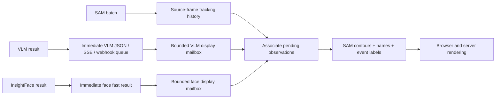

# VLM observations and tracking-owned event state

The independent VLM branch publishes each temporal observation immediately.
It no longer compares boxes across requests, retains a person-box history, or
maintains a second person-event state machine. The former 3-second candidate
cache and 1.2-second / 0.35-IoU pose matching are removed.

SAM/native tracking supplies person continuity. Background association binds
each VLM observation to tracking at its source time, then submits its positive,
negative or uncertain evidence to the existing scene event state machine.
Confirmation, clearing and duplicate-source handling use that scene's tracking
IDs and configured evidence rules.

## Information and SAM-driven display

Continuous native SAM sessions (`sam31_stream`, active scene mode and
independent VLM enabled) have two separate consumers of completed inference:

Previously, native contours could already bypass the service/scene lock, but
names and event colors came from scene callbacks independently of new contours.
VLM display association also depended on background scene processing, and face
labels depended on ordered identity processing. A late scene callback could
repaint already displayed geometry without a new SAM batch.
VLM webhook admission also ran in the association worker, so a stalled scene
association could hold up later webhook reports. It now goes directly to the
webhook's independent bounded delivery queue, immediately after JSON/SSE
publication. Network requests remain on the delivery worker.

`SAMDisplayFusion` now receives small, image-free copies **after** the raw
publication. Its two bounded mailboxes have no service, scene, archive or model
dependency. On each newly accepted native batch, the display consumer matches
each observation to a single historical SAM frame: exact source sequence first,
otherwise the closest source timestamp within 0.55 seconds for VLM or 0.75 seconds
for faces. An exact empty frame and ambiguous person matches are barriers, not
reasons to borrow a different person's earlier box. Native epoch plus object ID
supplies continuity; a predictor restart never inherits another epoch's labels.

The original evidence timestamp stays unchanged. New presentation intervals begin
at the newest source in the next accepted batch. For example, a face/name and
smoking observation from frame 5 arriving after SAM frame 8 are bound using
frame 5 geometry, and displayed on the same native person at frame 9's position.
Either branch can board by itself. Repeated delivery of frame 8 cannot flush the
mailboxes. Missing people have no contour to label; no legacy rectangle is drawn
at their obsolete coordinates. With no further SAM batch, pending display changes
stay pending while the independent information endpoints remain available.

The display projection reuses `SceneState`'s confirmation, clearing, source-order
replay and duplicate-evidence rules, using native SAM identities only. It is not
another inference model or an analysis-result publisher: its event IDs and
presentation times never feed JSON, webhooks, archives or identity consolidation.
Suspected and confirmed colors retain the existing two-source evidence rules.
Gallery names can display immediately after a unique historical face/body match;
stranger review still supplies its existing gated status and boards the next SAM
batch. Gallery deletion is an immediate revocation, including buffered labels.

History is bounded to 1,024 real SAM frames and 90 source seconds. Each inference
mailbox retains at most 128 reports; unresolved work is bounded to 256 reports.
Unmatchable, expired or overflowed display evidence cannot stall SAM or mutate an
already published information result. Dry-run and legacy display paths retain
their previous behavior. The older `sam31` batch-only backend resets person IDs
each batch, so it cannot supply this cross-batch identity continuity.

`test_sam_display_fusion.py` covers frame-5/frame-9 movement, either arrival order,
one branch absent, exact empty/ambiguous sources, nearest later sources, epoch and
session isolation, delayed clears, gallery revocation, lock isolation, and the
actual JavaScript name/color consumer. These are offline regressions, not a
measurement of real model latency or identity accuracy.

## Association retained for one observation

The VLM still receives original frames and returns local participant references
and boxes. Associating those participants with SAM tracks remains necessary:
the two branches do not share IDs in their model inputs.

This binding uses tracking observations within 0.55 source seconds. Matches must
be mutual best matches with IoU at least 0.5 and a 0.15 advantage over another
candidate. There is no relaxed pose threshold. Matching failure leaves the
observation unassociated; it does not create a replacement track or a clear vote.

VLM publication does not wait for SAM. Without tracking, event observations and
localization diagnostics remain available, but repeated boxes cannot confirm
or clear a person-event episode.

## Output semantics

- `vlm_report.subject_id_scope` is `observation`. Its object/subject IDs are valid
  only within that report, even if consecutive boxes or model-local IDs match.
  `objects` contains only participants localized in this observation.
- `observations[].accepted` means the observation has complete participant
  grounding and is eligible for background association. It does not mean that
  a scene vote has been accepted or that an event is confirmed.
- `judgments[].observed_detected` preserves the current model decision. Positive
  judgments remain `confirmation_state: pending` and `detected: null`; negative
  judgments have `detected: false`. These are not historical episode states.
  Unknown and omitted judgments remain distinct from negatives.
- Raw VLM reports omit `events`, `missing_event_labels`, `association` and
  `confirmation`. They describe a current observation, not a persistent episode.
  Judgment `event_ids` / `object_ids` remain empty compatibility fields.
- Requested VLM labels are session context: `/v1/vlm/status.event_labels` exposes
  the branch's configured labels alongside `stream_session_id` and `generation`.
  Retain that context for the corresponding run. Missing labels are the requested
  set minus `judgments[].event_label`; a negative or uncertain judgment is still
  a returned judgment. Do not infer missing labels from the set of all supported
  events or use a new session's configuration for an old report. `analysis_complete`
  remains the immediate completeness flag (and is false on request failure).
- `type: vlm_report` establishes the observation-only semantics. Association and
  confirmation destinations are protocol conventions rather than static objects
  repeated in every report. Background binding never rewrites the original report.
- `/v1/vlm/associations` connects report-local subject and evidence IDs with
  tracking subject IDs and scene event IDs. Its legacy `vlm_event_ids` list is
  empty because no independent VLM episodes are created.
- `/v1/scene` and scene SSE carry persistent event state. Tracking-owned safety
  results also publish as `analysis_kind: scene_state` through the normal result
  stream and webhook. They do not replace the global latest VLM observation.
  Feature-specific latest results remain source ordered; consumers must inspect
  `analysis_kind` or use `/v1/scene` when they need persistent event state.
- The camera's current-observation summary says “发现” for a raw positive.
  It recognizes `type: vlm_report`; confirmation and clearing belong to the
  continuous-scene display.

This reduction applies to `vlm_report` and its overall-description projection.
Scene snapshots retain their `events`; other analysis-result protocols retain
their existing completeness metadata. The report builder emits 25 root fields;
the published report adds `process_metrics` for 26, before camera-specific wrapping.

The VLM model output protocol is unchanged. Invalid geometry still preserves a
reliable event decision, but cannot contribute person-specific confirmation or
clearing. No approximate match between successive VLM replies is used as identity
evidence.

Offline regressions cover non-overlapping movement with a stable tracking ID,
different tracking IDs at the same position, duplicate evidence, missing/bad
localization, confirmation and clearing, publication while SAM is blocked, and
scene-result delivery. They do not establish SAM identity accuracy or model
latency on real video.

## Opt-in parallel event JSON experiment

The runtime supports `SCENE_VLM_OUTPUT_MODE=parallel`; `full` remains the
default. `compact` runs only the conditional grounding adapter for a single-lane
control. Both adapters use original temporal images and the same selected route,
sensitivity policies, image budget and source window. No Jev service is involved.

In parallel mode, a window admitted by both lanes starts two requests: `events` returns only
the requested event-to-boolean/null mapping; `compact` supplies subjects/verdicts
or a compact all-negative `no_events` response. The two requests share immutable
evidence and `request_id`/`window_id`, but have distinct report message IDs. They
are independent assessments and can disagree; neither rewrites the other.

Information reports go to the existing VLM result bus, shared result stream and
webhook admission queue. Grounding reports go to a separate bounded result bus,
SAM display mailbox and background tracking association. Only the latter can
contribute person-event confirmation or clearing. The information reply is never
counted as a second vote for the same source window. The raw observation and the
tracking-owned scene state continue to have different meanings.

Each lane has its own executor and admission capacity. When both have room,
they share a window; when one is full, only that lane skips it. A newly available
lane takes the latest window without replaying skipped work. `SCENE_MAX_IN_FLIGHT=4`
permits four requests per lane, eight total.

The information lane uses the smaller of the configured HTTP timeout and five
seconds. Completed information reports publish immediately; a late result older
than the last published source sequence is discarded. A non-superseded timeout
publishes a failed report, never a negative judgment. Grounding keeps its configured
timeout and source-ordered publication. The HTTP budget excludes image preparation,
ingress and report delivery, so it is not an end-to-end deadline. There are no retries.

Counters expose `information_http_timeouts`, `late_information_reports_discarded`,
`events_busy_windows_skipped` and `compact_busy_windows_skipped`. Bounded history,
age limits and session isolation remain in force. Skipping stale work can miss a
short event; this policy does not guarantee full offline observation coverage.

`no_events` means all requested events were explicitly assessed as absent. It
does not imply that every tracked person's activity was visible. Its local
normalization produces ungrounded negative observations and cannot clear a
person-event episode. The SAM display projection exposes a small pending/active
flag: while a positive report awaits association or a person event remains active,
subsequent jobs require full localized negative/uncertain follow-up. A compact
reply to such a job is rejected. SAM does not wait for the VLM; the flag only
changes instructions for future requests.

Conditional output instructions must be tested for recognition as well as token
count. The first tested instruction variant made 8B return `no_events` on every
Drive window, including positives; it is retained as a failed experiment, not a
latency improvement. Results and deployment limits are maintained in
[recognition quality](../validation/recognition-quality.md).
