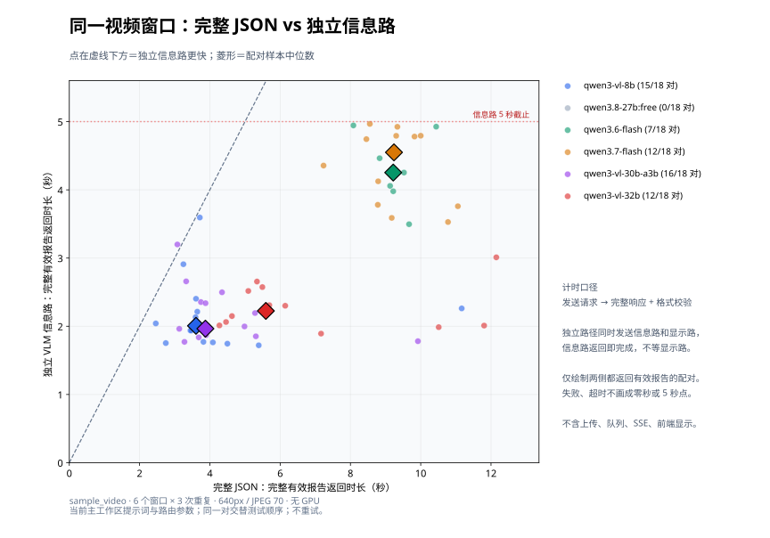

# 网络接收与连续显示：结论和验收缺口

[验证索引](README.md) · [网络显示设计](../architecture/network-display.md)

整理依据：2026-09-20～22 的接收隔离、真实 WebRTC 回放与浏览器队列验证。下列数字属于各自记录的版本，本次文档整理没有重新运行硬件或线上测试。

## 已定位的问题

同进程计算竞争能够使 UDP 接收不及时，导致本机 socket 缓冲溢出。基于 `7c2e723` 工作区的隔离对照使用 2560×720、30 FPS、约 2.49 Mbps 的真实 SRTP/H.264 链路：

| 场景 | UDP 接收缓冲丢包 | 接收回调收到的包 |
| --- | ---: | ---: |
| 空载 | 0 | 2,467 |
| 计算与接收同进程 | 1,506 | 961 |
| 计算移至另一进程 | 0 | 2,467 |

该对照证明一种可复现机制；历史故障没有完整逐包与线程记录，不能把每个丢包归因于同一业务函数。

当前源码将 WHEP、SRTP、解码和颜色转换放到独立进程，通过固定 32 MiB 共享槽交付完整图像。主进程慢时可以覆盖完整图像，不阻塞压缩包接收。局部 RTP 适配处理旧包、序号回绕、重启及 IDR 恢复，重组容量为 2,048 包，缺片等待上限 500 ms。此适配依赖 aiortc 私有接口，升级依赖时需重跑真实协议测试。

连续显示使用源图像缓存，最多 512 帧、64 MiB JPEG；显示进度与分析完成水位分开。浏览器可选补帧计算最多接纳 2 帧，显示查询最多 2 个在途，元数据最多 1 个在途和 1 个待发。跳过可选显示计算不等于丢弃已接纳的分析任务，也不能将旧轮廓套到不匹配的源帧。

## 接收隔离有效，输出降帧仍存在

最终接收隔离实验使用 CPython 3.11.16、aiortc 1.15.0、PyAV 17.1.0。四个计算线程施压并暂停主进程取帧 50 秒，全程约 53.48 秒收到 17,112 个 RTP 包，RTP 与 UDP 接收缓冲丢包均为 0，解码稳态约 30 FPS。共享槽覆盖的是完整图像，不能计为网络丢包。

随后使用 55.78 秒真实录像，经 FFmpeg → MediaMTX 1.21.0 → WHEP/ICE/DTLS/SRTP → 产品接收子进程 → JPEG/合成 → 真实 HTTP MJPEG 客户端，进行了 105 秒回放：

| 指标 | 空载 20 秒 | 四线程压力 70 秒 | 撤压 15 秒 |
| --- | ---: | ---: | ---: |
| 主进程获取完整图像 FPS | 15.04 | 10.47 | 15.01 |
| HTTP 客户端不同画面 FPS | 12.83 | **6.60** | 13.31 |
| 最大到帧间隔 | 188 ms | **538 ms** | 98 ms |
| 无效 JPEG | 0 | 0 | 0 |

全程 37,002 RTP 包，RTP 丢包和 UDP RcvbufErrors 增量均为 0；3,154 个可检查解码帧无 corrupt 标记。客户端收到 917 张不同画面。11 张抽检图与源片匹配帧的 PSNR 为 47.42～48.11 dB，人工抽检未见雪花。

**剩余问题是主进程取帧、JPEG、合成与输出在计算压力下降帧。** 本轮未运行 SAM、人脸或 VLM，没有经过物理 LAN 和原摄像头网关，也没有部署到原 8080；不能宣称整套产品达到 15 FPS 或原现场问题已消除。

## 完整 pipeline 与 API 层历史测量

### 2026-09-22 SAM 优先显示流：真实完整 pipeline 延迟

按用户指定的 **70% 描边率**验收。当时的 SAM 优先结构使用原始 `video_samples/sample_video.mp4`（55.798021 秒、1808×1030、HEVC）实时完整播放，每轮从头到尾一次；共 14 轮，没有把视频缩短、加速或循环。租赁真实 RTX 4090 运行 SAM 3.1，VLM 真实调用 OpenRouter，InsightFace 使用实际 CPU 模型。浏览器直接解码原文件，测试过程准备过的兼容转码文件没有用于计分。

**在 Docker 数据卷条件下，5 秒是本次重复测试中最低的达标档位，建议 6 秒留出余量；8 秒覆盖更高。** 这些是该样本的整段结果，不保证每个短窗口都超过 70%，也不构成长时间运行的可靠性承诺。5、6、8 秒各重新建立会话、完整复测两次；2、4 秒各测一次。

| 配置显示延迟 | 全人物闭合描边覆盖率，两轮分别列出 | 排除近似补全的完整轮廓覆盖率 | 最长完全无描边区间 |
| --- | ---: | ---: | ---: |
| 2 秒 | 57.0% | 56.8% | 11.77 秒 |
| 4 秒 | 65.7% | 60.9% | 10.62 秒 |
| 5 秒 | **74.8%、73.0%** | 70.9%、70.0% | 2.54、2.34 秒 |
| 6 秒 | **77.4%、78.1%** | 72.4%、72.5% | 2.33、2.34 秒 |
| 8 秒 | **86.0%、81.9%** | 78.6%、73.5% | 1.58、1.55 秒 |

主指标是生产渲染器的 `continuous_contour_frames / distinct_presented_frames`：当帧 SAM 已知的所有人物都有闭合完整轮廓或近似补全轮廓才计入。仅画出一个人物不算全部达标；源视频开头没有轮廓的帧也计入分母。另列 `complete_contour_frames`，排除近似补全。逐帧记录的重算值与生产渲染器计数完全一致。这个指标衡量显示覆盖，**不是人工标注的人员召回率、分割精度、事件识别率或姓名命中率**。保留各 5 秒源时间窗口，快速动作附近的覆盖仍可能低于整段均值。

前六轮把 `/data` 放在 Windows bind mount；随后检查发现正式容器使用 Docker 数据卷，后八轮统一改为相同存储类型。前六轮也全部保留：2 秒 58.1%、4 秒 67.3%、5 秒 67.2%、6 秒 75.5%/64.9%、8 秒 83.1%。因此不能把 5～6 秒建议直接推广到 Windows 挂载目录。某次 bind 测试单批结果写盘 2.26 秒、归档提交 6.04 秒，显示上游还存在排队；数据卷也未完全消除抖动。试验按顺序运行，CPU/上游服务负载会变，不能单凭这两组数字证明存储是全部差异的原因。

时延拆分使用源帧捕获、模型结果、元数据到浏览器和真正呈现四类时间点。以推荐的 6 秒两次数据卷试验为例：

| 测量阶段 | 首轮中位数 / P95 | 复测中位数 / P95 |
| --- | ---: | ---: |
| 源帧捕获 → 实际画面呈现 | 6.022 / 7.557 秒 | 6.009 / 6.089 秒 |
| 源帧捕获 → SAM 元数据到浏览器 | 2.355 / 4.947 秒 | 1.697 / 4.919 秒 |
| 一批 SAM HTTP 请求往返 | 0.563 / 1.426 秒 | 0.537 / 1.156 秒 |
| 源帧捕获 → 人脸信息发布后入显示收件箱 | 11.782 / 15.029 秒 | 9.026 / 14.507 秒 |
| 源帧捕获 → VLM 独立 SSE 收到报告，含失败报告 | 8.162 / 9.646 秒 | 14.413 / 17.438 秒 |
| VLM 报告标记发布 → 独立 SSE 接收 | 60 / 161 毫秒 | 51 / 106 毫秒 |
| 信息到达 → 下一批 SAM 合成机会 | 0.477 / 1.401 秒 | 0.455 / 1.286 秒 |
| SAM 显示关联本身 | 1.37 / 2.64 毫秒 | 1.22 / 4.57 毫秒 |

5 秒的实际呈现延迟中位数均约 5.006 秒，P95 为 5.056/5.041 秒。各数据卷试验实际不同画面平均 13.61～14.53 FPS；目标为 15 FPS。人脸这一列是服务端发布后的时间，不是外部接收器到达时间；“下一批机会”也不等于必定完成几何关联或画上标签。VLM API 耗时波动很大，6 秒复测发生 5 次超时，SAM 描边仍达到 78.1%；不能把模型速度变化归因于调整播放缓冲。

结构复核与实测相符：VLM/人脸先发布各自信息，再交给显示收件箱；SAM 到达时从历史同帧或允许范围内最近帧关联人物，并将语义生效时间限制到当前新批次，详见 [SAM 优先关联设计](../architecture/vlm-observation-association.md)。原始 VLM/人脸推理结果不等待对方，SAM 显示关联也不调用它们的推理。SAM 自己的结果持久化及有界归档提交队列仍可产生资源背压；本次没有把“模型之间无等待依赖”夸大为“系统没有任何队列”。

固定条件：SAM 3.1 源码 `660a5e9e1b8b4c02c0ad97229b88a09a6e4ff5b7`，推理边长 640，H.264 传输边长 384/CRF28，采样配置 1 FPS、批次上限 4；InsightFace CPU 1.25 FPS；VLM 保存路由 AA（公开 C），配置为 OpenRouter `qwen/qwen3-vl-30b-a3b-instruct` / Alibaba，1.25 FPS、最多 4 并发、15 秒时限。浏览器目标 15 FPS、运动估计宽 160、分析输入边长 720/JPEG80、最大轮廓传播 1.5 秒。每轮保留同一份冻结后端源码；报告附哈希。模型常驻已就绪，每轮新建本地服务、浏览器和 SAM 会话，模型下载/安装不计入播放延迟。

全部 14 轮都播放到 EOF、呈现缓冲归零并完成服务收尾，共呈现 11,201 帧。浏览器/传输记录无错误。491 份 VLM 报告在独立 SSE 和通用 SSE 均收到，463 份成功，23 份 `invalid_response`、5 份 `timeout` 均保留。979 次人脸观察没有已登记姓名命中，故没有验证真实名字成功上屏的正例。抽检画面可见轮廓及事件颜色/标签，但部分跌倒阳性报告没有形成画面标签：当前关联要求源时间接近及唯一的几何匹配，显示覆盖达标不等于标签全部成功关联。没有为提高描边数字放宽这些规则。

入口是原始录像替代摄像头采集，之后经过真实浏览器上传、SAM、人脸、VLM、显示元数据和生产浏览器运动补全；没有覆盖物理摄像头、WHEP 或外部 LAN。此次只调整隔离试验的延迟和数据盘，未改用户部署参数。测试页允许同源本机视频加载，生成的兼容副本不参与测量。

实测工具：[evaluate_pipeline_latency.cjs](../../tools/evaluate_pipeline_latency.cjs)。脱敏汇总与完整指标：[sam-display-latency-20260922.json](evidence/sam-display-latency-20260922.json)。原始逐帧数据、截图、时间追踪、冻结源码及重算脚本留在 `outputs/sam-display-latency-20260922/`；租赁和服务控制脚本留在忽略目录 `tmp/sam_display_*.py`。复现实验须使用隔离的真实模型服务，并以支持 Range 的同源 URL 提供原视频；脚本通过 `--video`、`--video-url`、`--url`、`--output` 指定输入，`--preflight true` 可先验证解码。

### 2026-09-22 VLM 三模型真实延迟拆解

同一 55.798 秒标注视频，经原始 PTS 实时送入仅 VLM 的隔离服务；使用当前武器提示词、640/JPEG70、3～4 帧窗口、4 并发、15 秒时限。公开 A 为 `qwen3-vl-8b-instruct`，C 为 `qwen3-vl-30b-a3b-instruct`，另测 `qwen/qwen3.6-flash`，均真实走 OpenRouter Nitro。源码冻结并保存哈希，实际供应商逐请求记录。

| 项目 | A | C | Qwen3.6-Flash |
| --- | ---: | ---: | ---: |
| 成功/尝试 | 59/59 | 29/30 | 32/32 |
| 实际供应商（成功请求） | Alibaba | DeepInfra | Alibaba |
| 本地请求准备中位数 | 0.091 s | 0.141 s | 0.144 s |
| HTTP 全程中位数 / P95 | 3.159 / 4.694 s | 6.821 / 12.712 s | 6.277 / 8.299 s |
| 平台 generation_time 中位数 | 2.604 s | 6.591 s | 5.924 s |
| 最新证据帧→收到报告中位数 | 3.383 s | 7.261 s | 6.932 s |

时延主表仅使用成功请求。逐响应 ID 查询平台生成记录后，`generation_time` 合计占本地 HTTP 合计约 86%、95%、94%；这是平台报告的上游生成区间，不是纯 GPU 内核时间。平台 `latency` 与 `generation_time` 不当作两个互斥阶段相加。请求约 83 KB、响应约 1.4～1.7 KB；响应头/空白保活可能提前返回，长时间读取响应体不能直接归因于下载带宽。

C 超时请求已写完请求体，0.738 秒收到 HTTP 200 头，15 秒截止仅收到 55 字节空白，没有有效 JSON。另做四个同帧窗口的串行对照：C 一次仅输出 163 token，HTTP 16.300 秒、平台生成 15.894 秒，说明慢请求并非只在本地并发时出现。A 串行对照两次路由到 Parasail，速度显著不同；本轮不是固定供应商的模型排名。

本地有序发布会等待队首请求，C 最长额外等待 3.415 秒、Flash 2.959 秒，已完成未发布的任务仍占调度容量。C/Flash 平均服务时间超过四槽在目标 1.25 次/秒下的承载能力；只延长超时会更久占槽。本轮保留原调度逻辑，没有混入性能修复。

121 份已发布报告全部被独立 SSE 和通用 SSE 接收。三路均覆盖三个标注事件，武器阳性为 0；A 在搬放物品时报打架，C/Flash 仍有跌倒误报。素材无真实武器正例。入口使用预解码 JPEG，本轮未测真实摄像头编码、WHEP 或外部 LAN；客户端非流式请求无法拆出模型逐 token 时刻、预填充或供应商排队。

首次新增模型误选 `qwen3.6-plus` 的记录已排除，正确 Flash 已重新完整测试并断言实际请求模型。汇总见 [vlm-route-latency-20260922.json](evidence/vlm-route-latency-20260922.json)；逐请求 60 多字段 CSV、原始分块日志、平台记录及详细报告在 `outputs/vlm-route-latency-20260922/`。隔离服务已停止，本轮未租 GPU。

### 2026-09-22 VLM 流式、Alibaba 30B 和 Qwen3.6-35B 对照

继续使用冻结源码与当前武器提示词，从同一标注视频选四个证据窗口。主试验为三组模型/供应商 × 流式与非流式 × 四窗口 × 两轮，共 48 次真实 OpenRouter 调用；串行、60 秒诊断时限、无重试。逐对核对消息哈希，交替模式先后。另做八次固定 Phala 的连接预热对照，总共 56 次模型调用，56 份平台生成记录均已取得。此轮只验证 API 层完整结果通过原解析器的时间，没有重跑完整 pipeline、确认状态机或推送接收，也未将 streaming 接入生产。

| 条件 | 非流式完整有效结果中位数 | 流式完整有效结果中位数 | 有效/尝试，非流式与流式 |
| --- | ---: | ---: | --- |
| Qwen3-VL 30B，固定 DeepInfra | 12.433 秒 | 10.832 秒 | 8/8、8/8 |
| Qwen3-VL 30B，固定 Alibaba | 3.700 秒 | 6.721 秒 | 6/8、7/8 |
| Qwen3.6-35B，Nitro 自动路由 | 20.656 秒 | 6.209 秒 | 8/8、8/8 |
| Qwen3.6-35B，固定 Phala、连接已建立，补充试验 | 3.623 秒 | 3.695 秒 | 4/4、4/4 |

**stream 提前首段内容，但没有证明稳定加速完整可用结果。** 前三行包含冷热连接及路由波动，不能仅用组中位数之差判断因果。30B/DeepInfra 的八组同帧配对差中位数为流式快 0.248 秒；Alibaba 六对均有效的样本反而慢 1.435 秒。固定 Phala 补充对照无新 TLS、无回退，流式首内容中位数为 2.253 秒，但完整结果与非流式基本相当。离线日志校准单条写入中位数约 2.34 毫秒；逐块记录也带来测量开销，未从请求计时中扣减。

35B 的 16 次 Nitro 请求中有五次供应商回退。例如一次客户端用时 20.476 秒、平台生成仅 2.631 秒，前置 IoNet 429 尝试已消耗 15.300 秒；另一条先等待 IoNet 504 达 17.261 秒。因此即使最终供应商相同，也可能受前置失败影响。本轮新连接 TLS 中位数约 4.1～4.3 秒，与上轮约 50 毫秒明显不同；两轮总延迟不能直接作为模型速度排名。

Alibaba 30B 的成功请求平台生成中位数为非流式 1.795 秒、流式 1.661 秒，但 16 次中有三次严格 JSON 解析失败。两次非流式在 JSON 后附加 Note；一次流式最终 JSON 无效，探针异常路径未保留该次最终文本，不能进一步断言相同文本原因。不能把失败当作阴性或快速结果。所有成功配对的事件布尔判断一致，主试验成功请求没有武器阳性；样本无真实武器正例，四窗口也不构成完整误报率或召回率评估。

脱敏指标与逐对时间见 [vlm-stream-provider-20260922.json](evidence/vlm-stream-provider-20260922.json)。完整中文报告、逐请求 CSV、SSE 分块日志、平台生成记录及复现脚本位于 `outputs/vlm-stream-provider-20260922/`。本轮未租 GPU，测试模型进程已退出。

### 现场接收与显示验收

- 固定源码、依赖和摄像头配置，运行超过此前约 46 秒的故障窗口，再做持续多路分析。
- 同时比较接收 socket drops、RTP 丢包、解码 FPS、主进程交付 FPS、HTTP 不同画面 FPS、最长停顿和 PTS；区分入口丢包与出口降帧。
- 浏览器额外检查真实待办数量、轮廓覆盖率与元数据等待。队列有界的模拟测试不保证实际 GPU/浏览器吞吐。
- 保留用户配置的播放缓冲；缓冲时间、推理时长、源到结果和到屏延迟分别报告。

复核入口：[接收进程测试](../../tests/test_whep_process.py)、[真实 WHEP 协议测试](../../tests/test_whep_integration.py)、[RTP 重组测试](../../tests/test_webrtc_jitter.py)、[连续显示测试](../../tests/test_continuous_display.py)。私有测量及源码清单位于 `.goodvision/diagnostics/receive-deep-20260921/`；真实录像、逐帧时序和复现脚本位于 `.goodvision/diagnostics/sample-webrtc-20260921/`。

## 双请求独立信息流的实际接收延迟（2026-09-22）

历史 full/parallel 对照各完整实时回放三轮，同一 55.798 秒视频，真实 SAM、CPU 人脸和 VLM 同时运行。主要指标为最新证据帧发出到独立 SSE worker 收到完整报告，不能用离线 API 耗时代替。

| 成功报告指标，中位 / P95（秒） | 完整 JSON | 双请求信息路 |
| --- | --- | --- |
| 发帧 → 实收 | 4.206 / 7.457 | 6.225 / 15.965 |
| 发帧 → VLM 分支接纳 | 0.570 / 2.028 | 4.027 / 14.344 |
| 分支接纳 → 实收 | 3.475 / 6.760 | 1.919 / 5.295 |
| 发布 → 实收 | 0.059 / 0.172 | 0.055 / 0.214 |

信息路进入分支后更快，但入口积压掩盖了收益。回放按 PTS 发送 767 张图（约 13.7 FPS），不逐帧等待 ACK；它是入口压力测试，不等同于正式浏览器。补充诊断的每帧入口到 ACK 平均约 75 ms，理想处理上限约 13.3 FPS，已低于送入速率。控制锁等待中位仅约 0.006 ms，不能把数秒积压归因于这把锁。

平台生成中位为完整 JSON 1.953 秒、信息路 0.467 秒、定位路 2.214 秒；客户端 HTTP 分别为 2.910 / 1.404 / 3.184 秒。图片准备约 0.21～0.25 秒，以缩放为主。新连接 TLS 中位约 2.3 秒，复用连接不产生该项。平台字段与客户端时间有包含关系，不能相加或把差额全部称为网络延迟。

完整 JSON 三轮终态有一轮 error，其余 idle；不能只凭报告收齐宣称全链路无故障。测量版本仍采用旧的双路配对接纳，不能把这些数值作为当前独立接纳策略的性能保证。

证据：[方法](evidence/parallel-delivery-20260922/method.json)、[报告汇总](evidence/parallel-delivery-20260922/summary.json)、[细分汇总](evidence/parallel-delivery-20260922/detail-summary.json)。原始记录在本地 `artifacts/parallel-delivery` 和 `artifacts/parallel-delivery-detail`。

### 5 FPS 无 GPU 对照及连接预热

随后将回放上传改为 5 FPS，关闭 SAM/GPU，保留 CPU 人脸与 VLM。full/parallel 各三轮，430 次调用、288 份对外报告全部实收。所有报告实收中位为完整 3.38 秒、信息路 2.09 秒；阳性报告则为 4.33 / 5.03 秒。阳性集中在片头且两组窗口不同，不能据整体中位断言告警稳定更快。旧轮启用了 GPU，跨轮差异也不能全部归因于降频。

连接预热后的 410 次模型调用没有新 TLS 握手。人脸提前准备的单轮对照将事件循环最大停顿从 1.70 秒降到 69 ms，准备耗时 9.44 秒；后续已将该准备流程实现于应用。服务入口同时关闭 JPEG WebSocket 消息的重复压缩。

证据：[5 FPS 方法](evidence/parallel-delivery-5fps-20260922/method.json)、[汇总](evidence/parallel-delivery-5fps-20260922/summary.json)、[审计](evidence/parallel-delivery-5fps-20260922/audit.json)；[预热方法](evidence/vlm-prewarm-20260922/method.json)、[汇总](evidence/vlm-prewarm-20260922/summary.json)、[预热审计](evidence/vlm-prewarm-20260922/warmup-audit.json)。完整日志留在本地 `artifacts/`。

### 当前的人脸准备与信息路长尾策略

人脸首次模型加载在接纳视频帧前、服务控制锁外完成；同一 runtime 跨会话复用。零帧启动检查中首次准备 9.390 秒，第二次为 0 秒；第二次完整启动仍耗时 4.31 秒，包含新 VLM 进程与连接准备。

parallel 信息路的 HTTP 截止时间为配置值与五秒中的较小值，完成即发布；迟到且已被更新帧取代的结果丢弃。尚未过时的超时结果发布失败报告，不能作为阴性。两路独立接纳，满槽只跳过该路窗口，恢复后处理最新窗口；每路最多四个在途，不重试、不补排。定位路保留配置预算及按序发布。实现语义见[架构说明](../architecture/vlm-observation-association.md#opt-in-parallel-event-json-experiment)。

预热后的 205 份信息请求中，阳性 37 次、阴性 164 次、其余不确定；HTTP 超过三秒分别为 1/37 和 6/164。相同四帧曾用时 7.396 秒，在其他回放为 1.475 / 1.465 秒，没有证据说明长尾是阳性特有。阴阳性是模型判断，不能作为额外人工真值。

同片 5 FPS、CPU 人脸开、SAM/GPU 关的最终单轮复测：87 次真实调用，信息路 49 次、定位路 38 次。信息路发布 48 份（46 成功、2 超时），另有 1 份迟到丢弃；两条 SSE 全部实收且源序号递增。两路忙时各跳过 4 / 15 窗口，收尾后无在途或待发布请求。

| 指标 | 结果 |
| --- | ---: |
| 入口发送 → 协议收齐 P95 / 最大 | 12.2 / 38.7 ms |
| 事件循环最大停顿 | 53.1 ms |
| 信息完成 → 等待发布最大 | 9.3 ms |
| 信息发布 → 实收 P95 / 最大（成功） | 33.7 / 40.4 ms |
| 信息总延迟中位 / P95 / 最大（含失败） | 3.694 / 4.471 / 5.205 s |
| 成功信息 HTTP / 平台生成中位 | 3.480 / 0.615 s |

这轮上游 HTTP 比前轮更慢，不能声称平均速度改善；支持的结论是消除了信息路等待前序结果的长尾，且超时、丢弃与独立接纳真实触发。三处标注窗口仍命中，但丢弃窗口可能遗漏短阳性，单片测试不是准确率或持续容量证明。

证据：[方法](evidence/vlm-tail-policy-20260922/method.json)、[汇总](evidence/vlm-tail-policy-20260922/summary.json)、[处置及人脸复用审计](evidence/vlm-tail-policy-20260922/run-audit.json)、[此前长尾分层](evidence/vlm-tail-policy-20260922/prior-tail-analysis.json)。原始回放及冻结源码在本地 `artifacts/parallel-delivery-tail-policy`。

### 仍需验证的入口策略

正式浏览器逐帧等待 ACK，但上传 FIFO 最多保留 12 项，短停顿仍可能留下旧帧。建议对照“一张在途加一张可替换待发帧”和最高 5 FPS 上传，记录采集到入模的源帧年龄、替换数、报告实收及短事件检出。该待发替换策略尚未实现；VLM 分支接纳后的过期计时不能反映此前的入口积压。

历史证据里的实验 worktree 绝对路径仅作来源记录；原始资料已迁入当前工作区 `artifacts/`，旧前缀可映射到当前仓库。原始媒体、逐帧与逐请求日志不提交。

## 六模型完整反馈对照（2026-09-22）

六个四帧窗口（终点 3、9、14、25、39、50 秒）各重复三次，full、信息、定位每路各 18 次；每模型另一次预热不计分。图片 640/JPEG70，四类敏感度 standard。连接复用，非流式、不重试，throughput 优先且允许供应商回退。full/定位 15 秒预算、信息五秒预算。

| 模型 | full 中位秒 / 有效数 | 信息中位秒 / 有效数 | 定位中位秒 / 有效数 |
| --- | --- | --- | --- |
| Qwen3-VL-8B | 3.64 / 17 | 2.01 / 15 | 3.99 / 17 |
| Qwen3.8-27B free | 11.89 / 4 | — / 0 | 8.82 / 7 |
| Qwen3.6-Flash | 9.14 / 17 | 4.22 / 8 | 8.87 / 3 |
| Qwen3.7-Flash | 9.30 / 15 | 4.24 / 14 | 8.78 / 16 |
| Qwen3-VL-30B-A3B | 3.87 / 18 | 1.96 / 16 | 4.19 / 7 |
| Qwen3-VL-32B | 5.59 / 16 | 2.23 / 12 | 5.49 / 16 |

中位数只用有效返回，各分母均为 18；失败、限流和超时不能算快速阴性。计时从准备好消息后的 API 调用到完整响应通过解析器，不含采样、解码、入口、SSE、SAM、人脸或显示。两路同时发出，图中纵轴仅取信息路。同窗同轮两侧均有效才配对；成功子集、预算和供应商不同，不能把该图作为一般模型排名或部署质量结论。

一次定位超时记录为 1856.88 秒，远超配置预算，疑有本地调度中断；原因未验证，作为失败保留，未计入成功延迟。事件判断一致性不代表准确率，本轮没有新增人工真值。

证据：[统计及失败分类](evidence/model-feedback-20260922/summary.json)、[脱敏请求表](evidence/model-feedback-20260922/requests.csv)、[配对数据](evidence/model-feedback-20260922/paired.csv)。原始响应、执行器快照和输入清单留在 `artifacts/model-feedback-20260922/`；一次性作图/执行脚本不作为日常维护工具。
