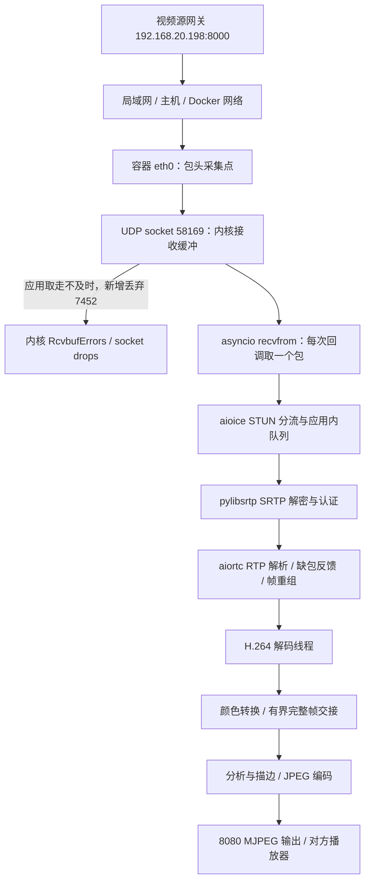

# 8080 网络视频雪花：丢包边界、接收调度与修复方案

日期：2026-09-21。历史故障时间均为北京时间；实验是业务停止后的隔离实验。

## 已经定位的部分

**主要丢包点在本机容器的 UDP socket 接收缓冲：数据包已到容器网卡，但应用没有及时取走，缓冲满后内核丢弃新包。**

在此基础上，用实际部署镜像进一步复现了一个具体机制：同进程的 Python 计算线程会使 SRTP 接收链路等待执行机会，取包速度下降，最终造成同一种内核缓冲溢出。把计算负载移到独立进程后，五组对照均恢复为零缓冲丢包。

证据强度必须分开：

1. **历史故障已证明**：本轮 7,452 次接收缓冲丢弃全部对应同一个视频 socket；不是根据画面猜测。
2. **相同依赖的实验已证明**：同进程负载可以造成这种丢包；SRTP 调用附近出现显著等待；进程隔离能消除实验中的丢包。
3. **历史数据尚不能证明**：当时具体是归档、人脸、描边结果处理中的哪个函数，分别占用了多少 GIL／锁等待时间。没有保存当时的线程调用栈和逐包用户态时间戳，事后读取旧日志无法补出这些记录。

本轮没有启动或停止业务分析，没有重启、部署 8080，也没有修改生产数据。主服务容器在核对结束时仍为 `exited`。临时实验容器没有外部网络，也没有挂载业务数据卷；读取数据库目录的另一个临时容器只读挂载数据卷。

## 一、实际数据路径

这轮被监控的视频流：连接 `da4b479eae9145eeac687bc185de481d`，本地 UDP 端口 `58169`，socket inode `3387876`，SSRC `7141453`，PT `101`，H.264，2560×720、约 30 FPS。它在开始分析前后是同一连接。

| 环节 | 查到的记录 | 可作出的判断 |
| --- | --- | --- |
| 容器网卡之前 | 分析区间包头统计新增序号缺口 86，后来补回 74，约 12 个未补回；采集自身丢包 0 | 不能声称外部网络绝对零丢包；但大量到达本机后被丢的包不能归给外部网络。 |
| 容器网卡 | 故障区间 `eth0` 接收错误、接收丢弃计数增量均为 0 | 这是容器网卡计数，不是故障时 Windows 物理 Wi-Fi 的完整记录。 |
| UDP socket 入队 | `InErrors +7452`、`RcvbufErrors +7452`、指定 socket `drops +7452`；每个仍存活的故障采样点累计增量都一致 | 主要损失明确发生在这一个 socket 的接收缓冲。 |
| UDP 其他错误 | `InCsumErrors +0`、`MemErrors +0`、`SndbufErrors +0` | 没有把校验错误、UDP 全局内存错误或发送缓冲错误混成接收缓冲溢出。 |
| socket 关闭之后 | `14:02:50.323` 采到 `NoPorts +55`；此前连接于 `14:02:49.907` 关闭 | 这是连接关闭后的另一个计数变化，不能拿来解释第 16 秒的雪花。 |
| 解密与 RTP 重组 | 旧日志没有逐包解密错误、NACK／PLI 次数及重组丢弃原因 | 不能用 `packetsLost` 净值反推每一个内核丢弃包，亦不能声称历史解密错误为零。 |
| 解码输出 | 从约 30 FPS 降到约 4.31 FPS；有超长原始 PTS 跳变 | 损坏／停顿已发生在分析取图之前。 |
| 标注输出 | 本轮只有 38 个不同源图，另有 14 次同图重画；约 0.765 个不同源帧／秒 | 对外画面卡顿还存在独立的输出更新频率限制，单修丢包不会自动解决这一项。 |

Linux 的 UDP 入队失败路径会分别记录接收缓冲错误和其他内存错误，接收缓冲失败同时计入 `InErrors`。计数含义参见 [Linux 6.6 UDP 实现](https://github.com/torvalds/linux/blob/v6.6/net/ipv4/udp.c)。本机 WSL 内核为 `6.6.87.2-microsoft-standard-WSL2`；上述引用说明机制，不冒充该 WSL 补丁版本的逐指令追踪。

## 二、逐秒顺序与用户雪花反馈

服务端开始分析请求完成于 **14:02:04.500**。用户反馈的是相对画面计时，以下按该时间近似对齐，存在 UI／播放缓冲和一秒采样误差。

| 北京时间 | 相对开始 | socket 队列记账字节 | 本轮累计缓冲丢包 | 含义 |
| --- | ---: | ---: | ---: | --- |
| 14:01:50–14:02:04 | 开始前 | 通常 0 或少量 KiB | 0 | 同一输入约 30 FPS，交接约 15 FPS。 |
| 14:02:14.315 | 9.815 秒 | 277,696 | 0 | 已出现明显积压，尚未采到新增溢出。 |
| 14:02:15.316 | 10.816 秒 | 214,080 | 90 | 首次采到新增溢出；采样瞬间队列不必仍满，期间可先满后排空。 |
| 14:02:20.328 | 15.828 秒 | 399,168 | 206 | 对应用户约第 16 秒开始有雪花。 |
| 14:02:23.315 | 18.815 秒 | 135,424 | 992 | 对应用户约第 19 秒雪花加重。 |
| 14:02:30.336 | 25.835 秒 | 337,024 | 1,980 | 对应用户约第 26 秒满屏。 |
| 14:02:37.316 | 32.816 秒 | 418,816 | 3,421 | 队列观测峰值，接近同环境测得的 425,984 字节缓冲记账值。 |
| 14:02:48.330 | 43.830 秒 | 391,424 | 7,058 | 这个约一秒采样区间新增丢弃 635；CPU 约 2.38 核。 |
| 连接结束后核对 | — | socket 已关闭 | **7,452** | 与视频 socket 最后可见累计增量相符。 |

缓冲字节包含内核包对象记账，不能直接除以视频码率当作精确排队时长。5 秒一次的事件循环延迟抽样也不足以排除反复出现的毫秒级调度等待。

本轮出现 5,083 个相同流序号的重复包；与缺包反馈后重传增加相符，但没有解密反馈记录，不把每个重复包都确定命名为 NACK 重传。丢弃次数含原始包和重复包，7,452 不是独立视频序号的损失个数。

原流量约 3 Mb/s，容器总入站采样峰值约 8.22 Mb/s、出站约 15.42 Mb/s。没有网卡吞吐量耗尽的证据。故障时 CPU 峰值约 8.66 核，严重丢包的后段仅约 2–4 核；16 个可见 CPU，没有 CPU 配额节流增量。因此“CPU 没跑满”不能用于排除某个 Python 接收循环得不到及时调度。

Windows 网卡采集在 14:04:36 才开始，晚于故障；它不能补证故障时无线链路的每次重传或丢失。缺少摄像头侧、交换机／AP、Windows 入站的同步逐包记录，也不能把那约 12 个未补回序号继续定位到某一个外部设备。

## 三、实际部署代码与新的对照实验

读取的主镜像：`sha256:18498955909467f1981a236b7570a67bc8f2b8a4dfa1028df2bf037ff505948d`，标记 `20260921-receive-fix1`。

实际运行时为 **CPython 3.11.16、aiortc 1.15.0、aioice 0.10.2、PyAV 17.1.0、pylibsrtp 1.0.0、CFFI 2.1.1**。本地工具用的 Python 3.12 不代表服务容器版本。

代码路径核对：

- `stream_adapter.py:308` 的 WHEP 接收建立一个线程；`:338` 在线程内运行 asyncio。网络接收与业务分析仍属于同一个 Python 进程。
- 当前 `_pump_track` 的颜色转换已经通过 `asyncio.to_thread` 卸载，前一版修复确实存在；不能再把历史同步转换代码当作正在运行的代码。
- 部署版 asyncio `_SelectorDatagramTransport._read_ready` 每次调用 `recvfrom` 取一个包，然后交给 `aioice.StunProtocol.datagram_received`；后者将媒体包放入连接队列。
- `aiortc.RTCDtlsTransport._recv_next` 从该队列取包，直接调用 `pylibsrtp.Session.unprotect`，随后解析、路由 RTP。这个同步调用发生在同一个接收事件循环。
- `pylibsrtp` 的 `unprotect` 经 CFFI 调用 `srtp_unprotect`。CFFI 在调用 C 函数时释放 GIL，返回 Python 时需要重新取得执行资格；这是可能受同进程计算线程影响的边界。[CFFI 官方说明](https://cffi.readthedocs.io/en/latest/ref.html#conversions)
- RTP 缺包反馈、重组之后才进入 aiortc 的独立解码线程。把颜色转换或解码放在线程里，并不能让之前的接收循环脱离整个进程的 GIL 竞争。独立进程能绕开这个共享限制。[Python 官方说明](https://docs.python.org/3.11/library/multiprocessing.html#introduction)

### 真实接收组件、人工负载的实验

实验使用该部署镜像，临时容器 `--network none`，UDP 只走本机回环；限制最多 8 CPU、2 GiB 内存。发送进程独立；视频预先生成，2560×720、30 FPS、8 秒、约 2.49 Mb/s，2,467 个 SRTP 包。发送在帧内做定时发送，记录实际发送时间，未接真实摄像头。

实际调用 aioice 分流、SRTP 解密、RTP 解析、aiortc 重组和 H.264 解码，以及已部署的 `_pump_track` 和颜色转换。握手和反馈传输用测试替身；不模拟源端重传。计算负载为四个循环进行 JSON 编解码的线程，**不是原分析模块的录制或重放**。

| 场景 | 五次实验的内核缓冲丢包 | 解码帧数 |
| --- | --- | --- |
| 接收进程空载 | 0、0、0、0、0 | 每次 239 |
| 计算负载在接收进程内 | 1,182、543、185、1,498、1,120 | 103、190、212、65、104 |
| 相同类型负载在另一个进程 | 0、0、0、0、0 | 每次 239 |

每次空载／隔离场景均取到并成功解密全部 2,467 包，输出 120 个 BGR 帧。最后一个编码帧没有后继时间戳触发重组出队，239／240 本身不表示丢包。这里只检查传输计数和出帧，没有做逐像素画质验收，也没有模拟最终跨进程完整帧交接成本。

分阶段的一组实测（均为每包平均耗时）：

| 位置 | 空载 | 同进程负载 | 负载隔离 |
| --- | ---: | ---: | ---: |
| 发送至 UDP 回调 | 0.976 ms | **822.252 ms** | 6.551 ms |
| ICE 回调本身 | 0.071 ms | 0.062 ms | 0.102 ms |
| ICE 应用内队列等待 | 0.132 ms | 2.535 ms | 0.178 ms |
| **SRTP unprotect 调用** | **0.070 ms** | **3.012 ms** | **0.096 ms** |
| RTP 头解析 | 0.026 ms | 0.032 ms | 0.038 ms |
| RTP 处理／重组 | 0.129 ms | 0.143 ms | 0.175 ms |

所有已取到的实验包都通过 SRTP 验证。包丢在取走前，SRTP 处的等待会拖慢整个共享事件循环继续取包。不能把较慢的 `unprotect` 墙钟耗时直接叫作“加密计算性能不足”。

为区分计算和等待，另外单独测量同一个接收线程对 **1,000 个有效 SRTP 包**执行 `unprotect` 的墙钟与线程 CPU 时间：

| 场景 | 总墙钟时间 | 接收线程实际 CPU 时间 |
| --- | ---: | ---: |
| 空载 | 11.143 ms | 8.672 ms |
| 同进程负载 | **5,321.619 ms** | **157.297 ms** |
| 负载隔离 | 26.873 ms | 21.612 ms |

同进程负载时，约 97% 墙钟时间没有计为接收线程 CPU 时间。结合 CFFI 的 GIL 行为和进程隔离对照，支持调度／GIL 竞争解释。实验没有采集内核调度栈，不能把每一微秒进一步严格分成 GIL 与操作系统调度等待；更不能倒推历史归档线程独占了多少时间。

### 实验审计说明

早期未做帧内定时发送的探索实验有过大的关键帧突发，空载本身就丢包。它保存在 `pipeline-experiment.log`，**没有纳入上述五次有效对照，也不能用于宣布隔离后零丢包**。用于表格的记录是 `pipeline-paced-experiment.log`、`pipeline-stage-experiment.log`、`pipeline-crypto-experiment.log`。不同实验的调度差异很大，不能从一次数字推算生产环境的固定容量。

## 四、丢包之后还有一个迟到包处理问题

实际版本的 aiortc 视频重组缓冲容量为 128 包，`MAX_MISORDER=100`。到达一个落后当前重组起点至少 100 个序号的包时，该实现会清空缓冲并把起点退到旧包，同时发起 PLI 请求。

其 `TimestampMapper.map` 遇到 RTP 时间戳变小，会按 32 位回绕处理，给展开时间增加 `2^32 / 90000 ≈ 47,721.859` 秒。

已用真实 SRTP 验证和真实重组器复现：先接收序号 110–249，再补进之前未接收到的旧包 100、101。旧包仍处在 SRTP 的 1,024 包防重放窗口内，验证通过；重组起点由 249 退到 100，随后输出时间从 4.6 秒跳到约 47,721.526 秒。

历史日志确有同量级跳变，例如 14:02:34 的原始解码 PTS 已到约 1,813,790 秒，窗口内单次 PTS 间隔约 47,724.8 秒。这个实验提供了与现象一致的机制，**旧包头统计没有逐包到达顺序存档，不能证明每一次历史跳变都由同一序列触发**。

因此还应防止过期补包把已经前进的视频重组位置拉回，并在失去解码参考后明确请求关键帧、恢复解码。原始 PTS 规范化是保护下游业务时钟，不能修复之前已丢失的 H.264 内容。

## 五、为什么本地摄像头正常

本地浏览器摄像头路径使用 `getUserMedia`、canvas JPEG 和 WebSocket 上传完整图像；后端解出完整 JPEG 再交给分析。它绕开上述 WHEP / UDP / SRTP / H.264 包重组链路，因此开启同样分析后画面正常，与本机 UDP 接收路径存在缺陷相符。

“直连摄像头”的实际接入协议尚未确认，不把它自动等同于 USB、RTSP/TCP 或同一条 WebRTC 连接。其正常表现是重要对照，但单凭它不能定位某个交换机或无线信号故障。

## 六、应怎样修复

以下为根因调查时的修复方案。随后基于 origin 更新实施的代码及验证结果见
[接收隔离修复验证](network-receive-isolation-fix-20260921.md)；其中区分离线验证与真实摄像头验收。

### 1. 首先隔离完整接收链路

将 WHEP 会话、ICE UDP 取包、SRTP、RTP 重组、H.264 解码放入专用接收进程；主业务进程处理分析、归档和输出。只是继续添加接收线程或转换线程不足以隔离同一进程的 GIL。

业务进程变慢时，接收进程必须继续取完压缩流并解码。背压应施加在**已解码完整帧**的交接处，限制保留最新帧；不能通过丢任意压缩 RTP 包来“跳帧”。

跨进程交接必须测量：2560×720 BGR、15 FPS 约为 82.9 MB/s 原始数据，直接不断序列化整帧可能引入新瓶颈。优先设计有界共享内存、明确槽位所有权和帧序号，验证慢消费者、停止、异常退出、分辨率变化和资源回收。此次隔离实验没有实现或验证这一最终业务交接，因此不能称为生产修复已完成。

### 2. 补上乱序与失去参考帧后的恢复

对已越过播放／重组位置的过期补包采取明确的丢弃策略；源端真正重启或 SSRC 变化要单独识别，不能简单把一切倒退都认作时间戳回绕。覆盖序号正常回绕、合法轻微乱序、严重迟到、重复包、丢片和重连的测试，再选择局部兼容层或上游修复。不要未经测试扩大／缩小 SRTP 防重放窗口来掩盖问题。

### 3. 接收能力、突发容忍与输出流分别验收

适度增加 socket 缓冲可提高突发容忍，但应同时读取系统上限和实际 `SO_RCVBUF`，不能只设置一个数就认为生效。持续处理速度不足时，更大的缓冲只是延后溢出、增加延迟。

如果源网关提供可用的 RTSP/TCP，可作为对照或临时入口；仓库 FFmpeg RTSP 路径已显式使用 TCP，但本轮没有连接或验证源端 RTSP 地址，不能直接承诺可切换。

对外 MJPEG 应按连续源图更新，并用可用标注合成画面，而非只随约 1 FPS 的分析结果发布新图。这个输出频率问题需要单独修改和验收。

### 下一轮需要的观测和验收条件

当前没有自动发起新的复测。下次主动运行真实分析时，诊断应至少包含：

- socket 端口、inode、进程／线程身份，实际缓冲大小；每秒接收队列与该 socket drops。
- 接收回调间隔、取包至 ICE 队列消费、SRTP 调用墙钟与线程 CPU、解密失败类型、RTP 重组丢弃原因、NACK／PLI 次数、解码与完整帧交接延迟。
- 有限时长的业务线程和接收线程调用栈采样，才能指认具体模块，而不只看到 CPU 总量。
- 包头记录按同一 SSRC 和扩展序号关联，明确采集自身丢包；仅保存必要时间、序号和计数，不保存视频载荷。
- 同一源分别空载、全分析，至少覆盖此前故障的 46 秒并持续验证；主要验收条件为 socket drops 不随分析持续增长、输入解码接近源帧率、接收延迟不累积、长 PTS 跳变不再出现，同时人工确认实际对外 MJPEG 无雪花。

## 七、可复核的本地产物

私有目录：`.goodvision/diagnostics/receive-deep-20260921/`。

- `retained-service.log`：从停止的主容器导出的保留日志；没有启动容器取日志。
- `per-second-evidence.csv`：故障附近 70 个系统采样点，包含原始指标文件行号、socket、包头统计、CPU、流量及相邻状态。
- `history-detail-summary.json`、`aligned-timings.json`：新增复核结果和原服务日志行号。
- `evidence-manifest.json`：关键证据文件的大小及 SHA-256，便于复核来源。
- `dependencies.json`、`runtime-srtp.txt` 及导出的依赖源码：实际镜像版本与代码。
- `pipeline-*-experiment.log`、`srtp-scheduling-experiment.log`：隔离实验原始结果。
- `late-rtp-experiment.json`：迟到包触发重组回退和 PTS 跳变的实验。
- `analyze_history.py`、`probe_pipeline.py`、`probe_srtp_scheduling.py`、`probe_late_rtp.py`：复核与实验脚本。

CSV 中的系统、包头、状态采样并非完全同步。`wire_report_count=0` 时包头字段为空，不能解释为那一秒网络没有包；多个包头窗口落到同一系统区间时会相加。它用于对齐趋势，不能冒充逐包的同一毫秒计数。历史采集只保留每秒汇总，不存在可供事后逐包重放的 pcap。

先前完整的 30 分钟监控方法和结束核对见 `docs/validation/annotated-stream-retest-20260921.md`。
